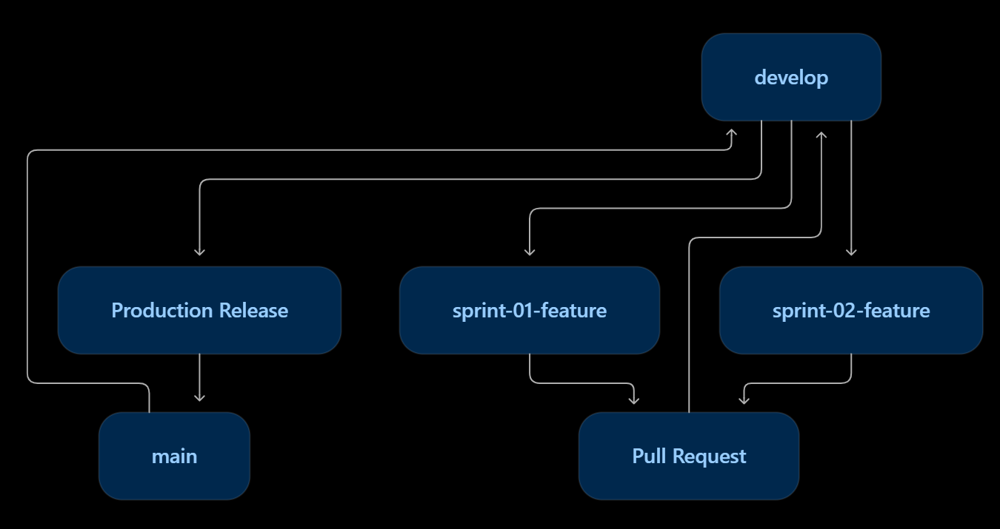

# PROJECT 2 MASTER TECHNICAL BLUEPRINT: ATOLL

Project: Atoll — Social Discovery & Community Platform\
Project Type: Client Project\
Initial Market: Rwanda, with international expansion in mind\
Initial Platform: SEO-friendly, mobile-first web application\
Future Platform: Dedicated mobile applications\
Architecture: Three Git repositories connected through Git Submodules\
Frontend: Next.js + TypeScript + Tailwind CSS v4 + shadcn/ui\
Backend: Node.js + Express + TypeScript\
Database & Authentication: Supabase (PostgreSQL + Supabase Auth + Storage)\
API Documentation: OpenAPI 3.0 + Scalar\
Frontend Hosting: Vercel\
Backend Hosting: Render\
Development Methodology: UI-first, feature-based sprint development\
Primary Development Objective: Build and validate the complete Atoll experience visually before implementing the production backend.

## 1. Stack Decision & Third-Party Setup Checklist

### 1.1 Frontend Choice Justification

Selected: Next.js

Atoll requires Next.js rather than React (Vite).

Reason: SEO is explicitly part of Project 1.

Atoll needs search engines to discover public discussions, individual public posts and public topic pages. These pages need meaningful HTML content, metadata and shareable URLs.

Next.js provides:

- Server-side rendering for public discussions.
- Static rendering for marketing and informational pages.
- Dynamic metadata for individual discussion pages.
- Search-engine-friendly public URLs.
- Server Components for efficient initial rendering.
- Client Components for interactive social features.
- A straightforward future path to mobile applications through the standalone REST API.

Important architectural restriction: Next.js is strictly the frontend presentation layer. It must not become the backend.

All business logic, authorization, database operations and application APIs belong to the standalone Express backend.

Next.js Server Components can request data from Express, but must not independently access Supabase tables or implement a second set of business rules.

### 1.2 Locked Technology Stack

| Layer               | Technology           | Responsibility                |
| ------------------- | -------------------- | ----------------------------- |
| Frontend            | Next.js + TypeScript | UI and SEO                    |
| Rendering           | Next.js App Router   | SSR, static rendering         |
| Styling             | Tailwind CSS v4      | Styling                       |
| Components          | shadcn/ui            | UI primitives                 |
| Icons               | Lucide React         | Icons                         |
| Forms               | React Hook Form      | Form management               |
| Validation          | Zod                  | Frontend validation           |
| API communication   | Axios                | Express communication         |
| Server state        | TanStack Query       | Client-side API caching       |
| Global state        | React Context        | Shared application state      |
| Backend             | Node.js + Express    | Business logic and REST API   |
| Backend language    | TypeScript           | Type safety                   |
| Validation          | Zod                  | Request validation            |
| Database            | Supabase PostgreSQL  | Persistent data               |
| Authentication      | Supabase Auth        | Email/password authentication |
| Database client     | Drizzle ORM          | Schema and queries            |
| File storage        | Supabase Storage     | Profile images                |
| API specification   | OpenAPI 3.0          | API contract                  |
| Documentation       | Scalar               | Interactive API reference     |
| Frontend deployment | Vercel               | Web hosting                   |
| Backend deployment  | Render               | API hosting                   |
| Version control     | GitHub               | Source control                |
| Repository linking  | Git Submodules       | Three-repository architecture |

### 1.3 Architecture Overview


Important responsibilities:

1. Next.js displays the application.
2. Page Data Classes prepare data for individual screens.
3. AppContext manages shared application state.
4. Express controls application operations.
5. Supabase stores application data and manages authentication.
6. Scalar documents the Express API.

Supabase Auth is used for authentication, but the Express backend remains responsible for authorization and application access rules.

### 1.4 Monthly Hosting Cost Estimate

Planning estimate in USD. Free-tier availability, quotas and commercial terms should be checked when accounts are created.

| Service         | Initial Plan | Monthly Budget |
| --------------- | ------------ | -------------- |
| GitHub          | Free         | $0             |
| Vercel          | Hobby        | $0             |
| Render          | Free         | $0             |
| Supabase        | Free         | $0             |
| Google Fonts    | Free         | $0             |
| Scalar          | Open-source  | $0             |
| shadcn/ui       | Open-source  | $0             |
| Tailwind CSS    | Open-source  | $0             |
| Lucide          | Open-source  | $0             |
| Domain          | Optional     | Variable       |
| Payment gateway | Not required | $0             |

Initial infrastructure target: $0/month, excluding domain registration and any paid usage or services.

Free hosting is appropriate for development and prototype validation, not a guaranteed production service level. Render's free instances can sleep, and database backups, capacity and availability must be reviewed before a larger public launch.

### 1.5 Exact Frontend Dependencies

Run inside `atoll-frontend`.

Create the Next.js application:

```
npx create-next-app@latest . --typescript --tailwind --eslint --app --src-dir --import-alias "@/*"
```

Use the App Router and the `src` directory.

Core dependencies:

```
npm install axios zod
npm install react-hook-form @hookform/resolvers
npm install @tanstack/react-query
npm install @supabase/supabase-js @supabase/ssr
npm install lucide-react
npm install clsx tailwind-merge class-variance-authority
npm install sonner
npm install date-fns
```

Initialize shadcn/ui:

```
npx shadcn@latest init
```

Install the initial component set:

```
npx shadcn@latest add button input textarea label
npx shadcn@latest add card avatar badge
npx shadcn@latest add dialog dropdown-menu
npx shadcn@latest add tabs select checkbox
npx shadcn@latest add separator skeleton
npx shadcn@latest add tooltip sheet
npx shadcn@latest add alert alert-dialog
npx shadcn@latest add popover command
npx shadcn@latest add switch
```

Tailwind CSS v4:

Use the Tailwind v4 CSS-first configuration.

If the generated project does not already contain the Vite/PostCSS-independent Tailwind v4 PostCSS setup, install:

```
npm install tailwindcss @tailwindcss/postcss postcss
```

Optional API documentation embedded in frontend:

```
npm install @scalar/api-reference-react
```

Scalar's primary installation will be in the backend documentation route. The frontend package is optional.

### 1.6 Exact Backend Dependencies

Run inside `atoll-backend`.

Initialize:

```
npm init -y
npm install express cors dotenv helmet zod
npm install @supabase/supabase-js
npm install drizzle-orm pg
npm install yaml
npm install @scalar/express-api-reference
npm install jsonwebtoken
npm install pino pino-http
```

Development dependencies:

```
npm install -D typescript tsx
npm install -D @types/node @types/express
npm install -D @types/cors @types/pg
npm install -D @types/jsonwebtoken
npm install -D drizzle-kit
npm install -D eslint
npm install -D vitest supertest @types/supertest
```

Important authentication decision: Supabase Auth handles user registration, login and password recovery. Express verifies Supabase-issued access tokens using the official Supabase JWT verification approach and enforces application-level authorization. Never trust a user ID supplied by the frontend.

For production, use the Supabase-supported verification method and signing-key configuration appropriate to the project's JWT signing algorithm. Do not assume every project uses a shared HS256 secret.

### 1.7 Third-Party Configuration Checklist

A. GitHub

Create three repositories:

- `atoll` — Parent Hub.
- `atoll-frontend` — Next.js frontend.
- `atoll-backend` — Express backend.

Required:

- Main branch.
- Develop branch.
- Branch protection for main.
- Pull requests into develop.
- GitHub Actions.
- Repository access for the development team.

B. Supabase

Create one Supabase project.

Required configuration:

- PostgreSQL database.
- Supabase Auth.
- Email/password authentication.
- Email confirmation enabled for production.
- Password recovery enabled.
- Storage bucket: `avatars`.
- Storage bucket: `covers` (only if cover images are implemented).
- Private storage policies where appropriate.
- Database connection/pooler credentials.
- Authentication JWT verification configuration.
- Row Level Security enabled on exposed tables.

Required environment values:

```
SUPABASE_URL=
SUPABASE_ANON_KEY=
SUPABASE_SERVICE_ROLE_KEY=
SUPABASE_JWT_ISSUER=
SUPABASE_JWKS_URL=
DATABASE_URL=
```

The service-role key must exist only on trusted server infrastructure. It must never use a `NEXT_PUBLIC_` prefix or appear in frontend bundles.

Use the Supabase connection pooler for the Render backend where required by network compatibility.

C. Vercel

Connect `atoll-frontend`.

Configure:

```
NEXT_PUBLIC_APP_URL=
NEXT_PUBLIC_API_URL=
NEXT_PUBLIC_SUPABASE_URL=
NEXT_PUBLIC_SUPABASE_ANON_KEY=
```

Add the production domain after deployment.

D. Render

Create a Node.js Web Service connected to `atoll-backend`.

Configure:

```
NODE_ENV=production
PORT=10000
FRONTEND_URL=
DATABASE_URL=
SUPABASE_URL=
SUPABASE_ANON_KEY=
SUPABASE_SERVICE_ROLE_KEY=
SUPABASE_JWT_ISSUER=
SUPABASE_JWKS_URL=
LOG_LEVEL=info
```

Set the health-check path to:

```
/api/v1/health
```

E. Google Fonts

Use:

- Plus Jakarta Sans.
- Inter.

Prefer `next/font/google` for optimized font delivery. Keep font fallbacks available.

F. Payments

Not required for initial release

Project 1 explicitly postpones monetization.

Do not integrate Flutterwave, Paypack, MTN MoMo or subscriptions into the initial product.

If monetization is approved later for Rwanda, evaluate local payment support, settlement, fees, business verification and RDB business registration requirements before enabling live transactions.

## 2. Complete Folder Structures & CSS Theme Setup

### 2.1 Parent Hub Architecture

The local working directory must contain three separate Git repositories.

```
atoll/
│
├── docs/
│   ├── PROJECT-1-MASTER-HANDOFF.md
│   ├── PROJECT-2-MASTER-BLUEPRINT.md
│   ├── ARCHITECTURE.md
│   ├── DATABASE-DESIGN.md
│   ├── API-CONTRACT.md
│   ├── SPRINT-ROADMAP.md
│   ├── GOOGLE-STITCH-URL.md
│   ├── DEPLOYMENT.md
│   ├── SECURITY.md
│   └── decisions/
│       ├── ADR-001-frontend-architecture.md
│       ├── ADR-002-backend-architecture.md
│       └── ADR-003-authentication.md
│
├── atoll-frontend/          [Git Submodule]
│
├── atoll-backend/           [Git Submodule]
│
├── .gitmodules
├── .gitignore
└── README.md
```

The Parent Hub stores project documentation and references the two application repositories.

It does not contain a duplicate frontend or backend implementation.

### 2.2 Frontend Directory Structure

Repository: `atoll-frontend`

```
atoll-frontend/
│
├── public/
│   ├── images/
│   ├── icons/
│   └── logo/
│
├── src/
│   │
│   ├── app/
│   │   ├── (public)/
│   │   │   ├── page.tsx
│   │   │   ├── explore/
│   │   │   │   └── page.tsx
│   │   │   ├── discussions/
│   │   │   │   └── [postId]/
│   │   │   │       └── page.tsx
│   │   │   ├── topics/
│   │   │   │   └── [slug]/
│   │   │   │       └── page.tsx
│   │   │   ├── about/
│   │   │   │   └── page.tsx
│   │   │   ├── guidelines/
│   │   │   │   └── page.tsx
│   │   │   └── privacy/
│   │   │       └── page.tsx
│   │   │
│   │   ├── (auth)/
│   │   │   ├── login/
│   │   │   ├── register/
│   │   │   └── forgot-password/
│   │   │
│   │   ├── (app)/
│   │   │   ├── home/
│   │   │   ├── explore/
│   │   │   ├── create/
│   │   │   ├── discussions/
│   │   │   ├── profile/
│   │   │   ├── settings/
│   │   │   ├── notifications/
│   │   │   ├── connections/
│   │   │   ├── messages/
│   │   │   └── account/
│   │   │
│   │   ├── api/
│   │   │   └── auth/
│   │   │       └── callback/
│   │   │           └── route.ts
│   │   │
│   │   ├── layout.tsx
│   │   ├── globals.css
│   │   ├── loading.tsx
│   │   ├── error.tsx
│   │   └── not-found.tsx
│   │
│   ├── components/
│   │   ├── ui/
│   │   ├── layout/
│   │   │   ├── PublicHeader.tsx
│   │   │   ├── AppSidebar.tsx
│   │   │   ├── MobileNavigation.tsx
│   │   │   └── AppHeader.tsx
│   │   ├── feed/
│   │   ├── discussion/
│   │   ├── profile/
│   │   ├── connections/
│   │   ├── messaging/
│   │   └── safety/
│   │
│   ├── data/
│   │   ├── pages/
│   │   │   ├── LandingPageData.ts
│   │   │   ├── ExplorePageData.ts
│   │   │   ├── PublicDiscussionPageData.ts
│   │   │   ├── TopicPageData.ts
│   │   │   ├── AboutPageData.ts
│   │   │   ├── GuidelinesPageData.ts
│   │   │   ├── PrivacyPageData.ts
│   │   │   ├── LoginPageData.ts
│   │   │   ├── RegistrationPageData.ts
│   │   │   ├── RecoveryPageData.ts
│   │   │   ├── HomePageData.ts
│   │   │   ├── SearchPageData.ts
│   │   │   ├── CreatePostPageData.ts
│   │   │   ├── DiscussionPageData.ts
│   │   │   ├── ProfilePageData.ts
│   │   │   ├── EditProfilePageData.ts
│   │   │   ├── NotificationsPageData.ts
│   │   │   ├── ConnectionsPageData.ts
│   │   │   ├── InboxPageData.ts
│   │   │   ├── ChatPageData.ts
│   │   │   ├── SettingsPageData.ts
│   │   │   └── SafetyPageData.ts
│   │   │
│   │   ├── mock/
│   │   │   ├── users.ts
│   │   │   ├── posts.ts
│   │   │   ├── comments.ts
│   │   │   ├── notifications.ts
│   │   │   ├── connections.ts
│   │   │   └── messages.ts
│   │   │
│   │   └── types/
│   │       ├── user.types.ts
│   │       ├── post.types.ts
│   │       ├── comment.types.ts
│   │       └── messaging.types.ts
│   │
│   ├── context/
│   │   ├── AppContext.tsx
│   │   └── AppProvider.tsx
│   │
│   ├── hooks/
│   │   ├── useApp.ts
│   │   ├── useAuth.ts
│   │   └── useTheme.ts
│   │
│   ├── lib/
│   │   ├── api/
│   │   │   ├── apiClient.ts
│   │   │   └── apiErrors.ts
│   │   ├── supabase/
│   │   │   ├── client.ts
│   │   │   └── server.ts
│   │   ├── utils.ts
│   │   └── constants.ts
│   │
│   ├── providers/
│   │   ├── QueryProvider.tsx
│   │   └── ThemeProvider.tsx
│   │
│   └── types/
│
├── .env.example
├── components.json
├── next.config.ts
├── postcss.config.mjs
├── tsconfig.json
├── package.json
└── README.md
```

### 2.3 Page Data Class Architecture

Every screen must have a dedicated data class.

Example:

`src/data/pages/HomePageData.ts`

```
export class HomePageData {
  async getInitialData() {
    return {
      greeting: "Good to see you again.",
      posts: [],
      trendingTopics: [],
      suggestedUsers: [],
      loading: false,
      error: null
    };
  }

  async getFeed() {
    // Sprint 01+: return realistic mock data.
    // Integration sprint: replace with Express API call.
  }

  async refreshFeed() {
    // Refresh the feed.
  }

  formatPostCount(count: number) {
    return `${count} conversations`;
  }

  getEmptyState() {
    return {
      title: "It's quiet here.",
      description: "Start something interesting."
    };
  }
}
```

Non-negotiable rule:

The React components must not know whether data comes from mock objects or the production API.

The Page Data Class owns:

- Screen data structures.
- Formatting.
- Default values.
- Data loading.
- Error handling.
- Screen-specific actions.
- Mock data during UI-first development.

During integration, replace the internal mock data source with Express requests without rebuilding the screen components.

Keep API transport concerns in `lib/api` and business rules in Express. Page Data Classes are frontend adapters, not replacements for backend business logic.

### 2.4 Global Context Contract

`src/context/AppContext.tsx`

Global context should hold only shared application state.

```
interface AppContextType {
  user: User | null;
  isAuthenticated: boolean;
  authLoading: boolean;

  theme: "light" | "dark";

  notifications: Notification[];
  unreadNotifications: number;

  connections: Connection[];
  pendingRequests: ConnectionRequest[];

  activeConversationId: string | null;

  setUser: (user: User | null) => void;
  setTheme: (theme: "light" | "dark") => void;

  setNotifications: (items: Notification[]) => void;
  setConnections: (items: Connection[]) => void;

  setActiveConversation: (id: string | null) => void;
  logout: () => Promise<void>;
}
```

Do not put the complete feed, every post, every comment and all message history into global context.

Use TanStack Query for server-owned data and caching. Use AppContext for cross-screen client state.

### 2.5 Global Fallback Handler

Every Page Data Class must return a predictable screen state.

```
export interface PageState<T> {
  data: T | null;
  loading: boolean;
  error: string | null;
  isEmpty: boolean;
  retryable: boolean;
}
```

Required UI states:

1. Initial loading.
2. Skeleton loading.
3. Successful data.
4. Empty data.
5. Recoverable error.
6. Retry state.
7. Offline or unstable connection.
8. Unauthorized state.

Never allow missing API data to crash an entire screen.

Preserve post drafts and unsent message content locally when a request fails.

### 2.6 Backend Directory Structure

Repository: `atoll-backend`

```
atoll-backend/
│
├── src/
│   │
│   ├── config/
│   │   ├── env.ts
│   │   ├── database.ts
│   │   ├── supabase.ts
│   │   └── cors.ts
│   │
│   ├── db/
│   │   ├── index.ts
│   │   ├── schema/
│   │   │   ├── profiles.ts
│   │   │   ├── profile-settings.ts
│   │   │   ├── categories.ts
│   │   │   ├── posts.ts
│   │   │   ├── comments.ts
│   │   │   ├── reactions.ts
│   │   │   ├── connections.ts
│   │   │   ├── conversations.ts
│   │   │   ├── messages.ts
│   │   │   ├── notifications.ts
│   │   │   ├── reports.ts
│   │   │   └── blocks.ts
│   │   └── seed.ts
│   │
│   ├── middleware/
│   │   ├── authenticate.ts
│   │   ├── authorize.ts
│   │   ├── validate.ts
│   │   ├── rateLimit.ts
│   │   ├── errorHandler.ts
│   │   └── notFound.ts
│   │
│   ├── modules/
│   │   ├── auth/
│   │   ├── profiles/
│   │   ├── posts/
│   │   ├── comments/
│   │   ├── categories/
│   │   ├── reactions/
│   │   ├── connections/
│   │   ├── conversations/
│   │   ├── messages/
│   │   ├── notifications/
│   │   ├── reports/
│   │   └── blocks/
│   │
│   ├── routes/
│   │   ├── index.ts
│   │   └── health.routes.ts
│   │
│   ├── docs/
│   │   ├── openapi.yaml
│   │   └── scalar.ts
│   │
│   ├── utils/
│   │   ├── pagination.ts
│   │   ├── response.ts
│   │   ├── logger.ts
│   │   └── ids.ts
│   │
│   ├── app.ts
│   └── server.ts
│
├── drizzle/
│   └── migrations/
│
├── tests/
│   ├── integration/
│   └── unit/
│
├── drizzle.config.ts
├── tsconfig.json
├── .env.example
├── package.json
└── README.md
```

Standard module structure:

```
modules/posts/
├── posts.routes.ts
├── posts.controller.ts
├── posts.service.ts
├── posts.repository.ts
├── posts.schema.ts
└── posts.types.ts
```

Responsibilities:

- Routes: HTTP endpoint definitions.
- Controllers: Request/response handling.
- Services: Business rules.
- Repositories: Database operations.
- Schemas: Zod validation.
- Types: Module-specific types.

### 2.7 Tailwind CSS v4 Theme

Place this in:

`src/app/globals.css`

```

@import "tailwindcss";

@import url("https://fonts.googleapis.com/css2?family=Inter:wght@400;500;600&family=Plus+Jakarta+Sans:wght@600;700&display=swap");

:root {
  color-scheme: light;

  --background: #FDFBFA;
  --foreground: #2F2A25;

  --card: #FFFFFF;
  --card-foreground: #2F2A25;

  --popover: #FFFFFF;
  --popover-foreground: #2F2A25;

  --primary: #367C83;
  --primary-foreground: #FFFFFF;

  --brand: #B38F65;
  --secondary: #8E8271;

  --secondary-foreground: #2F2A25;

  --muted: #F1EDE8;
  --muted-foreground: #71685F;

  --accent: #EAE4DC;
  --accent-foreground: #2F2A25;

  --border: #E8E1DA;
  --input: #E8E1DA;
  --ring: #367C83;

  --success: #478B70;
  --warning: #D69B48;
  --destructive: #C76E63;

  --font-heading: "Plus Jakarta Sans", sans-serif;
  --font-body: "Inter", sans-serif;

  --radius: 0.75rem;
}

.dark {
  color-scheme: dark;

  --background: #252B2C;
  --foreground: #F3EFE9;

  --card: #303738;
  --card-foreground: #F3EFE9;

  --popover: #303738;
  --popover-foreground: #F3EFE9;

  --primary: #367C83;
  --primary-foreground: #FFFFFF;

  --brand: #B38F65;
  --secondary: #B0A493;

  --secondary-foreground: #F3EFE9;

  --muted: #353D3E;
  --muted-foreground: #B0A493;

  --accent: #41494A;
  --accent-foreground: #F3EFE9;

  --border: #465051;
  --input: #465051;
  --ring: #76AEB0;

  --success: #478B70;
  --warning: #D69B48;
  --destructive: #C76E63;
}

@theme inline {
  --color-background: var(--background);
  --color-foreground: var(--foreground);

  --color-card: var(--card);
  --color-card-foreground: var(--card-foreground);

  --color-popover: var(--popover);
  --color-popover-foreground: var(--popover-foreground);

  --color-primary: var(--primary);
  --color-primary-foreground: var(--primary-foreground);

  --color-brand: var(--brand);
  --color-secondary: var(--secondary);

  --color-muted: var(--muted);
  --color-muted-foreground: var(--muted-foreground);

  --color-accent: var(--accent);
  --color-accent-foreground: var(--accent-foreground);

  --color-border: var(--border);
  --color-input: var(--input);
  --color-ring: var(--ring);

  --color-success: var(--success);
  --color-warning: var(--warning);
  --color-destructive: var(--destructive);

  --font-heading: var(--font-heading);
  --font-sans: var(--font-body);

  --radius-lg: var(--radius);
}

html {
  scroll-behavior: smooth;
}

body {
  background: var(--background);
  color: var(--foreground);
  font-family: var(--font-body);
}

h1, h2, h3, h4, h5, h6 {
  font-family: var(--font-heading);
}

button, input, textarea {
  font-family: inherit;
}

```

Implementation note: for production, load fonts with `next/font/google` in the root layout rather than relying on a CSS `@import` request. The font variables above can then be mapped to the Next.js font variables.

### 2.8 Design Rules

- Mobile-first at every breakpoint.
- Maximum comfortable reading width for discussions.
- Desktop feed can use three columns.
- Mobile uses a single-column feed and bottom navigation.
- Avoid excessive gradients and glassmorphism.
- Keep the bronze color for brand identity.
- Use Deep Ocean for primary actions.
- Ensure text contrast in both themes.
- Use skeletons for loading.
- Lazy-load nonessential images.
- Never autoplay video.
- Keep public and private navigation visually distinct.

## 3. UI Screen-by-Screen Blueprint (Frontend-First)

### 3.1 Screen Architecture and Scope Decisions

Project 1 defines five core product features, but lists 24 screen entries when individual safety interactions are counted.

These are not 24 independent features.

The implementation will follow this distinction:

| Core feature                                  | Screens supporting it                                      |
| --------------------------------------------- | ---------------------------------------------------------- |
| 1. Account Creation & Identity Control        | Registration, Login, Recovery, Profile, Privacy, Settings  |
| 2. Discovery Feed & Content Creation          | Landing, Explore, Home, Search, Create Post, Topic         |
| 3. Post Conversations & Threaded Comments     | Public Discussion, Authenticated Discussion, Notifications |
| 4. Profiles & Voluntary Identity Revelation   | Public Profile, Edit Profile, Identity Controls            |
| 5. Mutual Connections & Private Conversations | Connections, Requests, Inbox, Chat                         |

Safety and moderation are cross-cutting capabilities, not a sixth core feature.

### 3.2 Final Screen Inventory and Journey

The screen order below follows the actual visitor-to-member journey.

| Order | Screen                                 | Route                        | Access        |
| ----- | -------------------------------------- | ---------------------------- | ------------- |
| 01    | Landing / Homepage                     | `/`                          | Public        |
| 02    | Explore Discussions                    | `/explore`                   | Public        |
| 03    | Public Post Detail                     | `/discussions/[postId]`      | Public        |
| 04    | Public Topic / Category                | `/topics/[slug]`             | Public        |
| 05    | About Atoll                            | `/about`                     | Public        |
| 06    | Community Guidelines                   | `/guidelines`                | Public        |
| 07    | Privacy & Safety                       | `/privacy`                   | Public        |
| 08    | Login                                  | `/login`                     | Public        |
| 09    | Registration                           | `/register`                  | Public        |
| 10    | Account Recovery                       | `/forgot-password`           | Public        |
| 11    | Main Home / Personalized Feed          | `/home`                      | Member        |
| 12    | Explore & Search                       | `/app/explore`               | Member        |
| 13    | Create Post                            | `/create`                    | Member        |
| 14    | Post Detail & Threaded Discussion      | `/app/discussions/[postId]`  | Member        |
| 15    | User Profile                           | `/profile/[username]`        | Public/Member |
| 16    | Edit Profile & Privacy                 | `/settings/profile`          | Member        |
| 17    | Notifications                          | `/notifications`             | Member        |
| 18    | Connections & Requests                 | `/connections`               | Member        |
| 19    | Private Conversations List             | `/messages`                  | Member        |
| 20    | Private Chat                           | `/messages/[conversationId]` | Member        |
| 21    | Account Settings                       | `/settings`                  | Member        |
| 22    | Report Content / User                  | Dialog                       | Contextual    |
| 23    | Block / Disconnect Confirmation        | Dialog                       | Contextual    |
| 24    | Report Submitted / Safety Confirmation | Dialog/State                 | Contextual    |

Implementation decisions:

- Public and authenticated discussion screens use shared discussion components but separate route wrappers and data classes.
- Public and authenticated exploration share the same feed-card components.
- Report and block screens are dialogs, not standalone pages.
- About Atoll and Privacy & Safety are separate routes because the supplied guide lists them together as separate information destinations.
- The public profile is indexable only when the owner explicitly permits public visibility and the content is safe to index.
- Authenticated home, private chat and private account data must never be indexed.
- No separate splash screen is necessary for a web application. Use a lightweight initial loading state.

### 3.3 Global UI Components

Build these before the individual screen implementations.

| Component        | Purpose                                   |
| ---------------- | ----------------------------------------- |
| AtollLogo        | Brand symbol and wordmark                 |
| PublicHeader     | Public navigation                         |
| PublicFooter     | Information and legal links               |
| AppSidebar       | Desktop authenticated navigation          |
| MobileNavigation | Bottom navigation                         |
| AppHeader        | Member header, search, notifications      |
| PostCard         | Reusable discussion preview               |
| CategoryChip     | Topic navigation                          |
| UserAvatar       | Optional profile image or abstract avatar |
| CommentItem      | Comment and reply display                 |
| ReactionButton   | Post reaction                             |
| ConnectionButton | Connection request state                  |
| PrivacyIndicator | Visibility information                    |
| EmptyState       | Friendly empty states                     |
| ErrorState       | Recoverable error                         |
| SkeletonCard     | Loading state                             |
| ConfirmDialog    | Destructive action confirmation           |
| ReportDialog     | Safety reporting                          |
| ToastProvider    | User feedback                             |

### 3.4 Screen 01 — Landing / Homepage

Route: `/`

Purpose: Explain Atoll within five seconds and encourage visitors to explore discussions or register.

Ordered sections:

1. Public header: logo, Explore, About, Guidelines, Log In, Join Atoll.
2. Hero:
   - "Good Conversations. Unexpected Connections."
   - Project 1's complete subheadline.
   - Explore Conversations and Join Atoll buttons.
3. Discussion preview: three realistic sample discussions.
4. How Atoll works: Discover, Participate, Connect.
5. Three value pillars:
   - Speak Freely.
   - Find Your People.
   - Connect at Your Own Pace.
6. Privacy explanation: pseudonymous participation and voluntary identity revelation.
7. Final registration CTA.
8. Public footer.

Data class: `LandingPageData.ts`

Methods:

- `getHeroContent()`
- `getFeaturedDiscussions()`
- `getHowItWorks()`
- `getValuePillars()`
- `getPrivacyContent()`
- `getFooterLinks()`

Global context: Reads `theme`; no authentication requirement.

SEO: Static metadata, descriptive title, Open Graph image and indexable landing content.

Google Stitch prompt:

```
Design the Atoll social discovery platform homepage.

Create a premium, responsive, mobile-first web landing page.

Brand: Atoll.
Slogan: Less Pressure. More Connection.
Headline: Good Conversations. Unexpected Connections.

Use:
- Lagoon Bronze #B38F65
- Driftwood #8E8271
- Deep Ocean #367C83
- Soft Shell #FDFBFA
- Deep Shore #252B2C
- Light text #2F2A25
- Dark text #F3EFE9

Typography:
Plus Jakarta Sans for headings.
Inter for body text.

Layout:
1. Clean public navigation.
2. Large hero headline and descriptive paragraph.
3. Two prominent CTA buttons.
4. Realistic discussion card previews.
5. Three-column how-it-works section.
6. Three value proposition cards.
7. Privacy and pseudonymous identity explanation.
8. Registration CTA.
9. Footer.

Use realistic fictional Rwandan demonstration profiles and discussions, including KigaliExplorer and JustThinking.

Create both light and dark modes.
Use warm neutral backgrounds, restrained bronze details and teal CTAs.
Avoid dating-app aesthetics, generic SaaS dashboards and excessive gradients.

Mobile layout must use a single-column structure with comfortable spacing and readable cards.
```

### 3.5 Screen 02 — Explore Discussions / Public Feed

Route: `/explore`

Purpose: Allow visitors to discover public discussions without registration.

Ordered sections:

1. Public navigation.
2. Page heading: Explore Conversations.
3. Search bar.
4. Category filters:
   - Daily Life.
   - Relationships.
   - Lifestyle.
   - Entertainment.
   - Food & Places.
   - Career & Ambitions.
   - Random Thoughts.
5. Trending discussions.
6. Recent discussions.
7. Discussion cards.
8. Registration CTA for restricted actions.

Sample content must include:

- KigaliExplorer — "What is your favourite place for a quiet weekend?"
- JustThinking — "Can a friendship start without knowing someone's real name?"
- LateNightMind — "Why does making new friends become harder after university?"
- CuriousSoul — "Would you rather have a high-paying job or more time for yourself?"

Data class: `ExplorePageData.ts`

Methods:

- `getInitialData()`
- `getPublicDiscussions()`
- `getTrendingDiscussions()`
- `getCategories()`
- `filterByCategory(slug)`
- `searchDiscussions(query)`
- `getPagination()`

Global context: Reads `theme`, `isAuthenticated`.

SEO: Indexable public feed. Individual cards link to canonical public discussion URLs.

Stitch prompt:

```
Design Atoll's public Explore Discussions page.

Use the exact Atoll brand palette:
#B38F65, #8E8271, #367C83, #FDFBFA and #252B2C.

Use Plus Jakarta Sans headings and Inter body text.

Layout:
- Public header.
- Large Explore Conversations title.
- Search field.
- Horizontal scrollable category filters.
- Trending discussion section.
- Recent discussion feed.
- Reusable discussion cards with pseudonyms, category, title, excerpt, timestamp and comment count.
- Registration invitation for restricted actions.
- Responsive footer.

Use realistic content:
KigaliExplorer, JustThinking, LateNightMind and CuriousSoul.

The feed should feel like a thoughtful social community rather than a dating platform or corporate dashboard.

Provide desktop and mobile layouts, light and dark themes.
```

### 3.6 Screen 03 — Public Post Detail / Discussion

Route: `/discussions/[postId]`

Purpose: Let visitors read a complete public discussion and understand how conversation works.

Ordered sections:

1. Public header.
2. Breadcrumb: Explore / Category / Discussion.
3. Original post:
   - Author pseudonym.
   - Category.
   - Title.
   - Content.
   - Publication time.
   - Reaction count.
   - Comment count.
4. Threaded comments.
5. Login invitation for commenting or reacting.
6. Related discussions.

Data class: `PublicDiscussionPageData.ts`

Methods:

- `getPost(postId)`
- `getComments(postId)`
- `getRelatedDiscussions(postId)`
- `formatPublicationDate(date)`
- `getVisitorActionState()`

Global context: Reads authentication state and theme.

SEO: Dynamic title, description, canonical URL and Open Graph data. Only publicly visible content is included in metadata and structured page content.

Stitch prompt:

```
Design an Atoll public discussion detail page.

Show a large, readable discussion card with:
- Pseudonymous author.
- Category label.
- Discussion title.
- Full text.
- Publication time.
- Reactions and comment count.

Below it, show threaded comments with indentation and reply hierarchy.

Include a friendly comment access prompt:
"Join Atoll to add your voice."

Show related discussions at the bottom.

Use the Atoll bronze and ocean palette.
Keep reading width comfortable.
Use Plus Jakarta Sans for titles and Inter for conversations.

Create desktop and mobile versions and both themes.
Do not display real identities or contact details.
```

### 3.7 Screen 04 — Public Topic / Category Page

Route: `/topics/[slug]`

Purpose: Explore discussions belonging to a specific category.

Ordered sections:

1. Public header.
2. Category title and description.
3. Discussion count.
4. Trending discussions.
5. Recent discussions.
6. Create discussion CTA.
7. Related categories.

Data class: `TopicPageData.ts`

Methods:

- `getTopic(slug)`
- `getTopicStatistics(slug)`
- `getTrendingPosts(slug)`
- `getRecentPosts(slug)`
- `getRelatedTopics(slug)`

Global context: Reads theme and authentication state.

Stitch prompt:

```
Design an Atoll topic/category discovery page.

Show:
- Category title and description.
- Number of public discussions.
- Trending conversations.
- Recent discussion cards.
- Related category chips.
- Create discussion CTA.

Use an elegant warm editorial layout.
Atoll colors: #B38F65, #8E8271, #367C83, #FDFBFA and #252B2C.

Use realistic examples from Daily Life, Relationships, Lifestyle, Entertainment, Food & Places and Career & Ambitions.

Provide mobile-first responsive layouts and light/dark mode.
```

### 3.8 Screen 05 — About Atoll

Route: `/about`

Purpose: Explain the platform's philosophy and product identity.

Ordered sections:

1. Hero: Less Pressure. More Connection.
2. Why Atoll exists.
3. Conversation-first philosophy.
4. How people move from discussion to connection.
5. Community values.
6. Final Explore CTA.
7. Footer.

Data class: `AboutPageData.ts`

Methods:

- `getBrandStory()`
- `getMission()`
- `getPrinciples()`
- `getJourneyExplanation()`

Global context: Theme only.

Stitch prompt:

```
Create the Atoll About page.

Communicate a relaxed social platform where people meet through conversations before revealing their identities.

Use the headline:
"People should meet through ideas before they are expected to meet through identities."

Sections:
- Brand introduction.
- Why Atoll exists.
- Discover, participate and connect.
- Community philosophy.
- Privacy-first values.
- Explore Conversations CTA.

Use Atoll's exact warm bronze, natural neutral and ocean teal colors.

Create a sophisticated editorial design with organic shapes and subtle island-inspired imagery, without using location pins or dating symbols.

Support light and dark themes.
```

### 3.9 Screen 06 — Community Guidelines

Route: `/guidelines`

Purpose: Explain acceptable behaviour and user responsibilities.

Ordered sections:

1. Page title.
2. Respectful discussion.
3. No harassment or threats.
4. No impersonation.
5. No sharing private information without consent.
6. No spam.
7. Respect personal boundaries.
8. Reporting and enforcement explanation.

Data class: `GuidelinesPageData.ts`

Methods:

- `getGuidelines()`
- `getSafetyRules()`
- `getReportingInstructions()`

Global context: Theme.

Stitch prompt:

```
Design a readable Atoll Community Guidelines page.

Create a calm editorial document layout with:
- Clear heading.
- Short introductory paragraph.
- Numbered community rules.
- Small icons.
- Highlighted privacy and consent principles.
- Reporting explanation.
- Footer.

Use Atoll brand colors and typography.

Make the page comfortable to read on mobile.
Provide light and dark modes.
Avoid an intimidating legal-document appearance.
```

### 3.10 Screen 07 — Privacy & Safety Information

Route: `/privacy`

Purpose: Explain pseudonymous participation, identity control and platform privacy principles.

Ordered sections:

1. Privacy introduction.
2. Public identity versus account identity.
3. Public profile visibility.
4. Voluntary identity revelation.
5. Private conversations.
6. Account security.
7. Reporting and blocking.
8. Privacy contact/information footer.

Data class: `PrivacyPageData.ts`

Methods:

- `getPrivacyPrinciples()`
- `getIdentityVisibilityExplanation()`
- `getAccountSecurityContent()`
- `getSafetyControls()`

Global context: Theme.

Important: This screen is product information, not a replacement for a legally reviewed privacy policy and terms of service.

Stitch prompt:

```
Design Atoll's Privacy and Safety information page.

The central message is:
"Your identity is yours to reveal. Your experience is yours to control."

Explain:
- Pseudonymous public participation.
- Account identity remains distinct from public identity.
- Profile information is controlled by users.
- Identity revelation is voluntary.
- Private messages are restricted to mutual connections.
- Users can report and block abusive accounts.

Use warm neutral cards, teal action highlights and bronze branding.

Include simple privacy diagrams and clear mobile typography.

Create light and dark themes.
Never promise complete anonymity.
```

### 3.11 Screen 08 — Login

Route: `/login`

Purpose: Authenticate existing users.

Ordered sections:

1. Atoll logo.
2. Welcome heading.
3. Email field.
4. Password field.
5. Remember me.
6. Forgot password.
7. Login button.
8. Registration link.
9. Privacy reassurance.

Data class: `LoginPageData.ts`

Methods:

- `getLoginFormDefaults()`
- `validateCredentials()`
- `login(email, password)`
- `getErrorMessage(error)`

Global context: Writes authenticated user and authentication state.

Stitch prompt:

```
Design an Atoll login page.

Use a clean centered authentication card.

Fields:
Email.
Password.
Remember me.
Forgot password.

Include:
"Good to see you again."

Primary CTA:
"Log In"

Secondary link:
"Join Atoll"

Add a subtle Atoll island-inspired brand graphic and privacy reassurance.

Use #B38F65 and #367C83 with Soft Shell backgrounds.
Provide dark mode with #252B2C.

Mobile-first, simple, friendly and trustworthy.
```

### 3.12 Screen 09 — Registration

Route: `/register`

Purpose: Create a new account and establish a pseudonymous public identity.

Ordered sections:

1. Atoll branding.
2. Registration heading.
3. Display name.
4. Email address.
5. Password.
6. Confirm password.
7. Acceptance of terms and guidelines.
8. Explanation of pseudonymous identity.
9. Create account button.
10. Existing account login link.

Data class: `RegistrationPageData.ts`

Methods:

- `getRegistrationDefaults()`
- `validateRegistration()`
- `checkDisplayNameAvailability()`
- `registerAccount(payload)`
- `getRegistrationFeedback()`

Global context: Writes user state after verified authentication.

Important: Account registration must enforce 18+ eligibility. Project 1 establishes an adult-only audience, but does not specify the exact date-of-birth collection or age-verification method. Do not claim that a simple checkbox establishes verified age. Define the production age-assurance procedure and data-minimization approach before launch.

Stitch prompt:

```
Design Atoll's registration screen.

Create a friendly and reassuring signup interface.

Fields:
- Display name or pseudonym.
- Email address.
- Password.
- Confirm password.
- Terms and Community Guidelines acceptance.

Show the statement:
"Your public identity is yours to control."

Explain visually that a real name and profile photograph are not required for public participation.

Primary CTA:
"Join Atoll"

Use Atoll's exact brand colors, Plus Jakarta Sans and Inter.

Create light and dark mode.
Make the interface compact and mobile-first.
```

### 3.13 Screen 10 — Forgot Password / Account Recovery

Route: `/forgot-password`

Purpose: Recover access to an existing account.

Ordered sections:

1. Logo.
2. Recovery heading.
3. Email field.
4. Send recovery link.
5. Simulated success state during UI-first development.
6. Back to login.

Data class: `RecoveryPageData.ts`

Methods:

- `getRecoveryDefaults()`
- `requestRecovery(email)`
- `getConfirmationState()`

Global context: Theme; authentication updates after password reset completion.

Stitch prompt:

```
Design a minimal Atoll password recovery page.

Show:
- Atoll logo.
- "Forgot your password?"
- A short explanation.
- Email input.
- "Send Recovery Link" button.
- Friendly confirmation state.
- Back to login link.

Use warm off-white backgrounds, bronze branding and teal CTA.

Create a dark version and a mobile-first layout.
```

### 3.14 Screen 11 — Main Home / Personalized Feed

Route: `/home`

Purpose: Become the member's central daily discussion destination.

Ordered sections:

1. Authenticated header.
2. Desktop left sidebar.
3. Main greeting: "Good to see you again."
4. Composer prompt: "What's on your mind today?"
5. Category filters.
6. Recent discussion feed.
7. Trending topics.
8. Suggested discussions.
9. Right sidebar discovery content.
10. Mobile bottom navigation.

Data class: `HomePageData.ts`

Methods:

- `getInitialData()`
- `getPersonalizedFeed()`
- `getTrendingTopics()`
- `getSuggestedDiscussions()`
- `refreshFeed()`
- `getEmptyState()`

Global context:

Reads:

- `user`
- `theme`
- `isAuthenticated`
- `notifications`

Writes:

\- Shared notification updates where needed.

Stitch prompt:

```
Design the authenticated Atoll home feed.

Desktop:
Three-column layout.
Left navigation.
Central discussion feed.
Right discovery sidebar.

Mobile:
Single-column feed.
Compact header.
Bottom navigation.

Show:
"Good to see you again."
"What's on your mind today?"
Create post composer.
Category filters.
Recent discussions.
Trending discussions.
Suggested topics.

Use realistic pseudonymous users and discussion content.

Atoll brand colors:
#B38F65, #8E8271, #367C83, #FDFBFA, #252B2C.

Plus Jakarta Sans headings, Inter body.

Make discussion cards the main visual focus.
Include skeleton, empty and error states.
Provide both themes.
```

### 3.15 Screen 12 — Explore & Search

Route: `/app/explore`

Purpose: Help authenticated members discover conversations and users.

Ordered sections:

1. Search field.
2. Suggested topics.
3. Trending conversations.
4. Popular categories.
5. Search results.
6. Suggested users based on interests.
7. Empty search state.

Data class: `SearchPageData.ts`

Methods:

- `getSuggestedTopics()`
- `getTrendingConversations()`
- `searchPosts(query)`
- `searchUsers(query)`
- `getPopularCategories()`
- `clearSearch()`

Global context: Reads user and theme.

Stitch prompt:

```
Design Atoll's authenticated Explore and Search page.

Include:
- Prominent search field.
- Suggested topics.
- Trending conversations.
- Category discovery.
- Search result cards.
- Suggested pseudonymous users based on interests.

Create clear tabs for discussions and people.

Use the Atoll warm palette and teal interaction highlights.

Use realistic fictional profiles and local demonstration content.

Desktop and mobile layouts.
Light and dark modes.
```

### 3.16 Screen 13 — Create Post

Route: `/create`

Purpose: Allow members to publish questions, opinions, experiences and recommendations.

Ordered sections:

1. Composer heading: Share a thought.
2. Discussion title.
3. Main content field.
4. Category selection.
5. Character count.
6. Preview.
7. Save draft.
8. Publish button.
9. Draft/error feedback.

Data class: `CreatePostPageData.ts`

Methods:

- `getComposerDefaults()`
- `validatePost()`
- `updateDraft()`
- `previewPost()`
- `saveDraft()`
- `publishPost()`

Global context: Reads user; draft state can be shared with navigation if required.

Stitch prompt:

```
Design the Atoll Create Post experience.

Use a spacious, focused editor card.

Include:
- "Share a thought" heading.
- Discussion title input.
- Large text editor.
- Category selector.
- Character counter.
- Preview.
- Save draft.
- Publish button.

Add a small privacy note explaining public pseudonymous participation.

Use Atoll bronze branding and Deep Ocean CTA.

Show loading, draft-saved, validation and publish-success states.

Provide desktop and mobile layouts and both themes.
```

### 3.17 Screen 14 — Post Detail & Threaded Discussion

Route: `/app/discussions/[postId]`

Purpose: Enable members to participate in the central Atoll experience.

Ordered sections:

1. Authenticated header.
2. Discussion breadcrumb.
3. Original post.
4. Author profile shortcut.
5. Reaction action.
6. Comment count.
7. Threaded comments.
8. Reply input.
9. Add comment action.
10. Related discussions.
11. Report action.

Data class: `DiscussionPageData.ts`

Methods:

- `getDiscussion(postId)`
- `getThreadedComments(postId)`
- `addComment(payload)`
- `replyToComment(commentId, payload)`
- `reactToPost(postId)`
- `followDiscussion(postId)`
- `reportDiscussion(postId)`

Global context: Reads user, theme and authentication state.

Stitch prompt:

```
Design the core Atoll discussion experience.

Prioritize conversation readability.

Display:
- Original discussion.
- Author pseudonym.
- Category.
- Reaction controls.
- Threaded comments.
- Nested replies.
- Comment composer.
- Reply actions.
- Related discussions.
- Report option.

Use subtle indentation to make comment hierarchy understandable.

The page must feel welcoming and conversational.

Use Atoll colors and typography.
Show loading, empty, error and successful comment states.

Create responsive desktop and mobile layouts in both themes.
```

### 3.18 Screen 15 — User Profile

Route: `/profile/[username]`

Purpose: Help members understand another person's interests and public contributions without exposing private identity information.

Ordered sections:

1. Profile header.
2. Optional profile photograph or abstract avatar.
3. Display name/pseudonym.
4. Short biography.
5. Interests.
6. Public contributions.
7. Public comments.
8. Connect button.
9. Report and block actions.

Data class: `ProfilePageData.ts`

Methods:

- `getPublicProfile(username)`
- `getPublicPosts(userId)`
- `getPublicComments(userId)`
- `getProfileInterests(userId)`
- `getConnectionState(userId)`

Global context: Reads current user and connections.

Privacy rule: Never return email, real name, phone number or private profile fields through this endpoint.

Stitch prompt:

```
Design an Atoll pseudonymous user profile.

Show:
- Optional avatar.
- Display name.
- Short biography.
- Interests.
- Public discussions.
- Public comments.
- Connect button.
- Report and block actions.

Example profile:
KigaliExplorer.
"Curious about new places, good food and meaningful conversations."

Interests:
Travel, Food, Music, Weekend Adventures.

Do not show real name, email or phone number.

Use Atoll's organic, warm and relaxed visual identity.

Desktop and mobile layouts.
Light and dark modes.
```

### 3.19 Screen 16 — Edit Profile & Privacy Settings

Route: `/settings/profile`

Purpose: Let members control their public presentation and identity disclosure.

Ordered sections:

1. Profile image.
2. Display name.
3. Biography.
4. Interests.
5. Profile visibility.
6. Public information controls.
7. Identity disclosure explanation.
8. Save changes.

Data class: `EditProfilePageData.ts`

Methods:

- `getEditableProfile()`
- `updateDisplayName()`
- `updateBiography()`
- `updateInterests()`
- `updateVisibility()`
- `updateAvatar()`
- `saveChanges()`

Global context: Updates user profile state after a successful save.

Stitch prompt:

```
Design Atoll's Edit Profile and Privacy Settings page.

Include:
- Profile image editor.
- Display name.
- Biography.
- Interest tags.
- Profile visibility selector.
- Public information toggles.
- Identity disclosure explanation.
- Save changes button.

Make privacy choices easy to understand.

Use the message:
"Only you decide when to reveal more about yourself."

Atoll brand colors and typography.
Light and dark modes.
Mobile-first responsive design.
```

### 3.20 Screen 17 — Notifications

Route: `/notifications`

Purpose: Keep members informed about activity relevant to their discussions and connections.

Ordered sections:

1. Page heading.
2. Unread indicator.
3. Mark all as read.
4. Notification list.
5. Notification categories.
6. Empty state.

Notification examples:

- Someone replied to your discussion.
- Someone mentioned you.
- Someone accepted your connection request.
- A discussion you follow has new activity.

Data class: `NotificationsPageData.ts`

Methods:

- `getNotifications()`
- `getUnreadCount()`
- `markAsRead(id)`
- `markAllAsRead()`
- `getEmptyState()`

Global context: Reads and updates notifications and unread count.

Stitch prompt:

```
Design an Atoll notification center.

Show:
- Page title.
- Unread count.
- Mark all as read.
- Notification items with relevant icons.
- Pseudonymous actors.
- Short notification descriptions.
- Timestamps.
- Read/unread visual distinction.

Include:
Reply notification.
Mention notification.
Accepted connection.
Followed discussion activity.

Use calm neutral cards and teal highlights.

Provide a thoughtful empty state:
"Your next interesting connection might start here."

Both themes and mobile layouts.
```

### 3.21 Screen 18 — Connections / Connection Requests

Route: `/connections`

Purpose: Manage voluntary connections and requests.

Ordered sections:

1. Page title.
2. My Connections tab.
3. Incoming Requests tab.
4. Sent Requests tab.
5. Connection cards.
6. Accept/decline actions.
7. Disconnect action.
8. View profile.

Data class: `ConnectionsPageData.ts`

Methods:

- `getConnections()`
- `getIncomingRequests()`
- `getSentRequests()`
- `acceptRequest(id)`
- `declineRequest(id)`
- `sendRequest(userId)`
- `disconnect(userId)`

Global context: Updates connections and pending requests after successful actions.

Stitch prompt:

```
Design the Atoll Connections page.

Include three tabs:
My Connections.
Incoming Requests.
Sent Requests.

Each connection card displays:
- Optional avatar.
- Display name.
- Shared interests.
- Connection status.
- View Profile.
- Message or Accept Request.
- Decline or Disconnect where appropriate.

Example:
CoffeeAndConversations.
Shared interests: Food, Music, Lifestyle.

Make consent and mutual connection visually clear.

Use Atoll colors and typography.
Mobile-first.
Light and dark modes.
```

### 3.22 Screen 19 — Private Conversations List

Route: `/messages`

Purpose: Display private conversations available to mutually connected users.

Ordered sections:

1. Inbox heading.
2. Search conversations.
3. Conversation list.
4. Avatar.
5. Display name.
6. Last message preview.
7. Timestamp.
8. Unread indicator.
9. Empty state.

Data class: `InboxPageData.ts`

Methods:

- `getConversations()`
- `searchConversations(query)`
- `getUnreadMessages()`
- `openConversation(id)`

Global context: Reads active conversation and authentication state.

Stitch prompt:

```
Design the Atoll private conversations inbox.

Show:
- Inbox title.
- Search conversations field.
- Clean vertical conversation list.
- User avatar or abstract profile image.
- Pseudonymous display name.
- Last message preview.
- Timestamp.
- Unread indicator.

Private messaging must feel personal but not like a dating application.

Use warm surfaces, restrained teal highlights and bronze branding.

Provide mobile and desktop layouts with both themes.
```

### 3.23 Screen 20 — Private Chat

Route: `/messages/[conversationId]`

Purpose: Allow accepted connections to communicate privately.

Ordered sections:

1. Conversation header.
2. User profile shortcut.
3. Connection status.
4. Message history.
5. Message timestamps.
6. Message input.
7. Send button.
8. Identity revelation option.
9. Safety/report/block actions.

Data class: `ChatPageData.ts`

Methods:

- `getConversation(id)`
- `getMessages(id)`
- `sendMessage(id, content)`
- `loadOlderMessages(id)`
- `requestIdentityReveal(id)`
- `getConnectionStatus(id)`

Global context: Reads active conversation and current user.

Important: Identity revelation is a mutual-consent interaction. Neither participant can force the other to disclose personal information.

Stitch prompt:

```
Design Atoll's private messaging interface.

Create:
- Conversation header.
- User avatar and pseudonym.
- Connection status.
- Message bubbles.
- Timestamps.
- Message input.
- Send button.
- Profile access.
- Voluntary identity revelation action.
- Safety controls.

Example conversation:
CoffeeAndConversations:
"Hey! I enjoyed your thoughts on that weekend discussion."

KigaliExplorer:
"Thanks! I actually have a few more places to recommend."

CoffeeAndConversations:
"That would be great. We should exchange recommendations sometime."

Use a calm, relaxed chat interface.
Do not imitate dating apps.

Create mobile and desktop layouts, light and dark modes.
```

### 3.24 Screen 21 — Account Settings

Route: `/settings`

Purpose: Manage account security and application preferences.

Ordered sections:

1. Account information.
2. Password settings.
3. Privacy preferences.
4. Notification preferences.
5. Blocked users.
6. Account logout.
7. Account deletion request.

Data class: `SettingsPageData.ts`

Methods:

- `getAccountSettings()`
- `updateNotificationPreferences()`
- `getBlockedUsers()`
- `unblockUser(id)`
- `requestAccountDeletion()`
- `logout()`

Global context: Reads user and theme; logout clears authentication and shared private state.

Stitch prompt:

```
Design Atoll Account Settings.

Organize settings into clear sections:
Account information.
Password and security.
Privacy preferences.
Notification preferences.
Blocked users.
Logout.
Account deletion.

Use grouped cards with concise descriptions and simple icons.

Use the Atoll brand system and maintain comfortable mobile spacing.

Light and dark modes.
```

### 3.25 Screen 22 — Report Content / User Dialog

Purpose: Report abusive content or a user.

Trigger: Post menu, comment menu, profile menu or conversation menu.

Ordered sections:

1. Report heading.
2. Target identification.
3. Reason selector:
   - Harassment.
   - Impersonation.
   - Inappropriate content.
   - Privacy violation.
   - Spam.
   - Other.
4. Optional explanation.
5. Submit report.
6. Cancel.

Data class: `SafetyPageData.ts`

Methods:

- `getReportReasons()`
- `validateReport()`
- `submitReport()`
- `getReportConfirmation()`

Global context: Reads current user and updates safety-related feedback.

Stitch prompt:

```
Design an Atoll report-content modal.

Use a calm, respectful and non-intimidating layout.

Show report reasons:
Harassment.
Impersonation.
Inappropriate content.
Privacy violation.
Spam.
Other.

Include optional explanation field.

Buttons:
Submit Report.
Cancel.

Explain that the moderation team can review submitted reports.

Use Atoll's Coral Clay for restrained warning/error indicators and teal for the main action.

Create light and dark modal designs.
```

### 3.26 Screen 23 — Block / Disconnect Confirmation

Purpose: Confirm potentially destructive connection or safety actions.

Trigger: Profile, connections, chat and settings.

Ordered sections:

1. Confirmation title.
2. Target pseudonym.
3. Consequence explanation.
4. Cancel.
5. Confirm action.

Blocking and disconnecting are different actions.

- Disconnecting ends the mutual connection.
- Blocking prevents further unwanted interactions and should enforce the appropriate access restrictions.

Data class: `SafetyPageData.ts`

Methods:

- `getActionConfirmation(action, userId)`
- `blockUser(userId)`
- `disconnectUser(userId)`
- `getActionResult()`

Stitch prompt:

```
Design an Atoll safety confirmation dialog.

Show:
- User pseudonym.
- Clear action title.
- Short explanation of consequences.
- Cancel button.
- Confirm button.

Support two variants:
Block User.
Disconnect Connection.

Use clear, respectful language.
Use Coral Clay sparingly for blocking warnings.

Atoll visual identity, light and dark themes.
```

### 3.27 Screen 24 — Report Submitted / Safety Confirmation

Purpose: Confirm that a report has actually been received.

Ordered sections:

1. Success icon.
2. "Your report has been received."
3. Brief explanation of review.
4. Return to discussion/profile.
5. Close dialog.

Data class: `SafetyPageData.ts`

Methods:

- `getSubmissionConfirmation()`
- `getReportStatus()`
- `returnToPreviousScreen()`

Stitch prompt:

```
Design an Atoll report submission confirmation state.

Show:
- Subtle success illustration.
- Heading: "Your report has been received."
- Explanation that the moderation team can review the report.
- A clear return action.

Do not promise a specific resolution or investigation outcome.

Use Sea Glass #478B70 for success.
Maintain the Atoll warm neutral design system.

Create mobile and desktop modal variants.
```

### 3.28 Frontend Completion Definition

The frontend-only prototype must support:

- All 24 screen entries.
- Navigation between all major destinations.
- Working theme switch.
- Search against mock data.
- Category filtering.
- Creating posts.
- Adding comments and replies.
- Editing profiles.
- Sending and accepting simulated connection requests.
- Opening simulated private conversations.
- Sending simulated messages.
- Notifications and read states.
- Report dialogs.
- Block and disconnect confirmations.
- Empty, loading, error and success states.
- Responsive mobile and desktop experiences.

All interactions must work with local demonstration data before backend integration begins.

Use clearly fictional demonstration accounts. Do not create artificial engagement that could be mistaken for real user activity.

## 4. Simplified ER Diagram & UI-Driven API Specification

### 4.1 Database Design Principles

The database should support the five core features and screens above.

Avoid speculative tables for future functionality.

Use UUID primary keys, timestamps and foreign keys.

The database will use PostgreSQL through Supabase and Drizzle ORM.

Supabase Auth owns authentication credentials. The application `profiles` table references the Supabase Auth user ID.

### 4.2 Text-Based ER Diagram


### 4.3 Tables and Fields

1\. profiles

| Field              | Type         | Rule                      |
| ------------------ | ------------ | ------------------------- |
| id                 | UUID         | PK, references auth.users |
| username           | VARCHAR(30)  | Unique, case-insensitive  |
| display_name       | VARCHAR(50)  | Required                  |
| bio                | VARCHAR(300) | Nullable                  |
| avatar_url         | TEXT         | Nullable                  |
| country            | VARCHAR(100) | Nullable                  |
| city               | VARCHAR(100) | Nullable                  |
| interests          | TEXT[]       | Default empty             |
| profile_visibility | VARCHAR(20)  | Public/private            |
| account_status     | VARCHAR(20)  | Active/suspended/deleted  |
| created_at         | TIMESTAMPTZ  | Default now               |
| updated_at         | TIMESTAMPTZ  | Updated automatically     |
| deleted_at         | TIMESTAMPTZ  | deleted automatically     |

Do not store authentication passwords here.

2\. profile_settings

| Field                     | Type        | Rule                   |
| ------------------------- | ----------- | ---------------------- |
| id                        | UUID        | PK                     |
| user_id                   | UUID        | FK profiles.id, unique |
| show_interests            | BOOLEAN     | Default true           |
| show_bio                  | BOOLEAN     | Default true           |
| allow_connection_requests | BOOLEAN     | Default true           |
| notification_preferences  | JSONB       | Default object         |
| created_at                | TIMESTAMPTZ | Default now            |
| updated_at                | TIMESTAMPTZ | Updated automatically  |

3\. categories

| Field       | Type         | Rule         |
| ----------- | ------------ | ------------ |
| id          | UUID         | PK           |
| name        | VARCHAR(80)  | Required     |
| slug        | VARCHAR(100) | Unique       |
| description | TEXT         | Nullable     |
| is_active   | BOOLEAN      | Default true |

Seed the eight categories from Project 1, including Trending Discussions.

4\. posts

| Field          | Type         | Rule                           |
| -------------- | ------------ | ------------------------------ |
| id             | UUID         | PK                             |
| author_id      | UUID         | FK profiles.id                 |
| category_id    | UUID         | FK categories.id               |
| title          | VARCHAR(180) | Required                       |
| content        | TEXT         | Required                       |
| status         | VARCHAR(20)  | Draft/published/hidden/deleted |
| visibility     | VARCHAR(20)  | Public/restricted              |
| reaction_count | INTEGER      | Default 0                      |
| comment_count  | INTEGER      | Default 0                      |
| created_at     | TIMESTAMPTZ  | Default now                    |
| updated_at     | TIMESTAMPTZ  | Updated automatically          |

5\. comments

| Field      | Type        | Rule                  |
| ---------- | ----------- | --------------------- |
| id         | UUID        | PK                    |
| post_id    | UUID        | FK posts.id           |
| author_id  | UUID        | FK profiles.id        |
| parent_id  | UUID        | Nullable self-FK      |
| content    | TEXT        | Required              |
| status     | VARCHAR(20) | Active/hidden/deleted |
| created_at | TIMESTAMPTZ | Default now           |
| updated_at | TIMESTAMPTZ | Updated automatically |

6\. reactions

| Field         | Type        | Rule           |
| ------------- | ----------- | -------------- |
| id            | UUID        | PK             |
| post_id       | UUID        | FK posts.id    |
| user_id       | UUID        | FK profiles.id |
| reaction_type | VARCHAR(20) | Required       |
| created_at    | TIMESTAMPTZ | Default now    |

Unique constraint: `(post_id, user_id, reaction_type)`.

7\. connections

| Field        | Type        | Rule                                |
| ------------ | ----------- | ----------------------------------- |
| id           | UUID        | PK                                  |
| requester_id | UUID        | FK profiles.id                      |
| receiver_id  | UUID        | FK profiles.id                      |
| status       | VARCHAR(20) | Pending/accepted/declined/cancelled |
| created_at   | TIMESTAMPTZ | Default now                         |
| updated_at   | TIMESTAMPTZ | Updated automatically               |

Prevent self-connections and duplicate active requests. Enforce a canonical pair or equivalent database uniqueness strategy.

8\. conversations

| Field         | Type        | Rule                      |
| ------------- | ----------- | ------------------------- |
| id            | UUID        | PK                        |
| connection_id | UUID        | FK connections.id, unique |
| created_at    | TIMESTAMPTZ | Default now               |
| updated_at    | TIMESTAMPTZ | Updated automatically     |

A private conversation must be linked to an accepted connection.

9\. messages

| Field           | Type        | Rule                |
| --------------- | ----------- | ------------------- |
| id              | UUID        | PK                  |
| conversation_id | UUID        | FK conversations.id |
| sender_id       | UUID        | FK profiles.id      |
| content         | TEXT        | Required            |
| read_at         | TIMESTAMPTZ | Nullable            |
| created_at      | TIMESTAMPTZ | Default now         |

10\. notifications

| Field        | Type        | Rule                    |
| ------------ | ----------- | ----------------------- |
| id           | UUID        | PK                      |
| recipient_id | UUID        | FK profiles.id          |
| actor_id     | UUID        | Nullable FK profiles.id |
| type         | VARCHAR(40) | Required                |
| entity_type  | VARCHAR(30) | Required                |
| entity_id    | UUID        | Nullable                |
| is_read      | BOOLEAN     | Default false           |
| created_at   | TIMESTAMPTZ | Default now             |

11\. reports

| Field          | Type        | Rule                      |
| -------------- | ----------- | ------------------------- |
| id             | UUID        | PK                        |
| reporter_id    | UUID        | FK profiles.id            |
| target_user_id | UUID        | Nullable FK profiles.id   |
| post_id        | UUID        | Nullable FK posts.id      |
| comment_id     | UUID        | Nullable FK comments.id   |
| reason         | VARCHAR(50) | Required                  |
| explanation    | TEXT        | Nullable                  |
| status         | VARCHAR(20) | Pending/reviewed/resolved |
| created_at     | TIMESTAMPTZ | Default now               |

12\. blocks

| Field      | Type        | Rule           |
| ---------- | ----------- | -------------- |
| id         | UUID        | PK             |
| blocker_id | UUID        | FK profiles.id |
| blocked_id | UUID        | FK profiles.id |
| created_at | TIMESTAMPTZ | Default now    |

Unique constraint: `(blocker_id, blocked_id)`.

Blocking must also enforce messaging, profile and interaction restrictions.

### 4.4 Database Indexes

Create indexes for:

- `profiles.username`.
- `posts.status, posts.visibility, posts.created_at`.
- `posts.category_id`.
- `posts.author_id`.
- `comments.post_id, comments.created_at`.
- `comments.parent_id`.
- `reactions.post_id`.
- `connections.requester_id, connections.status`.
- `connections.receiver_id, connections.status`.
- `messages.conversation_id, messages.created_at`.
- `notifications.recipient_id, notifications.is_read`.
- `reports.status`.
- `blocks.blocker_id, blocks.blocked_id`.

Use case-insensitive unique indexing for usernames.

Use full-text search or PostgreSQL search indexes for public discussions when search implementation requires them.

### 4.5 Important Database Security Rules

- Enable RLS on exposed Supabase tables.
- Supabase Auth user IDs must match profile ownership.
- Private messages must be readable only by their two authorized participants.
- Only accepted connections can access their conversation.
- Users cannot edit another user's profile.
- Users cannot modify notification records belonging to another user.
- Reports must not be publicly readable.
- Users cannot remove their own report history to conceal abuse.
- Block restrictions must apply in backend services and database access policies.
- Never rely on frontend hiding alone.

### 4.6 API Architecture

Base URL:

```
/api/v1
```

Standard response:

```
{
  "success": true,
  "message": "Request completed successfully",
  "data": {},
  "meta": {
    "timestamp": "2026-11-13T12:00:00Z"
  }
}
```

Standard error:

```
{
  "success": false,
  "message": "Something went wrong. Please try again.",
  "code": "VALIDATION_ERROR",
  "errors": []
}
```

Pagination:

```
?page=1&limit=20
```

Use a maximum page size and prefer cursor pagination for long feeds and message history.

### 4.7 Page-Aggregator Endpoints

These endpoints consolidate data required for the initial rendering of each screen.

| Screen            | Endpoint                       | Returned data                           |
| ----------------- | ------------------------------ | --------------------------------------- |
| Landing           | `GET /public/home`             | Hero content and featured public posts  |
| Public Explore    | `GET /public/explore`          | Categories, trending and recent posts   |
| Public Discussion | `GET /public/posts/:id`        | Post, comments and related posts        |
| Public Topic      | `GET /public/topics/:slug`     | Topic, statistics and posts             |
| About             | `GET /public/pages/about`      | About content                           |
| Guidelines        | `GET /public/pages/guidelines` | Guidelines                              |
| Privacy           | `GET /public/pages/privacy`    | Privacy information                     |
| Home Feed         | `GET /home`                    | Feed, trends and suggested discussions  |
| Member Explore    | `GET /explore`                 | Topics, trends and suggestions          |
| Discussion        | `GET /posts/:id`               | Post, thread, reaction and viewer state |
| Profile           | `GET /profiles/:username`      | Public profile and contributions        |
| Edit Profile      | `GET /me/profile`              | Editable profile and preferences        |
| Notifications     | `GET /notifications`           | Notifications and unread count          |
| Connections       | `GET /connections`             | Connections and requests                |
| Inbox             | `GET /conversations`           | Conversation previews                   |
| Chat              | `GET /conversations/:id`       | Conversation and initial messages       |
| Settings          | `GET /me/settings`             | Account and preferences                 |

Why aggregate?

The initial screen should not need five independent requests just to render.

For example, `/home` should return:

```
{
  "success": true,
  "data": {
    "user": {},
    "feed": [],
    "trendingTopics": [],
    "suggestedDiscussions": [],
    "pagination": {}
  }
}
```

### 4.8 Granular Action & Refresh Endpoints

Authentication

Authentication is handled by Supabase Auth.

The frontend uses Supabase Auth for:

- Sign up.
- Sign in.
- Sign out.
- Password recovery.
- Password reset.
- Session refresh.

Express exposes:

```
GET /auth/me
```

This returns the authenticated application profile.

Profiles

```
PATCH  /me/profile
PATCH  /me/profile/settings
GET    /profiles/:username
POST   /profiles/:id/connections
```

Posts

```
POST   /posts
PATCH  /posts/:id
DELETE /posts/:id
GET    /posts/:id
GET    /posts/:id/related
```

Comments

```
POST   /posts/:id/comments
GET    /posts/:id/comments
PATCH  /comments/:id
DELETE /comments/:id
POST   /comments/:id/replies
```

Reactions

```
PUT    /posts/:id/reactions
DELETE /posts/:id/reactions
```

Connections

```
GET    /connections
GET    /connections/requests
POST   /connections/requests
PATCH  /connections/requests/:id/accept
PATCH  /connections/requests/:id/decline
DELETE /connections/:id
```

Conversations

```
GET    /conversations
GET    /conversations/:id
GET    /conversations/:id/messages
POST   /conversations/:id/messages
PATCH  /conversations/:id/read
```

Notifications

```
GET    /notifications
PATCH  /notifications/:id/read
PATCH  /notifications/read-all
```

Safety

```
POST   /reports
POST   /blocks
DELETE /blocks/:userId
GET    /blocks
```

Search

```
GET /search/posts?q=
GET /search/users?q=
GET /search/topics?q=
```

Health

```
GET /health
GET /api/v1/health
```

### 4.9 API Authorization Matrix

| Operation               | Public visitor | Authenticated member       |
| ----------------------- | -------------- | -------------------------- |
| Read public posts       | Yes            | Yes                        |
| Read public comments    | Yes            | Yes                        |
| Create post             | No             | Yes                        |
| Comment                 | No             | Yes                        |
| React                   | No             | Yes                        |
| Read public profile     | Yes            | Yes                        |
| Edit own profile        | No             | Yes                        |
| Send connection request | No             | Yes                        |
| Read private messages   | No             | Accepted participants only |
| Send private message    | No             | Accepted participants only |
| Report content          | No             | Yes                        |
| Block user              | No             | Yes                        |
| Read private settings   | No             | Owner only                 |

### 4.10 Starter OpenAPI 3.0 Specification

File:

`src/docs/openapi.yaml`

```

openapi: 3.0.3

info:
  title: Atoll API
  description: >
    REST API for the Atoll social discovery and community platform.
  version: 1.0.0

servers:
  - url: http://localhost:5000/api/v1
    description: Local development
  - url: https://YOUR-RENDER-URL/api/v1
    description: Production

tags:
  - name: Health
  - name: Authentication
  - name: Public
  - name: Posts
  - name: Comments
  - name: Profiles
  - name: Connections
  - name: Conversations
  - name: Notifications
  - name: Safety

security:
  - BearerAuth: []

paths:

  /health:
    get:
      tags:
        - Health
      security: []
      summary: Check API health
      responses:
        "200":
          description: API operational

  /public/explore:
    get:
      tags:
        - Public
      security: []
      summary: Get public discussions
      responses:
        "200":
          description: Public feed returned

  /public/posts/{id}:
    get:
      tags:
        - Public
      security: []
      summary: Get public discussion
      parameters:
        - in: path
          name: id
          required: true
          schema:
            type: string
            format: uuid
      responses:
        "200":
          description: Discussion returned
        "404":
          description: Discussion not found

  /home:
    get:
      tags:
        - Posts
      summary: Get personalized home feed
      responses:
        "200":
          description: Home data returned
        "401":
          description: Authentication required

  /posts:
    post:
      tags:
        - Posts
      summary: Create a discussion
      requestBody:
        required: true
        content:
          application/json:
            schema:
              type: object
              required:
                - title
                - content
                - categoryId
              properties:
                title:
                  type: string
                content:
                  type: string
                categoryId:
                  type: string
                  format: uuid
      responses:
        "201":
          description: Discussion created
        "400":
          description: Invalid input

  /posts/{id}/comments:
    get:
      tags:
        - Comments
      summary: Get discussion comments
      parameters:
        - in: path
          name: id
          required: true
          schema:
            type: string
            format: uuid
      responses:
        "200":
          description: Comments returned

    post:
      tags:
        - Comments
      summary: Add a comment
      responses:
        "201":
          description: Comment created
        "401":
          description: Authentication required

  /me/profile:
    get:
      tags:
        - Profiles
      summary: Get own profile
      responses:
        "200":
          description: Profile returned

    patch:
      tags:
        - Profiles
      summary: Update own profile
      responses:
        "200":
          description: Profile updated

  /connections:
    get:
      tags:
        - Connections
      summary: Get connections
      responses:
        "200":
          description: Connections returned

    post:
      tags:
        - Connections
      summary: Create connection request
      responses:
        "201":
          description: Request created

  /conversations:
    get:
      tags:
        - Conversations
      summary: Get private conversations
      responses:
        "200":
          description: Conversations returned

  /conversations/{id}/messages:
    get:
      tags:
        - Conversations
      summary: Get conversation messages
      responses:
        "200":
          description: Messages returned

    post:
      tags:
        - Conversations
      summary: Send a private message
      responses:
        "201":
          description: Message sent

  /notifications:
    get:
      tags:
        - Notifications
      summary: Get notifications
      responses:
        "200":
          description: Notifications returned

  /reports:
    post:
      tags:
        - Safety
      summary: Report content or a user
      responses:
        "201":
          description: Report received

  /blocks:
    post:
      tags:
        - Safety
      summary: Block a user
      responses:
        "201":
          description: User blocked

components:
  securitySchemes:
    BearerAuth:
      type: http
      scheme: bearer
      bearerFormat: JWT

  schemas:
    Error:
      type: object
      properties:
        success:
          type: boolean
        message:
          type: string
        code:
          type: string

```

This is the initial contract outline. Each implemented endpoint must receive complete request schemas, response schemas, error responses, authorization requirements and examples before its backend sprint is marked complete.

### 4.11 Scalar Documentation Setup

Create:

`src/docs/scalar.ts`

Expose the interactive documentation at:

```
/api/docs
```

Use `@scalar/express-api-reference` and load `openapi.yaml`.

Development and testing should have interactive documentation enabled.

Production documentation can remain accessible as read-only public documentation if desired. Never expose credentials, private operational endpoints or sensitive schemas.

## 5. Ordered Execution Sprints (Git Branch Roadmap)

### 5.1 Git Repository Strategy

There are three independent Git repositories.

| Repository       | Responsibility                         |
| ---------------- | -------------------------------------- |
| `atoll`          | Documentation and submodule references |
| `atoll-frontend` | Next.js application                    |
| `atoll-backend`  | Express API                            |

Each repository uses:

- `main` — production.
- `develop` — integration.
- `sprint-XX-description` — feature branches.

Branch workflow:


Rules:

1. Never work directly on `main`.
2. Never use `main` as the everyday integration branch.
3. Every sprint begins from the latest `develop`.
4. Every sprint branch has a clear feature scope.
5. Merge completed branches into `develop` through pull requests.
6. Delete merged sprint branches.
7. Merge `develop` into `main` only for approved releases.
8. Keep the Parent Hub's submodule pointers synchronized with the approved frontend and backend commits.
9. When a frontend/backend release is approved, update the corresponding submodule references and commit those references to the Parent Hub.

Branch naming:

```
sprint-00-setup-live-infrastructure
sprint-01-brand-design-system
sprint-02-public-pages
sprint-03-authentication-ui
sprint-04-feed-and-discovery
sprint-05-posts-and-discussions
sprint-06-profiles-and-privacy
sprint-07-connections-and-messaging
sprint-08-notifications-and-safety
sprint-09-ui-polish
sprint-10-database-foundation
sprint-11-authentication-backend
sprint-12-profiles-and-settings-api
sprint-13-posts-and-comments-api
sprint-14-connections-and-messaging-api
sprint-15-notifications-and-safety-api
sprint-16-integration-and-production
```

### 5.2 Sprint 00 — Setup & Live Infrastructure

Foundation sprint

Branch: `sprint-00-setup-live-infrastructure`

Objective: Establish all three repositories and deploy working Hello World applications before feature development.

Tasks:

Parent Hub

- Create `atoll`.
- Create `/docs`.
- Create frontend GitHub repository.
- Create backend GitHub repository.
- Add both repositories as Git Submodules.
- Initialize `main` and `develop`.
- Add `.gitmodules`.
- Add project README.
- Save the Project 1 handoff.
- Save this Project 2 blueprint.
- Create initial architecture documents.
- Save the Google Stitch project URL in `/docs/GOOGLE-STITCH-URL.md`.

Frontend

- Initialize Next.js with TypeScript.
- Configure Tailwind CSS v4.
- Initialize shadcn/ui.
- Install Lucide.
- Add Plus Jakarta Sans and Inter.
- Add Atoll CSS variables.
- Create root layout.
- Create theme provider.
- Create AppContext.
- Create shared layout components.
- Add basic error and loading boundaries.
- Configure Vercel.

Backend

- Initialize Node.js and Express.
- Configure TypeScript.
- Configure dotenv.
- Add Helmet and CORS.
- Create health-check route.
- Create environment validation.
- Create global error middleware.
- Configure Supabase connection.
- Create initial OpenAPI document.
- Configure Scalar.
- Configure Render.

Deliverable:

- Working Parent Hub.
- Working frontend repository.
- Working backend repository.
- Working submodules.
- Successful frontend deployment on Vercel.
- Successful backend deployment on Render.
- Health-check response.
- Scalar documentation route.
- Google Stitch project URL saved in docs.

Definition of Done: Both live deployments are accessible, and the infrastructure can be extended without rebuilding the repository architecture.

### 5.3 Sprint 01 — Brand Design System & Global UI

Branch: `sprint-01-brand-design-system`

Objective: Establish the complete visual foundation before building screens.

Tasks:

- Atoll logo placement.
- Brand colors.
- Typography.
- Light mode.
- Dark mode.
- Buttons.
- Inputs.
- Cards.
- Avatars.
- Badges.
- Dialogs.
- Toast notifications.
- Skeletons.
- Empty states.
- Error states.
- Responsive layout primitives.
- Public header.
- Public footer.
- Authenticated sidebar.
- Mobile navigation.

Frontend only: All data can be hardcoded.

Definition of Done: All shared UI primitives work, respond correctly to theme changes and adapt to mobile screens.

### 5.4 Sprint 02 — Public Discovery & Marketing Pages

Branch: `sprint-02-public-pages`

Screens:

1. Landing.
2. Public Explore.
3. Public Discussion.
4. Public Topic.
5. About.
6. Community Guidelines.
7. Privacy & Safety.

Tasks:

- Create seven Page Data Classes.
- Add realistic mock discussions.
- Implement reusable PostCard.
- Implement category filters.
- Implement navigation.
- Implement public discussion reading.
- Implement related discussion cards.
- Add mock pagination.
- Add metadata.
- Add canonical URLs.
- Add loading and error states.

SEO must work from the beginning. Public discussion pages should render meaningful content in server-generated HTML rather than depending entirely on client-side fetching.

Definition of Done: An unauthenticated visitor can move from homepage to a public discussion and browse categories without creating an account.

### 5.5 Sprint 03 — Authentication UI

Branch: `sprint-03-authentication-ui`

Screens:

- Login.
- Registration.
- Forgot Password.

Tasks:

- Build form layouts.
- Add client-side validation.
- Create simulated registration.
- Create simulated login.
- Create recovery confirmation.
- Create simulated authentication state.
- Add form loading states.
- Add validation messages.
- Add redirect simulation.

Do not connect real authentication yet.

Definition of Done: All authentication screens work visually and navigate through a complete mock user journey.

### 5.6 Sprint 04 — Authenticated Feed & Discovery

Branch: `sprint-04-feed-and-discovery`

Screens:

- Main Home.
- Explore & Search.

Tasks:

- Personalized feed.
- Category filters.
- Trending discussions.
- Suggested topics.
- Search posts.
- Search users.
- Responsive three-column desktop layout.
- Single-column mobile feed.
- Empty and loading states.

Definition of Done: A simulated member can browse, search and discover content.

### 5.7 Sprint 05 — Posts & Discussions

Branch: `sprint-05-posts-and-discussions`

Screens:

- Create Post.
- Authenticated Discussion.

Tasks:

- Post composer.
- Category selection.
- Draft storage.
- Post preview.
- Mock publishing.
- Post detail.
- Comment creation.
- Threaded replies.
- Reaction toggling.
- Related discussions.
- Report menu integration.

Definition of Done: A member can create a discussion and participate in a threaded conversation using mock data.

### 5.8 Sprint 06 — Profiles & Identity Control

Branch: `sprint-06-profiles-and-privacy`

Screens:

- User Profile.
- Edit Profile & Privacy.
- Account Settings.

Tasks:

- Profile cards.
- Pseudonymous profile display.
- Biography editing.
- Interest editing.
- Avatar placeholder.
- Profile visibility.
- Public information toggles.
- Notification preferences UI.
- Blocked users UI.
- Simulated logout.

Definition of Done: A member can edit their simulated public identity and understand the privacy controls.

### 5.9 Sprint 07 — Connections & Private Messaging

Branch: `sprint-07-connections-and-messaging`

Screens:

- Connections.
- Private Conversations List.
- Private Chat.

Tasks:

- Incoming requests.
- Sent requests.
- Accept/decline actions.
- Disconnect confirmation.
- Mock conversation list.
- Message history.
- Send simulated messages.
- Identity revelation UI.
- Connection status.

Definition of Done: A simulated user can send a connection request, accept another request and exchange mock private messages.

### 5.10 Sprint 08 — Notifications & Safety

Branch: `sprint-08-notifications-and-safety`

Screens:

- Notifications.
- Report dialog.
- Block confirmation.
- Disconnect confirmation.
- Report submitted state.

Tasks:

- Notification list.
- Read/unread states.
- Mark all as read.
- Report reasons.
- Report explanation.
- Simulated submission.
- Block action.
- Disconnect action.
- Confirmation messages.

Definition of Done: Every important safety action has a visible and understandable user flow.

### 5.11 Sprint 09 — Complete UI Prototype & Polish

Branch: `sprint-09-ui-polish`

Objective: Finish the entire frontend journey before implementing backend functionality.

Tasks:

- Verify all 24 screen entries.
- Verify every navigation link.
- Verify every primary button.
- Verify theme switching.
- Verify all mock interactions.
- Verify mobile responsiveness.
- Verify desktop responsiveness.
- Test slow loading simulations.
- Test missing data fallbacks.
- Test empty states.
- Test error states.
- Check typography.
- Check spacing.
- Check brand consistency.
- Verify no dead buttons.
- Review the complete prototype against the supplied `atollguide.docx`.

Critical milestone:

Frontend-first milestone

The complete visual product must work end-to-end before database and backend feature implementation begins.

At this point, the client should be able to review the complete experience without needing a functioning API.

### 5.12 Sprint 10 — Database Foundation

Branch: `sprint-10-database-foundation`

Backend tasks:

- Create Drizzle configuration.
- Connect Supabase PostgreSQL.
- Create profiles.
- Create profile_settings.
- Create categories.
- Create posts.
- Create comments.
- Create reactions.
- Create connections.
- Create conversations.
- Create messages.
- Create notifications.
- Create reports.
- Create blocks.
- Generate migrations.
- Apply migrations.
- Add indexes.
- Add constraints.
- Configure RLS.
- Add seed data.

Definition of Done:

- Database migrations execute successfully.
- Foreign keys work.
- Unique constraints work.
- RLS policies are verified.
- Seed data is available for local testing.
- Database schema matches the approved UI and API contracts.

### 5.13 Sprint 11 — Authentication Backend

Branch: `sprint-11-authentication-backend`

Tasks:

- Configure Supabase Auth.
- Implement registration support.
- Implement login support.
- Implement logout/session handling.
- Implement password recovery support.
- Verify access tokens in Express.
- Implement authentication middleware.
- Implement authorization middleware.
- Implement `/auth/me`.
- Create profile initialization after signup.
- Implement account ownership checks.

Definition of Done: Real users can authenticate, access protected routes and retrieve only their own private account information.

### 5.14 Sprint 12 — Profiles & Settings API

Branch: `sprint-12-profiles-and-settings-api`

Tasks:

- Public profile retrieval.
- Profile update.
- Profile visibility.
- Privacy settings.
- Interest updates.
- Avatar upload.
- Blocked-user listing.
- Notification preferences.

Definition of Done: Profile information is persisted and private information cannot leak through public endpoints.

### 5.15 Sprint 13 — Posts & Comments API

Branch: `sprint-13-posts-and-comments-api`

Tasks:

- Public feed aggregation.
- Personalized feed aggregation.
- Category retrieval.
- Search.
- Post creation.
- Post editing.
- Post deletion.
- Comment creation.
- Reply creation.
- Reaction management.
- Related discussions.
- Count maintenance.

Definition of Done: The API supports the entire public and authenticated discussion experience.

### 5.16 Sprint 14 — Connections & Messaging API

Branch: `sprint-14-connections-and-messaging-api`

Tasks:

- Connection request.
- Accept request.
- Decline request.
- Cancel request.
- Disconnect.
- Conversation creation.
- Conversation authorization.
- Message sending.
- Message retrieval.
- Read status.
- Identity revelation consent workflow.

Definition of Done: Private messaging is accessible only to mutually connected participants and blocked users cannot continue unwanted interactions.

### 5.17 Sprint 15 — Notifications & Safety API

Branch: `sprint-15-notifications-and-safety-api`

Tasks:

- Notification creation.
- Notification retrieval.
- Mark read.
- Mark all read.
- Report creation.
- Report validation.
- Report status.
- Block user.
- Unblock user.
- Moderation-related access restrictions.
- Safety event logging.

Definition of Done: Reporting, blocking and notifications work through real API endpoints.

### 5.18 Sprint 16 — Integration, Testing & Production Launch

Branch: `sprint-16-integration-and-production`

Release sprint

This sprint connects the completed frontend to the completed backend.

Tasks:

Frontend integration

- Configure API base URL.
- Configure Axios interceptors.
- Connect Supabase Auth.
- Connect HomePageData.
- Connect ExplorePageData.
- Connect DiscussionPageData.
- Connect ProfilePageData.
- Connect ConnectionsPageData.
- Connect InboxPageData.
- Connect ChatPageData.
- Connect NotificationsPageData.
- Connect SettingsPageData.
- Replace mock data sources.
- Preserve all existing UI components.

Backend integration

- Verify endpoint contracts.
- Verify authentication.
- Verify authorization.
- Verify pagination.
- Verify error responses.
- Verify database transactions.
- Verify RLS.
- Verify Scalar documentation.

Testing

- Registration.
- Login.
- Password recovery.
- Public browsing.
- Post creation.
- Comment creation.
- Replies.
- Reactions.
- Profile editing.
- Connection requests.
- Private messaging.
- Notifications.
- Reporting.
- Blocking.
- Disconnection.
- Unauthorized access.
- Invalid requests.
- Unstable connectivity.

Production deployment

1. Deploy backend to Render.
2. Verify database connectivity.
3. Verify health endpoint.
4. Deploy frontend to Vercel.
5. Verify environment variables.
6. Verify production domain.
7. Verify Supabase Auth redirects.
8. Verify CORS.
9. Verify public SEO.
10. Verify private route protection.
11. Verify no private data is indexed.
12. Merge approved develop branches into main.
13. Update Parent Hub submodule pointers.
14. Tag the first release.

Definition of Done: The production application works with real users and real data, without depending on frontend mock data.

### 5.19 Sprint Summary

| Sprint | Primary Deliverable            | Repository |
| ------ | ------------------------------ | ---------- |
| 00     | Infrastructure and deployments | All        |
| 01     | Brand design system            | Frontend   |
| 02     | Public pages                   | Frontend   |
| 03     | Authentication UI              | Frontend   |
| 04     | Feed and discovery             | Frontend   |
| 05     | Posts and discussions          | Frontend   |
| 06     | Profiles and privacy           | Frontend   |
| 07     | Connections and messaging      | Frontend   |
| 08     | Notifications and safety       | Frontend   |
| 09     | Complete UI prototype          | Frontend   |
| 10     | Database foundation            | Backend    |
| 11     | Authentication backend         | Backend    |
| 12     | Profiles and settings API      | Backend    |
| 13     | Posts and comments API         | Backend    |
| 14     | Connections and messaging API  | Backend    |
| 15     | Notifications and safety API   | Backend    |
| 16     | Integration and launch         | All        |

Expected development sequence:

```
SPRINT 00
Infrastructure
    |
SPRINT 01–09
Complete Frontend
    |
SPRINT 10–15
Complete Backend
    |
SPRINT 16
Integration and Launch
```

The sequence intentionally prevents premature backend work from slowing down the visual product validation stage.

## 6. Security, Privacy, SEO & Production Architecture

### 6.1 Security Architecture

Atoll's defining feature is pseudonymous participation. Security and privacy must therefore be treated as architectural requirements rather than visual features.

Authentication

- Supabase Auth owns account authentication.
- Access tokens are verified by Express.
- Refresh tokens must be handled securely.
- Use secure, HttpOnly cookies where appropriate for the web session architecture.
- Never store passwords in the profiles table.
- Never expose the service-role key to the browser.

Authorization

Implement:

- Authentication middleware.
- Resource ownership checks.
- Role and status checks where necessary.
- Conversation participant checks.
- Connection acceptance checks.
- Block checks.

A valid access token does not automatically authorize access to every resource.

Input validation

All API inputs must pass Zod validation.

Validate:

- Post titles.
- Post content.
- Comment content.
- Display names.
- Usernames.
- Message content.
- Search queries.
- Report explanations.
- Profile updates.

Use output encoding and appropriate content sanitization to prevent stored XSS.

Rate limiting

Apply stricter rate limits to:

- Registration.
- Login attempts.
- Password recovery.
- Post creation.
- Comments.
- Connection requests.
- Messaging.
- Reports.

HTTP security

Configure:

- Helmet.
- CORS allowlist.
- Secure cookie settings.
- Appropriate content security policy.
- Request body limits.
- Safe error messages.
- Production logging without sensitive payloads.

### 6.2 Privacy Architecture

Atoll must maintain three separate identity concepts.

| Identity              | Meaning                                          | Visibility                                                                          |
| --------------------- | ------------------------------------------------ | ----------------------------------------------------------------------------------- |
| Account identity      | Account ownership and authentication information | Restricted                                                                          |
| Public identity       | Pseudonym and approved profile information       | User-controlled                                                                     |
| Private communication | Conversation content between participants        | Participants and appropriately authorized platform personnel under defined policies |

Important implementation rules:

1. Public profiles must never expose account email addresses.
2. Real names must not be mandatory public fields.
3. Profile photographs must remain optional.
4. Identity disclosure must be voluntary.
5. A connection request must not automatically disclose personal information.
6. Private messaging requires an accepted connection.
7. Blocking must stop further unwanted interactions.
8. Reports must remain private.
9. Private conversations must not appear in search engine indexes.
10. Public posts must be explicitly designated as public.

Identity revelation implementation boundary:

Project 1 establishes voluntary identity revelation and consensual exchange of contact information, but does not define a detailed identity-document verification system.

Do not build paid identity verification, government-ID collection or automated identity matching into the initial version.

A future mutual identity-revelation feature may require:

- An explicit request.
- An acceptance from the other participant.
- Clear information about what is being shared.
- Revocation and visibility rules where technically and legally appropriate.

### 6.3 Reporting and Moderation

The initial moderation architecture should support:

- Reporting a post.
- Reporting a comment.
- Reporting a user.
- Harassment.
- Impersonation.
- Inappropriate content.
- Privacy violation.
- Spam.
- Other.

The backend records each report with a pending status.

Do not build a full moderation dashboard into the initial MVB unless the client separately approves it. However, the platform must have a secure way for authorized moderators to review and process reports before public launch.

A basic internal moderation interface can be added as an operational extension.

### 6.4 SEO Architecture

SEO is a core requirement because public discussions are intended to attract visitors organically.

Indexable pages:

- `/`
- `/explore`
- `/about`
- `/guidelines`
- `/privacy`
- `/topics/[slug]`
- `/discussions/[postId]`
- Public profiles only when explicitly permitted.

Non-indexable pages:

- `/home`
- `/app/explore`
- `/create`
- `/notifications`
- `/connections`
- `/messages`
- `/messages/[conversationId]`
- `/settings`
- `/login`
- `/register`
- `/forgot-password`
- Private or restricted profiles.

Use:

- Dynamic page titles.
- Meta descriptions.
- Canonical URLs.
- Open Graph metadata.
- XML sitemap.
- robots.txt.
- Appropriate structured data.
- Server-rendered public content.

Critical privacy rule: Do not rely only on `noindex` to protect private information. Private data must never be returned to unauthorized visitors in the first place.

### 6.5 Performance and Low-Connectivity Strategy

Atoll should be optimized for mobile-first access.

Implement:

- Compressed profile images.
- Lazy loading.
- Pagination.
- Limited initial feed results.
- Efficient database indexes.
- Cached public content.
- Skeleton loading.
- Retry mechanisms.
- Draft persistence.
- Message retry feedback.
- Minimal third-party scripts.

Do not automatically load all comments, messages or profile contributions at once.

### 6.6 Production Hosting Responsibilities

Vercel — Frontend

- Next.js production deployment.
- Public SEO rendering.
- Environment configuration.
- Preview deployments.
- Domain management.

  Render — Backend
- Express REST API.
- API health checks.
- Production environment variables.
- Request logging.
- Backend monitoring.

  Supabase — Data & Authentication
- PostgreSQL.
- Supabase Auth.
- Storage.
- RLS.
- Database backups according to selected plan.

### 6.7 Environment Variable Ownership

| Variable                      | Frontend | Backend  |
| ----------------------------- | -------- | -------- |
| NEXT_PUBLIC_APP_URL           | Yes      | No       |
| NEXT_PUBLIC_API_URL           | Yes      | No       |
| NEXT_PUBLIC_SUPABASE_URL      | Yes      | Optional |
| NEXT_PUBLIC_SUPABASE_ANON_KEY | Yes      | Optional |
| DATABASE_URL                  | No       | Yes      |
| SUPABASE_SERVICE_ROLE_KEY     | No       | Yes      |
| SUPABASE_JWKS_URL             | No       | Yes      |
| SUPABASE_JWT_ISSUER           | No       | Yes      |
| FRONTEND_URL                  | No       | Yes      |
| NODE_ENV                      | Yes      | Yes      |

Never commit `.env` files.

Keep `.env.example` in each repository with empty placeholder values.

### 6.8 Monitoring and Backup

Before the public production launch:

- Enable backend structured logs.
- Monitor API errors.
- Monitor database usage.
- Monitor authentication failures.
- Monitor storage usage.
- Test database backups and restoration.
- Document database migration rollback procedures.
- Document incident response.
- Document how to suspend an abusive account.

A free hosting deployment should not be treated as a substitute for an operational recovery plan.

## 7. Project Completion Criteria, Testing & Handover

### 7.1 Definition of a Successful Application

Atoll is considered successfully implemented when it satisfies the following conditions.

A. Product Requirements

- Visitors understand Atoll's purpose immediately.
- Visitors can explore public discussions without registering.
- Members can create discussions.
- Members can comment and reply.
- Members can manage pseudonymous profiles.
- Members can control public profile information.
- Members can send and accept connection requests.
- Private messaging requires mutual connection.
- Members can report and block other users.
- The experience works on desktop and mobile.

B. Technical Requirements

- Three separate Git repositories exist.
- Both application repositories are linked using Git Submodules.
- Each repository uses main and develop.
- Frontend uses Next.js and TypeScript.
- Backend uses Express and TypeScript.
- Supabase stores application data.
- Supabase Auth manages authentication.
- Drizzle manages database schema and migrations.
- Every screen has a Page Data Class.
- AppContext manages shared state.
- Global fallback states exist.
- Express endpoints follow controller/service/repository separation.
- OpenAPI documentation is complete.
- Scalar renders the API documentation.

C. Production Requirements

- Frontend is deployed on Vercel.
- Backend is deployed on Render.
- Database is accessible securely.
- Environment variables are configured.
- Authentication works in production.
- Public SEO pages are indexable.
- Private information is protected.
- Reporting and blocking work.
- Error logging is enabled.
- Database recovery procedures are documented.

### 7.2 Required Testing Strategy

Use three testing levels.

Level 1 — Unit Tests

Frontend:

- Page Data Class methods.
- Formatting functions.
- Validation.
- Fallback handling.
- Search filtering.
- Category filtering.

Backend:

- Service functions.
- Zod schemas.
- Authorization rules.
- Business logic.
- Database repository functions.

Level 2 — Integration Tests

Test:

- Express routes.
- Supabase Auth token verification.
- Database queries.
- RLS policies.
- Connection request workflow.
- Conversation authorization.
- Report submission.
- Block restrictions.

Level 3 — End-to-End Tests

Recommended dependency:

```
npm install -D @playwright/test
npx playwright install
```

Test the following journeys:

| Test                            | Expected Result                     |
| ------------------------------- | ----------------------------------- |
| Visitor opens homepage          | Homepage loads                      |
| Visitor explores discussions    | Public posts are visible            |
| Visitor opens a discussion      | Comments are readable               |
| Visitor tries to comment        | Registration/login is requested     |
| Visitor registers               | Account is created                  |
| Member logs in                  | Authenticated home opens            |
| Member creates a post           | Post appears in feed                |
| Member comments                 | Comment appears                     |
| Member replies                  | Nested reply appears                |
| Member edits profile            | Changes are saved                   |
| Member sends connection request | Request appears for recipient       |
| Recipient accepts               | Mutual connection is created        |
| Member opens chat               | Authorized conversation loads       |
| Member sends message            | Message is persisted                |
| Member reports content          | Report is recorded                  |
| Member blocks user              | Restricted interaction is prevented |
| Unauthorized user accesses chat | Access is denied                    |

### 7.3 Performance and Accessibility Requirements

Performance

- Public pages should render meaningful content without waiting for client-side JavaScript.
- Avoid unnecessarily large images.
- Paginate discussion feeds.
- Lazy-load nonessential content.
- Use loading skeletons.
- Avoid duplicate API requests.
- Cache appropriate public responses.

Accessibility

- Keyboard navigation.
- Visible focus states.
- Semantic HTML.
- Accessible form labels.
- Appropriate contrast.
- Accessible dialog behaviour.
- Screen-reader-friendly notifications.
- Meaningful image alternative text.

Responsive breakpoints

| Device  | Target layout    |
| ------- | ---------------- |
| Mobile  | 320–767px        |
| Tablet  | 768–1023px       |
| Desktop | 1024px and above |

The design must remain usable at all three sizes.

### 7.4 Git Commands — Initial Repository Setup

These commands establish the three-repository architecture.

Create Parent Hub:

```
mkdir atoll
cd atoll

git init
git branch -M main

mkdir docs

git add .
git commit -m "chore: initialize Atoll parent hub"

git branch develop
```

Add frontend submodule:

```
git submodule add https://github.com/YOUR-USERNAME/atoll-frontend.git atoll-frontend
```

Add backend submodule:

```
git submodule add https://github.com/YOUR-USERNAME/atoll-backend.git atoll-backend
```

Commit submodule references:

```
git add .gitmodules atoll-frontend atoll-backend

git commit -m "chore: add frontend and backend submodules"
```

Clone the complete architecture on another machine:

```
git clone --recurse-submodules https://github.com/YOUR-USERNAME/atoll.git

cd atoll
```

If the repositories were cloned without submodules:

```
git submodule update --init --recursive
```

### 7.5 Git Commands — Sprint Workflow

Example for the frontend:

```
cd atoll-frontend

git checkout develop
git pull origin develop

git checkout -b sprint-01-brand-design-system
```

After completing the sprint:

```
git add .
git commit -m "feat: implement Atoll brand design system"

git push -u origin sprint-01-brand-design-system
```

Create a pull request:

```
sprint-01-brand-design-system → develop
```

After successful review and merge:

```
git checkout develop
git pull origin develop

git branch -d sprint-01-brand-design-system
```

Repeat the process for each sprint.

Production release:

Only after testing and approval:

```
develop → main
```

Do not merge unfinished features into production.

### 7.6 Documentation Deliverables

The Parent Hub `/docs` directory must eventually contain:

| Document                      | Contents                                  |
| ----------------------------- | ----------------------------------------- |
| PROJECT-1-MASTER-HANDOFF.md   | Original product requirements             |
| PROJECT-2-MASTER-BLUEPRINT.md | Technical implementation blueprint        |
| ARCHITECTURE.md               | System architecture                       |
| DATABASE-DESIGN.md            | Tables, relationships and policies        |
| API-CONTRACT.md               | API endpoint definitions                  |
| SPRINT-ROADMAP.md             | Sprint history and status                 |
| GOOGLE-STITCH-URL.md          | Design reference project                  |
| DEPLOYMENT.md                 | Hosting and environment setup             |
| SECURITY.md                   | Authentication, authorization and privacy |
| TESTING.md                    | Testing procedures                        |
| RELEASE-NOTES.md              | Production release history                |
| decisions/                    | Architecture decision records             |

Every important architectural change should be documented.

### 7.7 Final Development Milestones

## Atoll development roadmap

1. Foundation established

   Sprint 00

   Three repositories, submodules, initial deployments and development environment.
2. Design system completed

   Sprint 01

   Branding, typography, responsive components and themes.
3. Public experience completed

   Sprint 02

   Landing, exploration, public discussions and information pages.
4. Authentication experience completed

   Sprint 03

   Registration, login and account recovery.
5. Core social experience completed

   Sprints 04–08

   Feed, discussions, profiles, connections, messaging and safety.
6. Frontend prototype approved

   Sprint 09

   Complete interactive frontend, working with mock data.
7. Backend completed

   Sprints 10–15

   Database, authentication, REST endpoints, notifications and moderation.
8. Production integration

   Sprint 16

   Real API integration, testing, deployment and release.

### 7.8 Final Handover Checklist

Infrastructure

- Parent Hub created.
- Frontend repository created.
- Backend repository created.
- Git Submodules configured.
- Main and develop branches created.
- Branch protection configured.
- Vercel deployment working.
- Render deployment working.
- Supabase project configured.

Frontend

- Tailwind CSS v4 configured.
- shadcn/ui configured.
- Atoll light theme completed.
- Atoll dark theme completed.
- AppContext implemented.
- Page Data Classes implemented.
- Global fallback handling implemented.
- All 24 screen entries completed.
- Mobile responsiveness verified.
- Public SEO implemented.

Backend

- Express architecture completed.
- Drizzle database configured.
- All required tables created.
- Database migrations completed.
- Supabase Auth integrated.
- Authentication middleware implemented.
- Authorization middleware implemented.
- Posts and comments endpoints completed.
- Connections endpoints completed.
- Private messaging endpoints completed.
- Notification endpoints completed.
- Safety endpoints completed.
- RLS policies verified.
- OpenAPI specification completed.
- Scalar documentation accessible.

Integration and release

- All mock data sources replaced.
- All Page Data Classes connected to Express.
- Authentication tested.
- Public/private access tested.
- Connection workflow tested.
- Messaging tested.
- Reporting and blocking tested.
- Error and fallback states tested.
- SEO verified.
- Security reviewed.
- Database backup/recovery tested.
- Production deployment approved.
- Develop merged into main.
- First production release tagged.

# FINAL PROJECT 2 ARCHITECTURAL DECISION

Atoll will be developed as a three-repository application with a Next.js SEO-focused frontend, a standalone Express REST API and Supabase infrastructure.

The most important development decision is the separation between frontend presentation and backend functionality.

The frontend will be completed first using dedicated Page Data Classes, realistic mock data, reusable UI components and global fallback handling.

The backend will then be implemented against the screens and data requirements already established.

Finally, the Page Data Classes will switch their internal data sources from mock data to real Express endpoints without requiring the screen components to be rewritten.

This approach provides three major advantages:

1. Visual validation before backend complexity: The complete product can be reviewed before database and API implementation.
2. Predictable integration: The API is designed around actual screen requirements rather than speculative functionality.
3. Future platform flexibility: The Express REST API can eventually support a dedicated Flutter mobile application without replacing the backend.

Scope discipline: The first release is limited to the five core features established in Project 1. No subscriptions, payments, video calls, AI matchmaking, paid verification or artificial engagement systems are included.

The central product objective remains unchanged:

> People should have the freedom to meet through ideas and conversations before they are expected to meet through identities.

PROJECT 2 BLUEPRINT COMPLETE

Next development milestone: Sprint 00 — Setup & Live Infrastructure.
