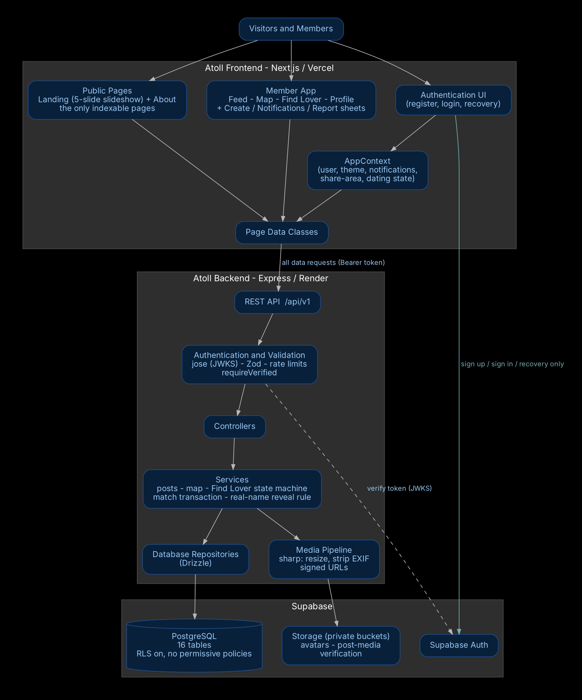
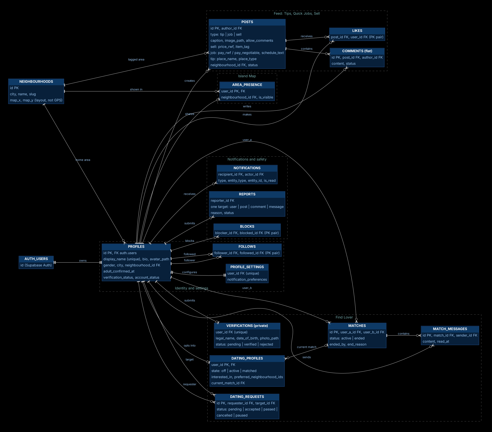

# PROJECT 2 MASTER TECHNICAL BLUEPRINT: ATOLL (v2, Aligned to Handoff v2)

Project: Atoll, Hyper-Local Youth Community Platform (Tips, Quick Jobs, Sell, Island Map, Find Lover)\
Project Type: Client Project\
Initial Market: Rwanda (Kigali first), with international expansion in mind\
Initial Platform: Mobile-first web application\
Future Platform: Dedicated mobile applications\
Architecture: Three Git repositories connected through Git Submodules\
Frontend: Next.js + TypeScript + Tailwind CSS v4 + shadcn/ui\
Backend: Node.js + Express + TypeScript\
Database & Authentication: Supabase (PostgreSQL + Supabase Auth + Storage)\
API Documentation: OpenAPI 3.0 + Scalar\
Frontend Hosting: Vercel\
Backend Hosting: Render\
Development Methodology: UI-first, feature-based sprint development\
Primary Development Objective: Build and validate the complete Atoll experience visually before implementing the production backend.\
Source of truth for product scope: `ATOLL_HANDOFF_v2.md` (Project 1 v2)

---

## 0. Changes from Blueprint v1 (Read First)

Project 1 v2 replaced the conversation platform with five features inside one app. This blueprint is refactored to match. The locked stack, three-repo architecture, Page Data Class pattern, UI-first sprint order and hosting plan are **unchanged**.

| Area | v1 | v2 |
|------|----|----|
| Product | Discussions, threaded comments, connections, private DMs | Unified feed (Tips / Quick Jobs / Sell), Island Map, Find Lover |
| Screens | 24 entries | 17 views (4 sheets/panels, 13 pages or tab views) |
| Public SEO | Public feed, public discussions, topic pages | Landing and About only. All user content is members-only |
| Navigation | Home, Explore, Create, Connections, Messages, Notifications, Profile, Settings | 4 tabs (Feed, Map, Find Lover, Profile) + Create (+) + header bell |
| Identity | Pseudonym, voluntary reveal to any connection | Alias by default. **Verification only to enable Find Lover. Real name shown only to a mutual match** |
| Social graph | Mutual connection requests | One-way **follow** (for the Map) and a **dating request/match** state machine |
| Messaging | DMs between any connected pair | Text chat **only inside an active match** (Our Space) |
| Comments | Threaded | Flat (single level), per-post toggle |
| Categories | 8 discussion topics | 3 post types: `tip`, `job`, `sell` |
| Data tables | 12 | 16 (see Section 4) |
| Sprints | 00 to 16 | 00 to 17 (Map and Find Lover each get their own sprints) |

Corrections made while refactoring (not caused by the handoff change):
1. **JWT library:** v1 listed `jsonwebtoken` but required JWKS verification. v2 uses `jose`, which supports remote JWKS.
2. **Rate limiting:** v1 had a `rateLimit.ts` middleware but no package. v2 adds `express-rate-limit`.
3. **RLS strategy:** v1 implied participant-based RLS policies while Express connects with a privileged database role (which bypasses RLS). v2 states the real model: the frontend uses Supabase **only for Auth**; every data request goes through Express; RLS is enabled with **no permissive policies** as defense-in-depth.
4. **Password reset route:** v1 had no `/reset-password` page for the Supabase recovery link. v2 adds it as a technical route.

Items that need a client decision are in **Section 8 (Open Decisions)**.

---

## 1. Stack Decision & Third-Party Setup Checklist

### 1.1 Frontend Choice Justification

Selected: Next.js (unchanged).

Honest note: in v1 the main reason was public SEO for discussions. In v2 only the landing page and About page are indexable, so the SEO argument is smaller. Next.js remains the choice because:

- The stack is already locked and the team workflow is built around it.
- App Router route groups cleanly separate public, auth and member layouts.
- Server rendering and static rendering give the landing page and About page fast, indexable HTML.
- Dynamic metadata, `robots` and sitemap support are built in.
- The standalone REST API still allows a future mobile app.

Architectural restriction (unchanged): Next.js is strictly the presentation layer. All business logic, authorization and database access live in Express. Server Components must not query Supabase tables. The frontend uses the Supabase client **only** for authentication.

Because member pages are private and interactive, they are built as **Client Components with TanStack Query**. Only the landing page and About page need server rendering.

### 1.2 Locked Technology Stack

| Layer               | Technology           | Responsibility                |
| ------------------- | -------------------- | ----------------------------- |
| Frontend            | Next.js + TypeScript | UI and landing SEO            |
| Rendering           | Next.js App Router   | SSR/static for public pages   |
| Styling             | Tailwind CSS v4      | Styling                       |
| Components          | shadcn/ui            | UI primitives                 |
| Carousel            | shadcn Carousel (Embla) | Landing slideshow          |
| Icons               | Lucide React         | Icons                         |
| Forms               | React Hook Form      | Form management               |
| Validation          | Zod                  | Frontend validation           |
| API communication   | Axios                | Express communication         |
| Server state        | TanStack Query       | Client-side API caching       |
| Global state        | React Context        | Shared application state      |
| Backend             | Node.js + Express    | Business logic and REST API   |
| Backend language    | TypeScript           | Type safety                   |
| Validation          | Zod                  | Request validation            |
| Token verification  | jose                 | Supabase JWT/JWKS verification|
| Image processing    | sharp + multer       | Upload resize, EXIF stripping |
| Database            | Supabase PostgreSQL  | Persistent data               |
| Authentication      | Supabase Auth        | Email/password authentication |
| Database client     | Drizzle ORM          | Schema and queries            |
| File storage        | Supabase Storage     | Avatars, post images, verification photos |
| API specification   | OpenAPI 3.0          | API contract                  |
| Documentation       | Scalar               | Interactive API reference     |
| Frontend deployment | Vercel               | Web hosting                   |
| Backend deployment  | Render               | API hosting                   |
| Version control     | GitHub               | Source control                |
| Repository linking  | Git Submodules       | Three-repository architecture |

Map rendering decision: the Island Map is a **stylised SVG map of Kigali neighbourhoods** with soft circles. No map tile provider, no GPS and no coordinates are used or stored (see Section 4 and Section 6). Real map tiles are deferred.

### 1.3 Architecture Overview


Responsibilities:

1. Next.js displays the application.
2. Page Data Classes prepare data for individual screens.
3. AppContext manages shared application state.
4. Express controls application operations and all data access.
5. Supabase stores application data, manages authentication and holds files.
6. Scalar documents the Express API.

Supabase Auth authenticates users. Express verifies the access token and enforces all authorization rules.

(The architecture image is unchanged from v1 and still valid. The ER image from v1 is **not** valid; Section 4.2 replaces it.)

### 1.4 Monthly Hosting Cost Estimate

Planning estimate in USD. Check free-tier quotas and terms when accounts are created.

| Service         | Initial Plan | Monthly Budget |
| --------------- | ------------ | -------------- |
| GitHub          | Free         | $0             |
| Vercel          | Hobby        | $0             |
| Render          | Free         | $0             |
| Supabase        | Free         | $0             |
| Google Fonts    | Free         | $0             |
| Scalar          | Open-source  | $0             |
| shadcn/ui       | Open-source  | $0             |
| Tailwind CSS    | Open-source  | $0             |
| Lucide          | Open-source  | $0             |
| Domain          | Optional     | Variable       |
| Payment gateway | Not required | $0             |

Initial infrastructure target: $0/month, excluding domain registration.

v2 note: post images and verification photos increase storage use. Images are resized and compressed on upload (Section 6.5) to stay inside the free Supabase storage quota during validation. Render free instances can sleep, which matters for chat responsiveness; review before a public launch.

### 1.5 Exact Frontend Dependencies

Run inside `atoll-frontend`.

```
npx create-next-app@latest . --typescript --tailwind --eslint --app --src-dir --import-alias "@/*"
```

Core dependencies:

```
npm install axios zod
npm install react-hook-form @hookform/resolvers
npm install @tanstack/react-query
npm install @supabase/supabase-js @supabase/ssr
npm install lucide-react
npm install clsx tailwind-merge class-variance-authority
npm install sonner
npm install date-fns
```

Initialize shadcn/ui:

```
npx shadcn@latest init
```

Initial component set:

```
npx shadcn@latest add button input textarea label
npx shadcn@latest add card avatar badge
npx shadcn@latest add dialog dropdown-menu
npx shadcn@latest add tabs select checkbox
npx shadcn@latest add separator skeleton
npx shadcn@latest add tooltip sheet
npx shadcn@latest add alert alert-dialog
npx shadcn@latest add popover command
npx shadcn@latest add switch
npx shadcn@latest add carousel
```

(`carousel` is new in v2 for the landing slideshow. `popover` and `command` are kept for tag and place-type pickers.)

Tailwind CSS v4 uses CSS-first configuration. If the generated project lacks the PostCSS setup:

```
npm install tailwindcss @tailwindcss/postcss postcss
```

### 1.6 Exact Backend Dependencies

Run inside `atoll-backend`.

```
npm init -y
npm install express cors dotenv helmet zod
npm install @supabase/supabase-js
npm install drizzle-orm pg
npm install yaml
npm install @scalar/express-api-reference
npm install jose
npm install pino pino-http
npm install express-rate-limit
npm install multer sharp
```

Development dependencies:

```
npm install -D typescript tsx
npm install -D @types/node @types/express
npm install -D @types/cors @types/pg
npm install -D @types/multer
npm install -D drizzle-kit
npm install -D eslint
npm install -D vitest supertest @types/supertest
```

Authentication decision: Supabase Auth handles registration, login and password recovery. Express verifies Supabase-issued access tokens with `jose` against the project's JWKS endpoint, and enforces application-level authorization. Never trust a user ID supplied by the frontend; always use the verified token subject.

### 1.7 Third-Party Configuration Checklist

A. GitHub

Create three repositories: `atoll` (Parent Hub), `atoll-frontend`, `atoll-backend`.

Required: main branch, develop branch, branch protection for main, pull requests into develop, GitHub Actions, team access.

B. Supabase

Create one Supabase project.

- PostgreSQL database.
- Supabase Auth with email/password, email confirmation enabled for production, password recovery enabled.
- Storage buckets (all **private**; files are served through short-lived signed URLs created by Express):
  - `avatars`
  - `post-media`
  - `verification` (service-role access only; never served to other users)
- Database pooler credentials.
- JWKS verification configuration.
- **Row Level Security enabled on every table with no permissive policies** (see Section 4.5).

Required environment values:

```
SUPABASE_URL=
SUPABASE_ANON_KEY=
SUPABASE_SERVICE_ROLE_KEY=
SUPABASE_JWT_ISSUER=
SUPABASE_JWKS_URL=
DATABASE_URL=
```

The service-role key exists only on trusted server infrastructure. It must never use a `NEXT_PUBLIC_` prefix or appear in the frontend.

C. Vercel

Connect `atoll-frontend`. Configure:

```
NEXT_PUBLIC_APP_URL=
NEXT_PUBLIC_API_URL=
NEXT_PUBLIC_SUPABASE_URL=
NEXT_PUBLIC_SUPABASE_ANON_KEY=
```

D. Render

Create a Node.js Web Service connected to `atoll-backend`.

```
NODE_ENV=production
PORT=10000
FRONTEND_URL=
DATABASE_URL=
SUPABASE_URL=
SUPABASE_ANON_KEY=
SUPABASE_SERVICE_ROLE_KEY=
SUPABASE_JWT_ISSUER=
SUPABASE_JWKS_URL=
LOG_LEVEL=info
```

Health-check path: `/api/v1/health`

E. Google Fonts

Plus Jakarta Sans and Inter via `next/font/google`, with fallbacks.

F. Payments

Not required. Project 1 v2 explicitly excludes payments, escrow and ratings. Sell and Quick Jobs are arranged between users outside the app. Do not integrate Flutterwave, Paypack, MTN MoMo or subscriptions.

G. Identity verification provider

Not required in this version. Verification is a manual-review workflow (Section 6.2). A paid verification provider is deferred.

---

## 2. Complete Folder Structures & CSS Theme Setup

### 2.1 Parent Hub Architecture

```
atoll/
│
├── docs/
│   ├── PROJECT-1-MASTER-HANDOFF-v2.md
│   ├── PROJECT-2-MASTER-BLUEPRINT-v2.md
│   ├── ARCHITECTURE.md
│   ├── DATABASE-DESIGN.md
│   ├── API-CONTRACT.md
│   ├── SPRINT-ROADMAP.md
│   ├── GOOGLE-STITCH-URL.md
│   ├── DEPLOYMENT.md
│   ├── SECURITY.md
│   ├── VERIFICATION-POLICY.md
│   └── decisions/
│       ├── ADR-001-frontend-architecture.md
│       ├── ADR-002-backend-architecture.md
│       ├── ADR-003-authentication.md
│       ├── ADR-004-identity-and-verification.md
│       └── ADR-005-map-privacy.md
│
├── atoll-frontend/          [Git Submodule]
├── atoll-backend/           [Git Submodule]
├── .gitmodules
├── .gitignore
└── README.md
```

The Parent Hub stores documentation and submodule references only.

### 2.2 Frontend Directory Structure

Repository: `atoll-frontend`

```
atoll-frontend/
│
├── public/
│   ├── images/
│   │   └── slideshow/            # 5 landing slide images (compressed)
│   ├── icons/
│   └── logo/
│
├── src/
│   │
│   ├── app/
│   │   ├── (public)/
│   │   │   ├── page.tsx                      # Landing (slideshow)
│   │   │   └── about/page.tsx                # About + Guidelines + Privacy sections
│   │   │
│   │   ├── (auth)/
│   │   │   ├── login/page.tsx
│   │   │   ├── register/page.tsx
│   │   │   ├── forgot-password/page.tsx
│   │   │   └── reset-password/page.tsx       # technical route for the recovery link
│   │   │
│   │   ├── (app)/
│   │   │   ├── layout.tsx                    # auth guard + 4-tab shell + Create (+) + bell
│   │   │   ├── feed/page.tsx
│   │   │   ├── posts/[postId]/page.tsx
│   │   │   ├── map/page.tsx
│   │   │   ├── find-lover/
│   │   │   │   ├── page.tsx                  # state gate (State 1 / redirect)
│   │   │   │   ├── discover/page.tsx
│   │   │   │   ├── requests/page.tsx
│   │   │   │   └── our-space/page.tsx
│   │   │   ├── profile/
│   │   │   │   ├── page.tsx                  # own profile
│   │   │   │   └── [userId]/page.tsx         # another member's profile
│   │   │   └── settings/page.tsx
│   │   │
│   │   ├── api/auth/callback/route.ts
│   │   ├── layout.tsx
│   │   ├── globals.css
│   │   ├── loading.tsx
│   │   ├── error.tsx
│   │   ├── not-found.tsx
│   │   ├── robots.ts
│   │   └── sitemap.ts
│   │
│   ├── components/
│   │   ├── layout/
│   │   │   ├── PublicHeader.tsx
│   │   │   ├── PublicFooter.tsx
│   │   │   ├── AppSidebar.tsx
│   │   │   ├── MobileNavigation.tsx
│   │   │   └── AppHeader.tsx
│   │   ├── landing/
│   │   │   ├── FeatureSlideshow.tsx
│   │   │   └── slides/                       # 5 mockup components, one per feature
│   │   ├── feed/                             # PostCard variants, FilterPills
│   │   ├── post/                             # CreatePostSheet, CommentList, LikeButton
│   │   ├── map/                              # IslandMap (SVG), AreaCircle, AreaCard
│   │   ├── find-lover/                       # StateGate, VerificationSheet, ProfileCard, RequestCard, RevealCard, ChatPanel
│   │   ├── profile/
│   │   ├── notifications/
│   │   └── safety/                           # ReportBlockSheet
│   │
│   ├── data/
│   │   ├── pages/
│   │   │   ├── LandingPageData.ts
│   │   │   ├── AboutPageData.ts
│   │   │   ├── LoginPageData.ts
│   │   │   ├── RegistrationPageData.ts
│   │   │   ├── RecoveryPageData.ts
│   │   │   ├── FeedPageData.ts
│   │   │   ├── PostDetailPageData.ts
│   │   │   ├── CreatePostPageData.ts
│   │   │   ├── MapPageData.ts
│   │   │   ├── FindLoverGatePageData.ts
│   │   │   ├── VerificationPageData.ts
│   │   │   ├── DiscoverPageData.ts
│   │   │   ├── RequestsPageData.ts
│   │   │   ├── OurSpacePageData.ts
│   │   │   ├── ProfilePageData.ts
│   │   │   ├── SettingsPageData.ts
│   │   │   ├── NotificationsPageData.ts
│   │   │   └── SafetyPageData.ts
│   │   ├── mock/
│   │   │   ├── users.ts
│   │   │   ├── posts.ts
│   │   │   ├── comments.ts
│   │   │   ├── neighbourhoods.ts
│   │   │   ├── dating.ts
│   │   │   └── notifications.ts
│   │   └── types/
│   │       ├── user.types.ts
│   │       ├── post.types.ts
│   │       ├── map.types.ts
│   │       └── dating.types.ts
│   │
│   ├── context/
│   │   ├── AppContext.tsx
│   │   └── AppProvider.tsx
│   ├── hooks/
│   │   ├── useApp.ts
│   │   ├── useAuth.ts
│   │   └── useTheme.ts
│   ├── lib/
│   │   ├── api/
│   │   │   ├── apiClient.ts
│   │   │   └── apiErrors.ts
│   │   ├── supabase/
│   │   │   ├── client.ts
│   │   │   └── server.ts
│   │   ├── drafts.ts                         # local draft storage for posts and chat
│   │   ├── utils.ts
│   │   └── constants.ts
│   ├── providers/
│   │   ├── QueryProvider.tsx
│   │   └── ThemeProvider.tsx
│   └── types/
```

Removed from v1: `explore/`, `discussions/`, `topics/`, `connections/`, `messages/`, `notifications/` as pages, `data/mock/connections.ts`, `messages.ts`, `comments` threading types.

### 2.3 Page Data Class Architecture

Every screen has a dedicated data class. Sheets with their own logic (Create, Verification, Report/Block) also have one.

Example: `src/data/pages/FeedPageData.ts`

```
export type PostType = "tip" | "job" | "sell";
export type FeedFilter = "all" | PostType;

export class FeedPageData {
  async getInitialData(filter: FeedFilter = "all") {
    return {
      greeting: "Good to see you again.",
      posts: [],
      suggestedPeople: [],
      filter,
      loading: false,
      error: null
    };
  }

  async getFeed(filter: FeedFilter, cursor?: string) {
    // Sprint 04: return realistic mock data.
    // Integration sprint: replace with GET /feed?type=...&cursor=...
  }

  async toggleLike(postId: string) {}
  async toggleFollow(userId: string) {}

  formatPrice(rwf: number) {
    return `${rwf.toLocaleString("en-RW")} RWF`;
  }

  getEmptyState() {
    return {
      title: "Nothing here yet.",
      description: "Be the first to post."
    };
  }
}
```

Non-negotiable rule (unchanged): React components must not know whether data comes from mock objects or the production API. The Page Data Class owns screen data structures, formatting, defaults, loading, error handling, screen actions and mock data during UI-first development. API transport lives in `lib/api`. Business rules live in Express.

### 2.4 Global Context Contract

`src/context/AppContext.tsx`

Only shared cross-screen state lives here.

```
type DatingState = "off" | "active" | "matched";
type VerificationStatus = "none" | "pending" | "verified" | "rejected";

interface AppContextType {
  user: User | null;
  isAuthenticated: boolean;
  authLoading: boolean;

  theme: "light" | "dark";

  notifications: Notification[];
  unreadNotifications: number;

  shareAreaEnabled: boolean;            // Map visibility toggle
  verificationStatus: VerificationStatus;
  datingState: DatingState;             // drives Find Lover gate and tab badge
  hasPendingRequests: boolean;          // incoming Find Lover requests

  setUser: (user: User | null) => void;
  setTheme: (theme: "light" | "dark") => void;
  setNotifications: (items: Notification[]) => void;
  setShareAreaEnabled: (value: boolean) => void;
  setDatingSnapshot: (snapshot: {
    verificationStatus: VerificationStatus;
    datingState: DatingState;
    hasPendingRequests: boolean;
  }) => void;

  logout: () => Promise<void>;
}
```

Do not put the feed, comments, discover profiles, map pins or chat history in global context. Use TanStack Query for server-owned data.

Important: `datingState` in context is a **display cache**. The server is the only authority on state. Every Find Lover action returns the new state, and the client updates the snapshot from the response.

### 2.5 Global Fallback Handler

```
export interface PageState<T> {
  data: T | null;
  loading: boolean;
  error: string | null;
  isEmpty: boolean;
  retryable: boolean;
}
```

Required UI states: initial loading, skeleton loading, success, empty, recoverable error, retry, offline/unstable connection, unauthorized.

Never allow missing API data to crash a screen. Preserve unpublished post drafts and unsent chat messages locally (`lib/drafts.ts`) when a request fails.

### 2.6 Backend Directory Structure

Repository: `atoll-backend`

```
atoll-backend/
│
├── src/
│   ├── config/
│   │   ├── env.ts
│   │   ├── database.ts
│   │   ├── supabase.ts
│   │   └── cors.ts
│   │
│   ├── db/
│   │   ├── index.ts
│   │   ├── schema/
│   │   │   ├── profiles.ts
│   │   │   ├── profile-settings.ts
│   │   │   ├── neighbourhoods.ts
│   │   │   ├── follows.ts
│   │   │   ├── posts.ts
│   │   │   ├── comments.ts
│   │   │   ├── likes.ts
│   │   │   ├── area-presence.ts
│   │   │   ├── verifications.ts
│   │   │   ├── dating-profiles.ts
│   │   │   ├── dating-requests.ts
│   │   │   ├── matches.ts
│   │   │   ├── match-messages.ts
│   │   │   ├── notifications.ts
│   │   │   ├── reports.ts
│   │   │   └── blocks.ts
│   │   └── seed.ts
│   │
│   ├── middleware/
│   │   ├── authenticate.ts
│   │   ├── authorize.ts
│   │   ├── requireVerified.ts        # gate for Find Lover actions
│   │   ├── validate.ts
│   │   ├── rateLimit.ts
│   │   ├── upload.ts                 # multer + size/type limits
│   │   ├── errorHandler.ts
│   │   └── notFound.ts
│   │
│   ├── modules/
│   │   ├── auth/
│   │   ├── profiles/
│   │   ├── follows/
│   │   ├── posts/
│   │   ├── comments/
│   │   ├── likes/
│   │   ├── neighbourhoods/
│   │   ├── map/
│   │   ├── find-lover/
│   │   │   ├── verification/
│   │   │   ├── discover/
│   │   │   ├── requests/
│   │   │   └── match/                # match, reveal, chat, unmatch
│   │   ├── media/                    # image processing + signed URLs
│   │   ├── notifications/
│   │   ├── reports/
│   │   └── blocks/
│   │
│   ├── routes/
│   │   ├── index.ts
│   │   └── health.routes.ts
│   │
│   ├── docs/
│   │   ├── openapi.yaml
│   │   └── scalar.ts
│   │
│   ├── utils/
│   │   ├── pagination.ts
│   │   ├── response.ts
│   │   ├── logger.ts
│   │   └── ids.ts
│   │
│   ├── app.ts
│   └── server.ts
│
├── drizzle/migrations/
├── tests/
│   ├── integration/
│   └── unit/
├── drizzle.config.ts
├── tsconfig.json
├── .env.example
├── package.json
└── README.md
```

Standard module structure (unchanged):

```
modules/posts/
├── posts.routes.ts
├── posts.controller.ts
├── posts.service.ts
├── posts.repository.ts
├── posts.schema.ts
└── posts.types.ts
```

Routes handle HTTP, controllers handle request/response, services hold business rules, repositories run database operations, schemas hold Zod validation.

### 2.7 Tailwind CSS v4 Theme

Place in `src/app/globals.css`. The palette and fonts are unchanged. v2 adds three subtle chip tints for post types and a `verified` token.

```
@import "tailwindcss";

:root {
  color-scheme: light;

  --background: #FDFBFA;
  --foreground: #2F2A25;

  --card: #FFFFFF;
  --card-foreground: #2F2A25;

  --popover: #FFFFFF;
  --popover-foreground: #2F2A25;

  --primary: #367C83;
  --primary-foreground: #FFFFFF;

  --brand: #B38F65;
  --secondary: #8E8271;
  --secondary-foreground: #2F2A25;

  --muted: #F1EDE8;
  --muted-foreground: #71685F;

  --accent: #EAE4DC;
  --accent-foreground: #2F2A25;

  --border: #E8E1DA;
  --input: #E8E1DA;
  --ring: #367C83;

  --success: #478B70;
  --warning: #D69B48;
  --destructive: #C76E63;

  /* v2: post type chip tints (subtle) */
  --chip-tip: color-mix(in srgb, #367C83 14%, transparent);
  --chip-job: color-mix(in srgb, #D69B48 18%, transparent);
  --chip-sell: color-mix(in srgb, #B38F65 18%, transparent);

  /* v2: verified badge (Find Lover only) */
  --verified: #478B70;

  --font-heading: "Plus Jakarta Sans", sans-serif;
  --font-body: "Inter", sans-serif;

  --radius: 0.75rem;
}

.dark {
  color-scheme: dark;

  --background: #252B2C;
  --foreground: #F3EFE9;

  --card: #303738;
  --card-foreground: #F3EFE9;

  --popover: #303738;
  --popover-foreground: #F3EFE9;

  --primary: #367C83;
  --primary-foreground: #FFFFFF;

  --brand: #B38F65;
  --secondary: #B0A493;
  --secondary-foreground: #F3EFE9;

  --muted: #353D3E;
  --muted-foreground: #B0A493;

  --accent: #41494A;
  --accent-foreground: #F3EFE9;

  --border: #465051;
  --input: #465051;
  --ring: #76AEB0;

  --success: #478B70;
  --warning: #D69B48;
  --destructive: #C76E63;

  --chip-tip: color-mix(in srgb, #76AEB0 22%, transparent);
  --chip-job: color-mix(in srgb, #D69B48 24%, transparent);
  --chip-sell: color-mix(in srgb, #B38F65 26%, transparent);
}

@theme inline {
  --color-background: var(--background);
  --color-foreground: var(--foreground);

  --color-card: var(--card);
  --color-card-foreground: var(--card-foreground);

  --color-popover: var(--popover);
  --color-popover-foreground: var(--popover-foreground);

  --color-primary: var(--primary);
  --color-primary-foreground: var(--primary-foreground);

  --color-brand: var(--brand);
  --color-secondary: var(--secondary);

  --color-muted: var(--muted);
  --color-muted-foreground: var(--muted-foreground);

  --color-accent: var(--accent);
  --color-accent-foreground: var(--accent-foreground);

  --color-border: var(--border);
  --color-input: var(--input);
  --color-ring: var(--ring);

  --color-success: var(--success);
  --color-warning: var(--warning);
  --color-destructive: var(--destructive);

  --color-chip-tip: var(--chip-tip);
  --color-chip-job: var(--chip-job);
  --color-chip-sell: var(--chip-sell);
  --color-verified: var(--verified);

  --font-heading: var(--font-heading);
  --font-sans: var(--font-body);

  --radius-lg: var(--radius);
}

html { scroll-behavior: smooth; }

@media (prefers-reduced-motion: reduce) {
  html { scroll-behavior: auto; }
}

body {
  background: var(--background);
  color: var(--foreground);
  font-family: var(--font-body);
}

h1, h2, h3, h4, h5, h6 { font-family: var(--font-heading); }

button, input, textarea { font-family: inherit; }
```

Implementation note: load fonts with `next/font/google` in the root layout (not a CSS `@import`) and map the Next.js font variables to `--font-heading` and `--font-body`.

### 2.8 Design Rules

- Mobile-first at every breakpoint.
- Mobile: single column, bottom navigation with Feed, Map, Create (+), Find Lover, Profile.
- Desktop: left sidebar, central content, optional right column.
- Deep Ocean for primary actions and active navigation. Lagoon Bronze for brand identity.
- Post type chips use only the three subtle tints. No saturated category colors.
- Map uses Driftwood and Deep Ocean only.
- Verified badge appears **only** inside Find Lover.
- Avoid heavy gradients and glassmorphism.
- Skeletons for loading. Lazy-load images. Never autoplay video.
- Landing slideshow respects `prefers-reduced-motion` (no auto-advance).
- Public and member navigation are visually distinct.

---

## 3. UI Screen-by-Screen Blueprint (Frontend-First)

### 3.1 Screen Architecture and Scope Decisions

Project 1 v2 defines **five features** and **17 views**. Features are not pages. The mapping:

| Feature | Screens supporting it |
| ------- | --------------------- |
| 1. Tips | Feed (filter), Post detail, Create sheet |
| 2. Quick Jobs | Feed (filter), Post detail, Create sheet |
| 3. Sell | Feed (filter), Post detail, Create sheet |
| 4. Island Map | Map tab, Settings (visibility toggle), Profile (follow) |
| 5. Find Lover | Gate, Verification sheet, Discover, Requests, Our Space |
| Shared | Landing, About, Auth (3), Profile, Settings, Notifications panel, Report/Block sheet |

Features 1 to 3 share one screen set and one `posts` table, differing by `type`.

### 3.2 Final Screen Inventory and Journey

| Order | View | Route | Access | Form |
| ----- | ---- | ----- | ------ | ---- |
| 01 | Landing (5-image slideshow) | `/` | Public | Page |
| 02 | About, Guidelines & Privacy | `/about` | Public | Page (three anchored sections) |
| 03 | Registration | `/register` | Public | Page |
| 04 | Login | `/login` | Public | Page |
| 05 | Forgot Password | `/forgot-password` | Public | Page |
| 06 | Feed (Tips / Quick Jobs / Sell) | `/feed` | Member | Tab |
| 07 | Post Detail & Comments | `/posts/[postId]` | Member | Page |
| 08 | Create Post | Global (+) | Member | Sheet |
| 09 | Island Map | `/map` | Member | Tab |
| 10 | Find Lover: Discover | `/find-lover/discover` | Member | Tab view |
| 11 | Find Lover: Requests | `/find-lover/requests` | Member | Tab view |
| 12 | Find Lover: Our Space | `/find-lover/our-space` | Member | Tab view |
| 13 | Verification Flow | Opens from Find Lover | Member | Sheet |
| 14 | Profile | `/profile`, `/profile/[userId]` | Member | Tab |
| 15 | Edit Profile & Settings | `/settings` | Member | Page |
| 16 | Notifications | Header bell | Member | Panel |
| 17 | Report / Block | Contextual | Member | Sheet |

Technical routes (not design screens): `/reset-password`, `/find-lover` (state gate that shows State 1 or redirects by state).

Implementation decisions:
- Post detail is built as a page route. It can be reached from the feed, notifications and profiles.
- `/profile/[userId]` is the same Profile view in "other member" mode (Follow, Report, Block). It is how "View profile" works from the Map, Feed and Discover.
- Report and Block are one sheet with two modes.
- No splash screen; use a lightweight loading state.
- Every member route requires authentication. Unauthenticated access redirects to `/login`.
- Find Lover sub-routes read `datingState` from the server and redirect: State 1 goes to the gate; State 3 locks Discover and Requests and routes to Our Space.

### 3.3 Global UI Components

Build before individual screens.

| Component | Purpose |
| --------- | ------- |
| AtollLogo | Brand symbol and wordmark |
| PublicHeader / PublicFooter | Public navigation and links |
| AppSidebar | Desktop navigation (4 tabs + Create) |
| MobileNavigation | Bottom navigation with center Create (+) |
| AppHeader | Logo, notification bell, theme toggle |
| FeatureSlideshow | Landing 5-slide carousel |
| PostCard | Renders `tip`, `job` or `sell` variant |
| PostTypeChip | Tip / Quick Job / Sell chip |
| FilterPills | All, Tips, Quick Jobs, Sell |
| CreatePostSheet | Category picker, then category fields |
| CommentList / CommentInput | Flat comments |
| LikeButton / FollowButton | Interactions |
| IslandMap / AreaCircle / AreaCard | Stylised SVG map and area popover |
| ShareAreaToggle | Map visibility control |
| FindLoverGate | State 1 explanation and Turn on |
| VerificationSheet | 3-step verification |
| DatingProfileCard | Discover card with Verified badge |
| RequestCard | Incoming and outgoing request |
| RevealCard | Real-name reveal on match |
| ChatPanel | 1-on-1 text chat |
| UserAvatar | Optional photo or abstract avatar |
| NotificationPanel | Header panel |
| ReportBlockSheet | Report and block |
| EmptyState / ErrorState / SkeletonCard | Fallback states |
| ConfirmDialog | Destructive confirmation (unmatch, block, logout) |
| ToastProvider | Feedback |
| SafetyTip | One-line "Meet in public places" notice |

### 3.4 Shared Stitch Preamble

Prepend this block to every Stitch prompt below, so each prompt can stay short.

```
BRAND: Atoll. Tagline "Less Pressure. More Connection."
COLORS: Lagoon Bronze #B38F65, Driftwood #8E8271, Deep Ocean #367C83 (primary action),
Soft Shell #FDFBFA, Deep Shore #252B2C, Sea Glass #478B70, Warm Sand #D69B48, Coral Clay #C76E63.
Text: light #2F2A25 / #71685F, dark #F3EFE9 / #B0A493.
FONTS: Plus Jakarta Sans (headings 600/700), Inter (body 400/500/600).
STYLE: premium but approachable, rounded cards, soft shadows, generous whitespace, restrained animation.
No heavy gradients, no glassmorphism. Not a dating app, not a generic dashboard, not a Twitter clone.
Mobile-first. Provide light and dark themes. Use fictional Kigali demo data and RWF prices.
Post type chips: Tip = Deep Ocean tint, Quick Job = Warm Sand tint, Sell = Lagoon Bronze tint.
```

### 3.5 Screen 01: Landing

Route: `/`. Purpose: explain Atoll in five seconds and get the visitor to join.

Ordered sections:
1. Public header: logo, About, Log In, Join Atoll.
2. Hero: headline "Your Area. Your People. Your Pace." Subheadline from Project 1 v2. Buttons: **Join Atoll** (primary), **See how it works** (secondary, scrolls to How it works).
3. **Five-image feature slideshow** (exactly five slides, one per feature):

| Slide | Feature | Title | Copy | Mockup |
| ----- | ------- | ----- | ---- | ------ |
| 1 | Tips | Find your spot | Cafés, chill corners and study places, recommended by people nearby. | Tip card |
| 2 | Quick Jobs | Pick up a quick job | Part-time gigs from your area. Clear pay, clear time. | Job card |
| 3 | Sell | Sell it nearby | Post a photo, set a price, let your area make an offer. | Sell card in RWF |
| 4 | Island Map | See who's around | Follow people and see the areas they choose to share. Never exact locations. | Soft-circle map |
| 5 | Find Lover | Meet someone serious | Verify, match one person at a time, then see each other's real name. | Discover card with Verified badge |

   Behavior: auto-advance about 5 seconds, pause on hover or touch, dots, arrows, swipe. No auto-advance under `prefers-reduced-motion`. Slides are **feature previews, not links to separate pages**. Slides are code-built mockup components (lightweight, no stock photos of people).
4. Line under slideshow: "Five things. One island."
5. How it works: Join with any name, Use your area, Go deeper if you want.
6. Three pillars: Everything local, Your name your choice, Serious not endless.
7. Privacy section explaining the identity model in plain language.
8. Final CTA and footer (About, Guidelines, Privacy, Contact).

Data class: `LandingPageData.ts`. Methods: `getHeroContent()`, `getSlides()`, `getHowItWorks()`, `getValuePillars()`, `getPrivacyContent()`, `getFooterLinks()`.

Global context: reads `theme`, `isAuthenticated` (logged-in visitors see "Open Atoll" instead of Join).

SEO: static metadata, descriptive title and description, Open Graph image, indexable.

Stitch prompt (after preamble):

```
Design the Atoll landing page.
Headline: "Your Area. Your People. Your Pace."
Subheadline: "Find quick jobs, sell and discover places nearby, see who is around, and meet someone serious when you're ready. Choose your own name. Verify only if you want a relationship."
Sections: public header; hero with two CTAs (Join Atoll, See how it works); a five-slide feature slideshow with dots and arrows
(Tips "Find your spot", Quick Jobs "Pick up a quick job", Sell "Sell it nearby", Island Map "See who's around",
Find Lover "Meet someone serious"), each slide showing a styled app-screen mockup, a title and one line;
"Five things. One island."; how-it-works in three steps; three value pillars; privacy section;
final CTA; footer. No stock photos of people. Single-column mobile layout.
```

### 3.6 Screen 02: About, Guidelines & Privacy

Route: `/about`. One page with three anchored sections (`#about`, `#guidelines`, `#privacy`). Footer links point to the anchors.

Sections:
1. **About:** Atoll philosophy, the five features in one line each, how the identity model works.
2. **Community guidelines:** be useful and kind; no harassment or threats; no scams or fraud; no impersonation; no sharing others' private information; no spam; respect boundaries. Short safety guidance for Sell and Quick Jobs (meet in public, avoid advance payment to strangers).
3. **Privacy & safety:** alias by default; verification only for Find Lover; real names revealed only between two mutual matches; map shows approximate areas only; reporting and blocking; account security. State clearly that alias is not total anonymity.

Data class: `AboutPageData.ts`. Methods: `getAbout()`, `getGuidelines()`, `getPrivacyPrinciples()`, `getSafetyGuidance()`.

Important: this is product information, not a legally reviewed privacy policy or terms of service. Those must be produced separately before public launch.

SEO: indexable, with one H1 and anchored H2 sections.

Stitch prompt:

```
Design one Atoll info page with three anchored sections: About, Community Guidelines, Privacy & Safety.
Calm editorial layout with a sticky section index on desktop and anchor chips on mobile.
Guidelines as short numbered rules with small icons. Privacy as an "identity ladder" visual:
Alias (no verification) -> Verified (only for Find Lover) -> Revealed (real name only between mutual matches).
Never promise total anonymity.
```

### 3.7 Screens 03 to 05: Registration, Login, Forgot Password

**03 Registration** (`/register`). Fields: display name (alias or real name), email, password, confirm password, gender, city/neighbourhood, "I am 18 or older", accept guidelines. Helper text: "Use any name you like. No verification needed." No verification at sign-up.

Data class `RegistrationPageData.ts`: `getRegistrationDefaults()`, `validateRegistration()`, `checkDisplayNameAvailability()`, `registerAccount(payload)`, `getRegistrationFeedback()`.

Rules:
- Display name is unique (case-insensitive) because it is the public handle.
- Gender and neighbourhood are required by v2 and stored on the profile.
- The 18+ box is **self-declared**. Do not describe it as verified age. Store `adult_confirmed_at`.
- After Supabase sign-up, the backend creates the `profiles` row (Sprint 11).

**04 Login** (`/login`). Email, password, remember me, forgot password, Login button, "Join Atoll" link. Data class `LoginPageData.ts`: `getLoginFormDefaults()`, `validateCredentials()`, `login(email, password)`, `getErrorMessage(error)`.

**05 Forgot Password** (`/forgot-password`, with technical `/reset-password`). Email field, simulated then real confirmation state, back to login. Data class `RecoveryPageData.ts`: `getRecoveryDefaults()`, `requestRecovery(email)`, `resetPassword(newPassword)`, `getConfirmationState()`.

Global context: Login and Registration write `user`; Recovery updates auth after reset.
SEO: all three `noindex`.

Stitch prompts:

```
Design Atoll registration: centered card with display name, email, password, confirm password, gender selector,
city/neighbourhood selector, "I am 18 or older" checkbox, guidelines acceptance.
Helper: "Use any name you like. No verification needed." Primary CTA "Join Atoll". Link to log in.
```

```
Design Atoll login: centered card with email, password, remember me, forgot password link, "Log In" CTA, "Join Atoll" link.
Friendly line: "Good to see you again."
```

```
Design Atoll password recovery: logo, "Forgot your password?", short explanation, email input, "Send Recovery Link",
friendly confirmation state, back to login. Include the reset-password variant with a new password field.
```

### 3.8 Screen 06: Feed

Route: `/feed`. The daily destination. Contains **Tips, Quick Jobs and Sell**.

Ordered sections:
1. App header and desktop sidebar.
2. Greeting "Good to see you again."
3. Filter pills: **All, Tips, Quick Jobs, Sell**.
4. Post cards (variant by type):
   - Sell: image, price (RWF), item tag, caption, author, time, like, comment count.
   - Quick Job: image, pay or "Negotiable", time/duration, caption, author.
   - Tip: image, place name, place type tag, caption, author.
5. Follow button on authors.
6. Desktop right column: suggested people (same neighbourhood).
7. Skeleton, empty ("Nothing here yet. Be the first to post.") and retry states.

Data class `FeedPageData.ts`: `getInitialData(filter)`, `getFeed(filter, cursor)`, `toggleLike(postId)`, `toggleFollow(userId)`, `formatPrice(rwf)`, `formatPay(post)`, `getEmptyState()`.

Global context: reads `user`, `theme`, `notifications`.
Pagination: cursor-based, 20 per page. The filter is a query parameter, not a separate route.

Stitch prompt:

```
Design the authenticated Atoll Feed. Greeting "Good to see you again." Horizontal filter pills: All, Tips, Quick Jobs, Sell.
Show three card variants:
Sell (photo, "150,000 RWF", tag Phone, caption, author, time, like, comments),
Quick Job (photo/flyer, "15,000 RWF/day", "Sat 9:00-17:00", caption),
Tip (photo, place name "Hilltop Cafe", type chip Study spot, caption).
Follow button on each author. Desktop: sidebar + feed + right column of suggested people. Mobile: bottom nav with centered Create (+).
Include skeleton, empty and error states.
```

### 3.9 Screen 07: Post Detail & Comments

Route: `/posts/[postId]`.

Ordered sections: header, back link, full post (type-specific fields), author with Follow, like, **flat comments** (only if `allow_comments` is true), comment input, report action, safety tip line on Sell and Quick Jobs ("Meet in public places. Avoid paying strangers in advance.").

Data class `PostDetailPageData.ts`: `getPost(postId)`, `getComments(postId)`, `addComment(payload)`, `toggleLike(postId)`, `deletePost(postId)` (author only), `getInteractionState()`.

Rules: no replies, no nesting. If comments are disabled the comment area is replaced with "Comments are off for this post."

Stitch prompt:

```
Design the Atoll post detail page. Large post card (type-specific fields: price+tag, or pay+duration, or place+type),
author row with Follow, like button, flat comment list, comment input, overflow menu with Report.
One-line safety tip on Sell/Quick Job posts. State when comments are turned off. Desktop and mobile.
```

### 3.10 Screen 08: Create Post (Sheet)

Opened by the central (+) button from any member screen.

Step 1: pick category (**Tip**, **Quick Job**, **Sell**). Step 2: only that category's fields.

| Category | Required fields |
| -------- | --------------- |
| Sell | Image + Price (RWF) + Item tag + Caption |
| Quick Job | Image + Pay (RWF amount or "Negotiable") + Time/Duration + Caption |
| Tip | Image + Place name + Place type (Café, Chill spot, Study spot) + Caption |

Common: "Allow comments" switch (default on for Sell and Quick Job; optional for Tip), preview, Publish. Drafts are saved **locally** (`lib/drafts.ts`), not on the server.

Data class `CreatePostPageData.ts`: `getCategories()`, `getFieldsFor(type)`, `validatePost(type, values)`, `saveDraftLocally()`, `previewPost()`, `publishPost()`.

v2 decision: one image per post, images only (no video). See Section 8.

Stitch prompt:

```
Design the Atoll Create Post bottom sheet. Step 1: three large options (Tip, Quick Job, Sell).
Step 2: category-specific fields only, "Allow comments" switch, preview, Publish, Save draft.
Show validation, uploading, draft-saved and success states. Lightweight, not a corporate form.
```

### 3.11 Screen 09: Island Map

Route: `/map`.

Ordered sections:
1. Header and sidebar.
2. **Share my area** toggle (off by default) with a one-line explanation.
3. Stylised Kigali SVG map with **soft neighbourhood circles**, never exact pins. Circle size reflects how many followed, visible people are in that area.
4. Tap an area to open a card: display name(s), area, **View profile**.
5. Note: "Approximate areas only. Never exact locations."
6. Empty state: "No one nearby is visible right now."

Rules:
- Shows only people **you follow** who have **Share my area** ON.
- When you turn Share my area ON, you choose the neighbourhood you want to show (defaults to your profile neighbourhood). The app never reads GPS.
- Turning it off removes you immediately.

Data class `MapPageData.ts`: `getMapData()`, `setShareArea(enabled, neighbourhoodId)`, `getAreaDetails(neighbourhoodId)`.

Global context: reads and writes `shareAreaEnabled`.

Stitch prompt:

```
Design the Atoll Island Map. Stylised Kigali neighbourhood map (Kimihurura, Kacyiru, Remera, Nyamirambo, Kicukiro and others)
using soft translucent circles, no pins and no street-level detail, in Driftwood and Deep Ocean tones.
Top: "Share my area" toggle with a short privacy note. Tapping a circle opens a small card with display names and "View profile".
Footer note: "Approximate areas only. Never exact locations." Empty state: "No one nearby is visible right now."
```

### 3.12 Screens 10 to 13: Find Lover

Route group: `/find-lover/*`. Sub-tabs: **Discover**, **Requests**, **Our Space**.

The experience is driven by three server-owned states.

| State | Meaning | What the user sees |
| ----- | ------- | ------------------ |
| 1. Off (default) | Not visible, cannot browse | Gate screen: explanation and **Turn on** |
| 2. Active | Visible and browsing | Discover, Requests; Our Space empty |
| 3. Matched | Locked to one person | Discover and Requests paused; Our Space active |

**Gate (State 1).** Explains the feature, the one-match model and the identity rule, then **Turn on**. If verification status is not `verified`, Turn on opens the **Verification sheet**. After verification, the user sets "Interested in" and optional area preference, then enters State 2.

**13 Verification sheet (3 steps).** Shown first: "Verification is only needed for Find Lover. Your real name stays hidden until you and your match both confirm."
1. Full real name and date of birth.
2. Photo (camera or upload).
3. Confirm and submit.

Result: status `pending` until reviewed (manual review in this version, Section 6.2). The user sees "We're checking your details" and cannot enter State 2 until `verified`. In the UI-first prototype this step is simulated and resolves instantly.

v2 refinement: **date of birth is collected here, not at sign-up.** It is needed to show age on Discover cards and to apply a real 18+ check to the dating feature. Sign-up remains a self-declared 18+ box.

**10 Discover (State 2).** Profile cards: display name, age, neighbourhood, short bio, Verified badge. Real names are never shown. Actions: **Send request** and **Pass**. Eligibility is decided on the server: both users active and verified, preferences match both ways, not blocked, no existing request, not matched.

**11 Requests (State 2).** Incoming (Accept or Pass) and Outgoing (Pending, Cancel).

**12 Our Space (State 3).** On match, show the **RevealCard**: each user sees the other's **verified real name**. Below it, a simple 1-on-1 text chat. **Unmatch** with confirmation, offering "Keep looking" (back to State 2) or "Turn off Find Lover" (back to State 1). Report and Block available.

Data classes:
- `FindLoverGatePageData.ts`: `getState()`, `getGateContent()`, `activate(preferences)`, `deactivate()`.
- `VerificationPageData.ts`: `getVerificationStatus()`, `validateStep(step, values)`, `submitVerification(payload)`.
- `DiscoverPageData.ts`: `getDiscoverProfiles(cursor)`, `sendRequest(userId)`, `pass(userId)`.
- `RequestsPageData.ts`: `getIncoming()`, `getOutgoing()`, `accept(id)`, `pass(id)`, `cancel(id)`.
- `OurSpacePageData.ts`: `getMatch()`, `getMessages(cursor)`, `sendMessage(content)`, `unmatch(next)`.

Global context: reads and updates `verificationStatus`, `datingState`, `hasPendingRequests` from each server response.

Prototype-only helper: a small "simulate: they accept" control for client demos. It must not exist in the production build or API.

SEO: all `noindex`.

Stitch prompts:

```
Design the Atoll Find Lover gate (State 1): calm explanation of serious, one-match-at-a-time dating,
the identity rule ("Verification is only needed for Find Lover. Your real name stays hidden until you and your match both confirm."),
and a "Turn on" button. Not a swipe-dating look.
```

```
Design the Atoll verification bottom sheet in 3 steps: (1) full real name and date of birth, (2) photo, (3) confirm.
Show the privacy promise at the top, progress dots, a "We're checking your details" pending state, and a success state.
```

```
Design Atoll Find Lover Discover: calm vertical profile cards with display name, age, neighbourhood, short bio and a small
Sea Glass "Verified" badge. Actions "Send request" and "Pass". No real names. Sub-tabs Discover, Requests, Our Space.
```

```
Design Atoll Find Lover Requests: two sections, Incoming (Accept, Pass) and Outgoing (Pending, Cancel).
Show a banner "You're matched. Other requests are paused." for the matched state.
```

```
Design Atoll Our Space: a reveal card ("You're matched. Here is [Real Name].") with a short explanation,
then a simple 1-on-1 text chat with message bubbles, timestamps and an input. Overflow menu: Report, Block, Unmatch.
Unmatch confirmation offers "Keep looking" or "Turn off Find Lover".
```

### 3.13 Screen 14: Profile

Routes: `/profile` (own) and `/profile/[userId]` (other member).

Own profile: avatar, display name, bio, neighbourhood, sub-tabs **My Posts**, **Following**, **Followers**, link to Settings.
Other profile: avatar, display name, bio, neighbourhood, their posts, **Follow/Unfollow**, overflow with Report and Block.

Privacy rule: profile responses **never** include email, real name, date of birth, gender-matching preferences, verification photo or verification details. A Verified badge is not shown on profiles outside Find Lover.

Data class `ProfilePageData.ts`: `getOwnProfile()`, `getPublicProfile(userId)`, `getPosts(userId, cursor)`, `getFollowing(cursor)`, `getFollowers(cursor)`, `follow(userId)`, `unfollow(userId)`.

Stitch prompt:

```
Design the Atoll profile screen. Avatar, display name, short bio, neighbourhood. Own profile: tabs My Posts, Following, Followers
and a Settings link. Other member: Follow button and overflow menu with Report and Block. Show a user's posts as the compact cards.
No real name, email or phone anywhere.
```

### 3.14 Screen 15: Edit Profile & Settings

Route: `/settings`. One screen with sections:

1. Profile: display name, bio, photo, neighbourhood.
2. Island Map: **Share my area** toggle.
3. Find Lover: toggle, verification status, preferences (interested in), turn off.
4. Notifications: preferences.
5. Blocked users: list with Unblock.
6. Account: password change, logout, **account deletion request**.

Data class `SettingsPageData.ts`: `getSettings()`, `updateProfile()`, `updateAvatar()`, `setShareArea()`, `updateDatingPreferences()`, `updateNotificationPreferences()`, `getBlockedUsers()`, `unblockUser(id)`, `changePassword()`, `logout()`, `requestAccountDeletion()`.

Global context: updates `user`, `shareAreaEnabled`; logout clears all private state.

Stitch prompt:

```
Design the Atoll Settings screen as grouped cards: Profile, Island Map (Share my area), Find Lover (toggle, verification status, preferences),
Notifications, Blocked users, Account (password, logout, request deletion). Short descriptions, clear toggles, mobile-first.
```

### 3.15 Screen 16: Notifications (Header Panel)

A bell in the header opens a panel (popover on desktop, sheet on mobile). Types in v2:
- Someone commented on your post.
- Someone followed you.
- A Find Lover request arrived.
- Your Find Lover request was accepted (you are matched).

Read/unread states, Mark all as read, empty state "Your next interesting connection might start here."

Data class `NotificationsPageData.ts`: `getNotifications()`, `getUnreadCount()`, `markAsRead(id)`, `markAllAsRead()`, `getEmptyState()`.

Global context: reads and updates `notifications`, `unreadNotifications`.

Stitch prompt:

```
Design the Atoll notifications panel opened from a header bell: list items with icon, actor display name, short text, time,
unread dot, "Mark all as read", and a friendly empty state. Types: comment, new follower, match request, match accepted.
```

### 3.16 Screen 17: Report / Block (Sheet)

Triggered from posts, comments, profiles and Our Space.

Report reasons: Harassment, Scam/Fraud, Inappropriate content, Impersonation, Spam, Other. Optional note. Confirmation: "Thank you. Our moderation team will review this." Do not promise a specific outcome.

Block: shows the consequence, then confirms. **Blocking ends any active match with that person.**

Data class `SafetyPageData.ts`: `getReportReasons()`, `validateReport()`, `submitReport()`, `getBlockConsequences()`, `blockUser(userId)`, `getConfirmation()`.

Stitch prompt:

```
Design one Atoll bottom sheet with two modes. Report: reasons (Harassment, Scam/Fraud, Inappropriate content, Impersonation, Spam, Other),
optional note, Submit, confirmation "Thank you. Our moderation team will review this." Block: user name, short consequence text,
Cancel and Confirm (Coral Clay used sparingly). Mention that blocking a matched partner ends the match.
```

### 3.17 Frontend Completion Definition

The frontend-only prototype must support:

- All 17 views and the technical routes.
- Landing slideshow with five slides, controls, auto-advance and reduced-motion handling.
- Navigation across all tabs and the Create (+) button.
- Theme switch.
- Registration, login and recovery flows (simulated).
- Feed filtering and like, follow, comment.
- Creating Tip, Quick Job and Sell posts with category-specific fields; new posts appear in the feed.
- Share my area toggle and Map showing only followed, visible users.
- Find Lover: Turn on triggers verification; verification unlocks Discover; send request; accept; match; real-name reveal; chat; unmatch.
- Notifications, report, block.
- Empty, loading, error and success states.
- Mobile and desktop layouts.

All interactions work with local demonstration data. Use clearly fictional accounts. Do not create artificial engagement that could be mistaken for real activity.

---

## 4. Simplified ER Diagram & UI-Driven API Specification

### 4.1 Database Design Principles

- Support only the five features and the screens above.
- UUID primary keys, timestamps, foreign keys.
- PostgreSQL on Supabase with Drizzle ORM.
- Supabase Auth owns credentials. `profiles.id` references `auth.users.id`.
- **Sensitive identity data is isolated.** Legal name, date of birth and verification photo live only in `verifications`, which no public or profile endpoint reads.
- **No coordinates anywhere.** The map uses neighbourhood IDs only.
- Prefer one table with a `type` column over three near-identical tables (posts).

### 4.2 Text-Based ER Diagram



```
auth.users (Supabase)
    1 ── 1  profiles ── 1 ── 1  profile_settings
                │
                ├── N ── 1  neighbourhoods
                │
                ├── 1 ── 0..1  verifications        (private identity data)
                ├── 1 ── 0..1  dating_profiles      (state: off | active | matched)
                ├── 1 ── 0..1  area_presence ── N ── 1  neighbourhoods
                │
                ├── N ── N  follows            (follower_id → followed_id)
                ├── 1 ── N  posts ── 1 ── N  comments
                │              └── N ── N  likes (via user)
                │
                ├── N ── N  dating_requests    (requester_id → target_id)
                ├── N ── N  matches            (user_a_id, user_b_id)
                │              └── 1 ── N  match_messages
                │
                ├── 1 ── N  notifications      (recipient_id, actor_id)
                ├── 1 ── N  reports            (reporter_id → user | post | comment | message)
                └── N ── N  blocks             (blocker_id → blocked_id)
```

### 4.3 Tables and Fields

**1. profiles**

| Field | Type | Rule |
| ----- | ---- | ---- |
| id | UUID | PK, references auth.users |
| display_name | VARCHAR(30) | Required, unique case-insensitive. Public handle |
| bio | VARCHAR(300) | Nullable |
| avatar_path | TEXT | Nullable (storage path, not a public URL) |
| gender | VARCHAR(20) | Required (client-approved list) |
| city | VARCHAR(100) | Required |
| neighbourhood_id | UUID | FK neighbourhoods.id, nullable |
| adult_confirmed_at | TIMESTAMPTZ | Required (self-declared 18+) |
| verification_status | VARCHAR(20) | none / pending / verified / rejected. Default none |
| account_status | VARCHAR(20) | active / suspended / deleted |
| created_at | TIMESTAMPTZ | Default now |
| updated_at | TIMESTAMPTZ | Updated automatically |
| deleted_at | TIMESTAMPTZ | Nullable |

Do not store passwords here. Email stays in `auth.users` and is never returned by profile endpoints.

**2. profile_settings**

| Field | Type | Rule |
| ----- | ---- | ---- |
| id | UUID | PK |
| user_id | UUID | FK profiles.id, unique |
| notification_preferences | JSONB | Default object |
| created_at / updated_at | TIMESTAMPTZ | |

(v1 flags `show_interests`, `show_bio`, `allow_connection_requests` are removed. Interests and connection requests no longer exist.)

**3. neighbourhoods** (seeded lookup)

| Field | Type | Rule |
| ----- | ---- | ---- |
| id | UUID | PK |
| city | VARCHAR(100) | Required |
| name | VARCHAR(80) | Required |
| slug | VARCHAR(100) | Unique |
| map_x | NUMERIC(5,2) | Position on the SVG map, 0 to 100 |
| map_y | NUMERIC(5,2) | Position on the SVG map, 0 to 100 |
| is_active | BOOLEAN | Default true |

Seed for Kigali (final list to be confirmed with the client): Kimihurura, Kacyiru, Remera, Nyamirambo, Kicukiro, Kiyovu, Nyarutarama, Kimironko, Gikondo, Gisozi, Nyabugogo. `map_x` and `map_y` are layout coordinates on the stylised map, **not geographic coordinates**.

**4. follows**

| Field | Type | Rule |
| ----- | ---- | ---- |
| follower_id | UUID | FK profiles.id |
| followed_id | UUID | FK profiles.id |
| created_at | TIMESTAMPTZ | Default now |

PK `(follower_id, followed_id)`. CHECK `follower_id <> followed_id`.

**5. posts** (Tips, Quick Jobs, Sell)

| Field | Type | Rule |
| ----- | ---- | ---- |
| id | UUID | PK |
| author_id | UUID | FK profiles.id |
| type | VARCHAR(10) | `tip` / `job` / `sell` |
| caption | VARCHAR(500) | Required |
| image_path | TEXT | Required (one image) |
| neighbourhood_id | UUID | FK, nullable (defaults to author's) |
| allow_comments | BOOLEAN | Default true |
| price_rwf | INTEGER | sell only, >= 0 |
| item_tag | VARCHAR(40) | sell only |
| pay_rwf | INTEGER | job only, nullable |
| pay_negotiable | BOOLEAN | job only, default false |
| schedule_text | VARCHAR(80) | job only (time/duration) |
| place_name | VARCHAR(100) | tip only |
| place_type | VARCHAR(20) | tip only: `cafe` / `chill_spot` / `study_spot` |
| status | VARCHAR(20) | published / hidden / deleted |
| like_count | INTEGER | Default 0 |
| comment_count | INTEGER | Default 0 |
| created_at / updated_at | TIMESTAMPTZ | |

CHECK constraints enforce the type rules:
- `sell` requires `price_rwf` and `item_tag`.
- `job` requires `schedule_text` and either `pay_rwf` or `pay_negotiable = true`.
- `tip` requires `place_name` and `place_type`.
- Fields belonging to other types must be null.

Drafts are **not** stored (client-side only). Sold/filled status is deferred; authors delete posts.

**6. comments** (flat)

| Field | Type | Rule |
| ----- | ---- | ---- |
| id | UUID | PK |
| post_id | UUID | FK posts.id |
| author_id | UUID | FK profiles.id |
| content | VARCHAR(500) | Required |
| status | VARCHAR(20) | active / hidden / deleted |
| created_at | TIMESTAMPTZ | Default now |

No `parent_id`. Comments are rejected when `posts.allow_comments` is false.

**7. likes**

| Field | Type | Rule |
| ----- | ---- | ---- |
| post_id | UUID | FK posts.id |
| user_id | UUID | FK profiles.id |
| created_at | TIMESTAMPTZ | Default now |

PK `(post_id, user_id)`. (Replaces v1 `reactions`; one reaction type only.)

**8. area_presence** (Island Map)

| Field | Type | Rule |
| ----- | ---- | ---- |
| user_id | UUID | PK, FK profiles.id |
| neighbourhood_id | UUID | FK neighbourhoods.id, required when visible |
| is_visible | BOOLEAN | Default false |
| updated_at | TIMESTAMPTZ | |

Stores a neighbourhood only. No GPS, no timestamps history.

**9. verifications** (private)

| Field | Type | Rule |
| ----- | ---- | ---- |
| id | UUID | PK |
| user_id | UUID | FK profiles.id, unique |
| legal_name | VARCHAR(120) | Required |
| date_of_birth | DATE | Required, must be 18+ |
| photo_path | TEXT | Path in private `verification` bucket |
| status | VARCHAR(20) | pending / verified / rejected |
| reviewed_by | TEXT | Nullable (reviewer reference) |
| reviewed_at | TIMESTAMPTZ | Nullable |
| rejection_reason | VARCHAR(200) | Nullable |
| created_at / updated_at | TIMESTAMPTZ | |

`profiles.verification_status` mirrors this table's status. This table is read by only two code paths: the verification endpoints (own record) and the match reveal (partner's `legal_name`, active match only).

**10. dating_profiles**

| Field | Type | Rule |
| ----- | ---- | ---- |
| user_id | UUID | PK, FK profiles.id |
| state | VARCHAR(10) | `off` / `active` / `matched`. Default off |
| interested_in | TEXT[] | Required when active |
| preferred_neighbourhood_ids | UUID[] | Optional filter |
| current_match_id | UUID | FK matches.id, set only when `matched` |
| created_at / updated_at | TIMESTAMPTZ | |

CHECK: `state = 'matched'` if and only if `current_match_id IS NOT NULL`. A user may only be set `active` when `profiles.verification_status = 'verified'`.

**11. dating_requests**

| Field | Type | Rule |
| ----- | ---- | ---- |
| id | UUID | PK |
| requester_id | UUID | FK profiles.id |
| target_id | UUID | FK profiles.id |
| status | VARCHAR(20) | pending / accepted / passed / cancelled / paused |
| created_at / updated_at | TIMESTAMPTZ | |

CHECK `requester_id <> target_id`. Unique partial index on the ordered pair for `status IN ('pending','paused')` to block duplicates in either direction.

**12. matches**

| Field | Type | Rule |
| ----- | ---- | ---- |
| id | UUID | PK |
| user_a_id | UUID | FK profiles.id (smaller UUID) |
| user_b_id | UUID | FK profiles.id (larger UUID) |
| status | VARCHAR(10) | active / ended |
| created_at | TIMESTAMPTZ | Default now |
| ended_at | TIMESTAMPTZ | Nullable |
| ended_by | UUID | Nullable FK profiles.id |
| end_reason | VARCHAR(20) | unmatch / block / account_deleted |

**13. match_messages**

| Field | Type | Rule |
| ----- | ---- | ---- |
| id | UUID | PK |
| match_id | UUID | FK matches.id |
| sender_id | UUID | FK profiles.id |
| content | VARCHAR(1000) | Required |
| read_at | TIMESTAMPTZ | Nullable |
| created_at | TIMESTAMPTZ | Default now |

Only readable and writable while the match is `active` and by its two participants.

**14. notifications**

| Field | Type | Rule |
| ----- | ---- | ---- |
| id | UUID | PK |
| recipient_id | UUID | FK profiles.id |
| actor_id | UUID | Nullable FK profiles.id |
| type | VARCHAR(40) | `post_comment` / `new_follower` / `match_request` / `match_created` |
| entity_type | VARCHAR(30) | post / profile / dating_request / match |
| entity_id | UUID | Nullable |
| is_read | BOOLEAN | Default false |
| created_at | TIMESTAMPTZ | Default now |

**15. reports**

| Field | Type | Rule |
| ----- | ---- | ---- |
| id | UUID | PK |
| reporter_id | UUID | FK profiles.id |
| target_user_id | UUID | Nullable FK |
| post_id | UUID | Nullable FK |
| comment_id | UUID | Nullable FK |
| match_message_id | UUID | Nullable FK |
| reason | VARCHAR(30) | harassment / scam / inappropriate / impersonation / spam / other |
| explanation | TEXT | Nullable |
| status | VARCHAR(20) | pending / reviewed / resolved |
| created_at | TIMESTAMPTZ | Default now |

CHECK: exactly one target column is set.

**16. blocks**

| Field | Type | Rule |
| ----- | ---- | ---- |
| blocker_id | UUID | FK profiles.id |
| blocked_id | UUID | FK profiles.id |
| created_at | TIMESTAMPTZ | Default now |

PK `(blocker_id, blocked_id)`.

Removed from v1: `categories`, `reactions`, `connections`, `conversations`, `messages`.

### 4.4 Database Indexes

- `profiles (lower(display_name))` unique.
- `posts (status, type, created_at DESC)` for the filtered feed.
- `posts (author_id, created_at DESC)`.
- `comments (post_id, created_at)`.
- `likes (post_id)`.
- `follows (followed_id)` and `follows (follower_id)`.
- `area_presence (neighbourhood_id) WHERE is_visible`.
- `dating_profiles (state)` and a partial index for `state = 'active'`.
- `dating_requests (target_id, status)` and `(requester_id, status)`.
- `matches (user_a_id) WHERE status='active'` and `(user_b_id) WHERE status='active'`.
- `match_messages (match_id, created_at)`.
- `notifications (recipient_id, is_read, created_at DESC)`.
- `reports (status)`.
- `blocks (blocker_id, blocked_id)` and `(blocked_id)`.

### 4.5 Important Database Security Rules

**Access model.** The frontend uses Supabase only for Auth. All reads and writes go through Express. Therefore:
- Enable RLS on **every** table with **no permissive policies** for `anon` or `authenticated`. A leaked anon key then cannot read data directly.
- Storage buckets are private. Files are served through signed URLs created by Express after an authorization check.
- Express connects with a privileged database role (which bypasses RLS). Authorization is therefore enforced in Express services and covered by tests; RLS is defense in depth, not the primary control.

Rules:
- Profile ownership is tied to the verified token subject.
- `verifications` and the `verification` bucket are never exposed except through the two code paths in Section 4.3.
- Real names are returned only by the match endpoint, only to a participant of an `active` match.
- Match creation runs in a single transaction that locks both `dating_profiles` rows (in a fixed order to avoid deadlocks), re-checks that both users are `active`, verified, unblocked and unmatched, then creates the match, sets both rows to `matched`, and sets all other pending requests involving either user to `paused`.
- On unmatch or block, set the match `ended`, return the chosen user(s) to `active` or `off`, and restore `paused` requests to `pending` only where both sides are still `active`.
- Reports are never publicly readable.
- Never rely on frontend hiding alone.

### 4.6 API Architecture

Base URL: `/api/v1`

Standard response:

```
{
  "success": true,
  "message": "Request completed successfully",
  "data": {},
  "meta": { "timestamp": "2026-11-15T12:00:00Z" }
}
```

Standard error:

```
{
  "success": false,
  "message": "Something went wrong. Please try again.",
  "code": "VALIDATION_ERROR",
  "errors": []
}
```

Pagination: cursor-based for feeds, followers and chat (`?cursor=...&limit=20`, maximum 50).

Find Lover actions return the **new state snapshot** (`verificationStatus`, `datingState`, `hasPendingRequests`) so the client cache stays correct.

Error codes specific to v2: `VERIFICATION_REQUIRED`, `ALREADY_MATCHED`, `NOT_ELIGIBLE`, `COMMENTS_DISABLED`, `BLOCKED`.

### 4.7 Page-Aggregator Endpoints

There are no public data endpoints in v2; landing and About content is static in the frontend. All aggregators require authentication.

| Screen | Endpoint | Returned data |
| ------ | -------- | ------------- |
| Feed | `GET /feed?type=` | Posts, viewer like/follow flags, suggested people, cursor |
| Post detail | `GET /posts/:id` | Post, comments (if enabled), viewer flags |
| Map | `GET /map` | Own share state, neighbourhood list, areas with visible followed people |
| Find Lover | `GET /find-lover` | State snapshot, preferences, verification status, counts |
| Discover | `GET /find-lover/discover` | Eligible profiles, cursor |
| Requests | `GET /find-lover/requests` | Incoming and outgoing |
| Our Space | `GET /find-lover/match` | Active match, partner (display name, **real name**, photo), first messages |
| Profile (own) | `GET /me/profile` | Profile, counts, own posts first page |
| Profile (other) | `GET /profiles/:id` | Public profile, posts first page, follow state |
| Settings | `GET /me/settings` | Profile, preferences, toggles, verification status, blocked users |
| Notifications | `GET /notifications` | Notifications and unread count |

Example `/feed` response:

```
{
  "success": true,
  "data": {
    "posts": [],
    "suggestedPeople": [],
    "pagination": { "nextCursor": null }
  }
}
```

### 4.8 Granular Action & Refresh Endpoints

Authentication (Supabase Auth in the frontend for sign up, sign in, sign out, recovery, session refresh). Express exposes:

```
GET    /auth/me
```

Profiles and follows

```
PATCH  /me/profile
PATCH  /me/settings
POST   /me/avatar                     (multipart image)
GET    /profiles/:id
PUT    /follows/:userId
DELETE /follows/:userId
GET    /me/following
GET    /me/followers
```

Posts, comments, likes

```
POST   /posts                         (multipart: image + fields)
DELETE /posts/:id
GET    /posts/:id
POST   /posts/:id/comments
GET    /posts/:id/comments
DELETE /comments/:id
PUT    /posts/:id/like
DELETE /posts/:id/like
```

Map

```
GET    /map
PUT    /me/area                       { isVisible, neighbourhoodId }
GET    /neighbourhoods
```

Find Lover

```
GET    /find-lover/verification
POST   /find-lover/verification       (multipart: legalName, dateOfBirth, photo)
POST   /find-lover/activate           { interestedIn, preferredNeighbourhoodIds? }   (requires verified)
POST   /find-lover/deactivate
GET    /find-lover/discover
POST   /find-lover/requests           { targetUserId }                               (requires active)
GET    /find-lover/requests
PATCH  /find-lover/requests/:id/accept
PATCH  /find-lover/requests/:id/pass
DELETE /find-lover/requests/:id       (cancel own outgoing)
GET    /find-lover/match
GET    /find-lover/match/messages
POST   /find-lover/match/messages     { content }
PATCH  /find-lover/match/messages/read
POST   /find-lover/match/unmatch      { next: "active" | "off" }
```

Notifications

```
GET    /notifications
PATCH  /notifications/:id/read
PATCH  /notifications/read-all
```

Safety

```
POST   /reports
POST   /blocks                        { userId }
DELETE /blocks/:userId
GET    /blocks
```

Account

```
POST   /me/deletion-request
```

Health

```
GET /health
GET /api/v1/health
```

Removed from v1: all `/public/*` data endpoints, `/search/*`, `/connections/*`, `/conversations/*`, comment replies, category and topic endpoints.

### 4.9 API Authorization Matrix

| Operation | Visitor | Member | Notes |
| --------- | ------- | ------ | ----- |
| View landing and About | Yes | Yes | Static pages |
| Read feed, posts, comments | No | Yes | Excludes blocked users both ways |
| Create post, comment, like | No | Yes | Comments only if enabled |
| Follow / unfollow | No | Yes | Not self |
| See Map | No | Yes | Followed users who are visible only |
| Submit verification | No | Yes | Own record only |
| Activate Find Lover | No | Verified only | `VERIFICATION_REQUIRED` otherwise |
| Browse Discover, send request | No | Active only | Eligibility checked server-side |
| Accept / pass / cancel request | No | Involved party, active | Accept blocked if either side matched |
| Read match, partner real name | No | Active-match participants only | Only after match exists |
| Read or send chat messages | No | Active-match participants only | Read-only access ends with the match |
| Unmatch | No | Active-match participants | Either side |
| Report, block | No | Yes | Reports private |
| Read own settings | No | Owner only | |

### 4.10 Starter OpenAPI 3.0 Specification

File: `src/docs/openapi.yaml`

```
openapi: 3.0.3

info:
  title: Atoll API
  description: >
    REST API for Atoll: Tips, Quick Jobs, Sell, Island Map and Find Lover.
  version: 2.0.0

servers:
  - url: http://localhost:5000/api/v1
    description: Local development
  - url: https://YOUR-RENDER-URL/api/v1
    description: Production

tags:
  - name: Health
  - name: Authentication
  - name: Feed
  - name: Posts
  - name: Profiles
  - name: Map
  - name: Find Lover
  - name: Notifications
  - name: Safety

security:
  - BearerAuth: []

paths:
  /health:
    get:
      tags: [Health]
      security: []
      summary: Check API health
      responses:
        "200": { description: API operational }

  /auth/me:
    get:
      tags: [Authentication]
      summary: Get the authenticated application profile
      responses:
        "200": { description: Profile returned }
        "401": { description: Authentication required }

  /feed:
    get:
      tags: [Feed]
      summary: Get the feed
      parameters:
        - in: query
          name: type
          schema: { type: string, enum: [all, tip, job, sell] }
        - in: query
          name: cursor
          schema: { type: string }
      responses:
        "200": { description: Feed returned }
        "401": { description: Authentication required }

  /posts:
    post:
      tags: [Posts]
      summary: Create a Tip, Quick Job or Sell post
      requestBody:
        required: true
        content:
          multipart/form-data:
            schema:
              type: object
              required: [type, caption, image]
              properties:
                type: { type: string, enum: [tip, job, sell] }
                caption: { type: string, maxLength: 500 }
                image: { type: string, format: binary }
                allowComments: { type: boolean }
                priceRwf: { type: integer }
                itemTag: { type: string }
                payRwf: { type: integer }
                payNegotiable: { type: boolean }
                scheduleText: { type: string }
                placeName: { type: string }
                placeType: { type: string, enum: [cafe, chill_spot, study_spot] }
      responses:
        "201": { description: Post created }
        "400": { description: Invalid input }

  /posts/{id}:
    get:
      tags: [Posts]
      summary: Get a post
      parameters:
        - in: path
          name: id
          required: true
          schema: { type: string, format: uuid }
      responses:
        "200": { description: Post returned }
        "404": { description: Not found }

  /posts/{id}/comments:
    post:
      tags: [Posts]
      summary: Add a comment
      responses:
        "201": { description: Comment created }
        "403": { description: Comments are disabled for this post }

  /follows/{userId}:
    put:
      tags: [Profiles]
      summary: Follow a member
      responses:
        "204": { description: Followed }
    delete:
      tags: [Profiles]
      summary: Unfollow a member
      responses:
        "204": { description: Unfollowed }

  /me/profile:
    get:
      tags: [Profiles]
      summary: Get own profile
      responses:
        "200": { description: Profile returned }
    patch:
      tags: [Profiles]
      summary: Update own profile
      responses:
        "200": { description: Profile updated }

  /map:
    get:
      tags: [Map]
      summary: Get areas with visible followed members
      responses:
        "200": { description: Map data returned }

  /me/area:
    put:
      tags: [Map]
      summary: Turn Share my area on or off
      requestBody:
        required: true
        content:
          application/json:
            schema:
              type: object
              required: [isVisible]
              properties:
                isVisible: { type: boolean }
                neighbourhoodId: { type: string, format: uuid }
      responses:
        "200": { description: Presence updated }

  /find-lover:
    get:
      tags: [Find Lover]
      summary: Get Find Lover state snapshot
      responses:
        "200": { description: State returned }

  /find-lover/verification:
    post:
      tags: [Find Lover]
      summary: Submit verification details
      requestBody:
        required: true
        content:
          multipart/form-data:
            schema:
              type: object
              required: [legalName, dateOfBirth, photo]
              properties:
                legalName: { type: string }
                dateOfBirth: { type: string, format: date }
                photo: { type: string, format: binary }
      responses:
        "202": { description: Submitted for review }
        "400": { description: Invalid input or under 18 }

  /find-lover/activate:
    post:
      tags: [Find Lover]
      summary: Turn on Open to a Serious Relationship
      responses:
        "200": { description: State is now active }
        "403": { description: VERIFICATION_REQUIRED }

  /find-lover/discover:
    get:
      tags: [Find Lover]
      summary: Get eligible profiles
      responses:
        "200": { description: Profiles returned }
        "403": { description: Not active }

  /find-lover/requests:
    post:
      tags: [Find Lover]
      summary: Send a request
      responses:
        "201": { description: Request created }
        "409": { description: Duplicate or not eligible }

  /find-lover/requests/{id}/accept:
    patch:
      tags: [Find Lover]
      summary: Accept a request and create the match
      responses:
        "200": { description: Match created, state is matched }
        "409": { description: ALREADY_MATCHED or NOT_ELIGIBLE }

  /find-lover/match:
    get:
      tags: [Find Lover]
      summary: Get the active match and the partner's verified real name
      responses:
        "200": { description: Match returned }
        "404": { description: No active match }

  /find-lover/match/messages:
    get:
      tags: [Find Lover]
      summary: Get chat messages
      responses:
        "200": { description: Messages returned }
    post:
      tags: [Find Lover]
      summary: Send a chat message
      responses:
        "201": { description: Message sent }

  /find-lover/match/unmatch:
    post:
      tags: [Find Lover]
      summary: End the match
      responses:
        "200": { description: Match ended, new state returned }

  /notifications:
    get:
      tags: [Notifications]
      summary: Get notifications
      responses:
        "200": { description: Notifications returned }

  /reports:
    post:
      tags: [Safety]
      summary: Report a post, comment, member or chat message
      responses:
        "201": { description: Report received }

  /blocks:
    post:
      tags: [Safety]
      summary: Block a member (ends any active match)
      responses:
        "201": { description: Member blocked }

components:
  securitySchemes:
    BearerAuth:
      type: http
      scheme: bearer
      bearerFormat: JWT

  schemas:
    Error:
      type: object
      properties:
        success: { type: boolean }
        message: { type: string }
        code: { type: string }
```

This is the initial contract outline. Each implemented endpoint must receive complete request schemas, response schemas, error responses, authorization requirements and examples before its backend sprint is marked complete.

### 4.11 Scalar Documentation Setup

Create `src/docs/scalar.ts` and expose interactive documentation at `/api/docs` using `@scalar/express-api-reference` and `openapi.yaml`. Enabled in development and testing. In production it can remain read-only public documentation; never expose credentials, private operational endpoints or sensitive schemas.

---

## 5. Ordered Execution Sprints (Git Branch Roadmap)

### 5.1 Git Repository Strategy (unchanged)

| Repository | Responsibility |
| ---------- | -------------- |
| `atoll` | Documentation and submodule references |
| `atoll-frontend` | Next.js application |
| `atoll-backend` | Express API |

Each repository uses `main` (production), `develop` (integration) and `sprint-XX-description` (feature branches).


Rules:
1. Never work directly on `main`.
2. Never use `main` as the everyday integration branch.
3. Every sprint begins from the latest `develop`.
4. Every sprint branch has a clear feature scope.
5. Merge into `develop` through pull requests.
6. Delete merged sprint branches.
7. Merge `develop` into `main` only for approved releases.
8. Keep the Parent Hub's submodule pointers synchronized with approved commits.
9. On approved releases, update the submodule references and commit them to the Parent Hub.

Branch names:

```
sprint-00-setup-live-infrastructure
sprint-01-brand-design-system
sprint-02-landing-and-about
sprint-03-authentication-ui
sprint-04-feed-and-post-detail
sprint-05-create-post
sprint-06-profile-follow-and-settings
sprint-07-island-map
sprint-08-find-lover
sprint-09-notifications-safety-and-polish
sprint-10-database-foundation
sprint-11-authentication-backend
sprint-12-profiles-follows-and-media-api
sprint-13-posts-comments-and-likes-api
sprint-14-map-presence-api
sprint-15-find-lover-api
sprint-16-notifications-and-safety-api
sprint-17-integration-and-production
```

### 5.2 Sprint 00: Setup & Live Infrastructure

Branch: `sprint-00-setup-live-infrastructure`

Objective: establish all three repositories and deploy working Hello World applications before feature development.

Parent Hub: create `atoll`, `/docs`, the two application repos, submodules, `main` and `develop`, `.gitmodules`, README; save Handoff v2 and this blueprint; create initial architecture docs; save the Stitch project URL.

Frontend: Next.js with TypeScript, Tailwind v4, shadcn/ui, Lucide, fonts, Atoll CSS variables, root layout, theme provider, AppContext, shared layout components, error and loading boundaries, Vercel.

Backend: Node and Express, TypeScript, dotenv, Helmet, CORS, health route, environment validation, global error middleware, Supabase connection, initial OpenAPI document, Scalar, Render.

Deliverable: working Parent Hub, frontend and backend repos with submodules, both deployments live, health-check response, Scalar route, Stitch URL saved.

Definition of Done: both live deployments are accessible and the infrastructure can be extended without rebuilding the repository architecture.

### 5.3 Sprint 01: Brand Design System & Global UI

Branch: `sprint-01-brand-design-system`

Tasks: logo placement, brand colors and tokens (including v2 chip tints and verified token), typography, light and dark modes, buttons, inputs, cards, avatars, badges, dialogs, sheets, toasts, skeletons, empty and error states, responsive layout primitives, public header and footer, member sidebar, mobile bottom navigation with center Create (+), app header with bell and theme toggle, `PostTypeChip`, `FilterPills`.

Frontend only; data hardcoded.

Definition of Done: shared primitives work, respond to theme and adapt to mobile.

### 5.4 Sprint 02: Landing & About

Branch: `sprint-02-landing-and-about`

Screens: 01 Landing, 02 About/Guidelines/Privacy.

Tasks: `LandingPageData`, `AboutPageData`; `FeatureSlideshow` with five code-built slide mockups (Tip card, Job card, Sell card, map, Discover card); auto-advance, pause, dots, arrows, swipe, reduced-motion handling; how-it-works, pillars, privacy section, footer; anchored About sections; metadata, Open Graph, `robots.ts`, `sitemap.ts` (landing and About only).

Definition of Done: a visitor understands the five features from the slideshow within seconds and can navigate to About and registration. Slides never link to separate pages.

### 5.5 Sprint 03: Authentication UI

Branch: `sprint-03-authentication-ui`

Screens: 03 Registration, 04 Login, 05 Forgot Password (plus `/reset-password`).

Tasks: forms with validation (gender, neighbourhood, 18+ checkbox, alias helper text), simulated registration, login and recovery, simulated auth state, loading and validation states, redirect simulation, route guard for `(app)`.

No real authentication yet.

Definition of Done: all auth screens complete a mock user journey into the Feed.

### 5.6 Sprint 04: Feed & Post Detail

Branch: `sprint-04-feed-and-post-detail`

Screens: 06 Feed, 07 Post Detail.

Tasks: `FeedPageData`, `PostDetailPageData`; PostCard for tip, job and sell; filter pills; follow and like; flat comments with the comments-off state; safety tip line; suggested people; cursor pagination mock; skeleton, empty and error states; responsive layouts.

Definition of Done: a simulated member can browse each category, open a post, like, follow and comment.

### 5.7 Sprint 05: Create Post

Branch: `sprint-05-create-post`

Screen: 08 Create Post (sheet).

Tasks: `CreatePostPageData`; category picker; per-category fields and validation; image picker with preview; allow-comments switch; preview; local draft storage (`lib/drafts.ts`); mock publishing into the feed; failure and retry feedback.

Definition of Done: a member can publish a Tip, Quick Job and Sell post, each with the correct required fields, and see it in the feed.

### 5.8 Sprint 06: Profile, Follow & Settings

Branch: `sprint-06-profile-follow-and-settings`

Screens: 14 Profile, 15 Edit Profile & Settings.

Tasks: own and other-member profile; My Posts, Following, Followers; follow and unfollow; edit display name, bio, photo, neighbourhood; notification preferences; blocked users list; Share my area and Find Lover rows (wired in later sprints); logout; account deletion request UI.

Definition of Done: a member can edit their simulated alias profile and manage who they follow.

### 5.9 Sprint 07: Island Map

Branch: `sprint-07-island-map`

Screen: 09 Island Map.

Tasks: `MapPageData`; stylised Kigali SVG with neighbourhood circles positioned by `map_x` and `map_y`; Share my area toggle with neighbourhood choice; show only followed, visible people; area card with View profile; empty state and privacy note.

Definition of Done: following a mock user who is visible makes their area appear; turning visibility off removes it; no exact locations are shown anywhere.

### 5.10 Sprint 08: Find Lover

Branch: `sprint-08-find-lover`

Screens: 10 Discover, 11 Requests, 12 Our Space, 13 Verification.

Tasks: state machine in `FindLoverGatePageData` (off, active, matched) with mock persistence; gate screen; verification sheet (name and date of birth, photo, confirm, simulated pending and verified); preferences; Discover cards with Verified badge; Send request and Pass; Requests (incoming and outgoing); accept leading to match; pause of other requests and delisting; RevealCard with real name; chat with simulated replies; unmatch with the two outcomes; prototype-only "simulate: they accept" control (flag so it can be stripped).

Definition of Done: the full journey runs: Turn on, verify, browse, request, match, see real name, chat, unmatch.

### 5.11 Sprint 09: Notifications, Safety & Complete UI Polish

Branch: `sprint-09-notifications-safety-and-polish`

Screens: 16 Notifications panel, 17 Report/Block sheet, plus whole-product polish.

Tasks: notification panel with read states; report reasons and confirmation; block flow including the "ends your match" consequence; confirmation messages; then verify all 17 views, every navigation link, every primary button, theme switching, all mock interactions, mobile and desktop layouts, slow-load simulation, missing data fallbacks, empty and error states, typography, spacing and brand consistency; confirm no dead buttons; review the complete prototype against `ATOLL_HANDOFF_v2.md`.

Critical milestone: **the complete visual product works end to end before backend feature work begins.** The client can review everything without a working API.

### 5.12 Sprint 10: Database Foundation

Branch: `sprint-10-database-foundation`

Tasks: Drizzle config; Supabase PostgreSQL connection; all 16 tables; CHECK constraints (post type rules, dating state rule, request and report targets); indexes; migrations; RLS enabled with no permissive policies; storage buckets (private); seed (neighbourhoods, sample dev data).

Definition of Done: migrations run; foreign keys and unique constraints work; post-type CHECK constraints reject invalid rows; RLS verified to deny `anon`/`authenticated` direct access; seed data available.

### 5.13 Sprint 11: Authentication Backend

Branch: `sprint-11-authentication-backend`

Tasks: configure Supabase Auth; token verification with `jose` and JWKS; `authenticate` and `authorize` middleware; `GET /auth/me`; profile creation after sign-up (display name uniqueness, gender, neighbourhood, `adult_confirmed_at`); `requireVerified` middleware; account ownership checks; rate limits on auth-related endpoints.

Definition of Done: real users can sign up, sign in, recover passwords and reach protected routes; users see only their own private data.

### 5.14 Sprint 12: Profiles, Follows & Media API

Branch: `sprint-12-profiles-follows-and-media-api`

Tasks: own and other-member profile endpoints (strict public field list); profile and settings update; avatar upload; the `media` module (type and size validation, resize and compress with `sharp`, **strip EXIF metadata**, store in private buckets, issue signed URLs); follow, unfollow, following and followers; blocked-user listing; notification preferences; account deletion request.

Definition of Done: profiles persist; no private field can leak through any profile response; uploaded images have no location metadata.

### 5.15 Sprint 13: Posts, Comments & Likes API

Branch: `sprint-13-posts-comments-and-likes-api`

Tasks: `GET /feed` aggregation with type filter and cursor; create post (per-type validation matching the CHECK constraints, image upload); get and delete post (author only); comments with the `allow_comments` rule; likes; count maintenance; block-aware filtering (hide content between blocked pairs); `new_follower` and `post_comment` notification triggers.

Definition of Done: the API supports the full Feed, Post Detail and Create flows.

### 5.16 Sprint 14: Map Presence API

Branch: `sprint-14-map-presence-api`

Tasks: `neighbourhoods` endpoint; `PUT /me/area`; `GET /map` returning only areas that contain visible people **the caller follows**, grouped by neighbourhood; block-aware filtering; immediate removal when visibility is turned off or an account is suspended or deleted.

Definition of Done: a user never appears on the map unless they are visible AND followed by the viewer; no endpoint returns coordinates.

### 5.17 Sprint 15: Find Lover API

Branch: `sprint-15-find-lover-api`

Tasks: verification submit and status endpoints (private bucket, age check from date of birth); manual review workflow and `VERIFICATION-POLICY.md`; activate and deactivate (state rules); Discover with server-side eligibility and bidirectional preference matching; send, cancel, accept and pass requests; **transactional match creation** with row locks, delisting and pausing of other requests; match endpoint returning the partner's real name only to participants of an active match; chat endpoints limited to active-match participants; unmatch with `next` option and request restoration; block-triggered match end; `match_request` and `match_created` notifications.

Definition of Done: the three-state machine is enforced on the server; two simultaneous accepts cannot create two matches for one user; real names never leave the match endpoint; chat is inaccessible once a match ends.

### 5.18 Sprint 16: Notifications & Safety API

Branch: `sprint-16-notifications-and-safety-api`

Tasks: notification retrieval, mark read, mark all read; report creation and validation (exactly one target); report status; block and unblock; moderator access path for reported content; safety event logging; rate limits on reports and blocks.

Definition of Done: reporting, blocking and notifications work through real endpoints, and blocking a matched partner ends the match.

### 5.19 Sprint 17: Integration, Testing & Production Launch

Branch: `sprint-17-integration-and-production`

Frontend integration: API base URL, Axios interceptors, Supabase Auth, connect every Page Data Class (Feed, PostDetail, CreatePost, Map, FindLoverGate, Verification, Discover, Requests, OurSpace, Profile, Settings, Notifications, Safety), replace mock data sources, preserve existing UI components, remove the prototype-only "simulate: they accept" control.

Backend verification: endpoint contracts, authentication, authorization, pagination, error responses, transactions, RLS, Scalar.

Testing: see Section 7.2.

Production deployment: backend to Render; verify database connectivity and health; frontend to Vercel; verify environment variables, domain, Supabase Auth redirects, CORS; verify only the landing and About pages are indexable; verify private route protection and `noindex`; merge approved develop branches into main; update Parent Hub submodule pointers; tag the first release.

Definition of Done: the production app works with real users and real data without frontend mock data.

### 5.20 Sprint Summary

| Sprint | Primary Deliverable | Repository |
| ------ | ------------------- | ---------- |
| 00 | Infrastructure and deployments | All |
| 01 | Brand design system | Frontend |
| 02 | Landing (slideshow) and About | Frontend |
| 03 | Authentication UI | Frontend |
| 04 | Feed and Post Detail | Frontend |
| 05 | Create Post | Frontend |
| 06 | Profile, Follow, Settings | Frontend |
| 07 | Island Map | Frontend |
| 08 | Find Lover | Frontend |
| 09 | Notifications, Safety, Polish | Frontend |
| 10 | Database foundation | Backend |
| 11 | Authentication backend | Backend |
| 12 | Profiles, Follows, Media API | Backend |
| 13 | Posts, Comments, Likes API | Backend |
| 14 | Map Presence API | Backend |
| 15 | Find Lover API | Backend |
| 16 | Notifications and Safety API | Backend |
| 17 | Integration and launch | All |

```
SPRINT 00
Infrastructure
    |
SPRINT 01-09
Complete Frontend
    |
SPRINT 10-16
Complete Backend
    |
SPRINT 17
Integration and Launch
```

The sequence intentionally prevents premature backend work from slowing down visual validation.

---

## 6. Security, Privacy, SEO & Production Architecture

### 6.1 Security Architecture

Authentication
- Supabase Auth owns credentials. Express verifies access tokens (`jose`, JWKS). Refresh tokens handled securely; HttpOnly cookies where the web session design allows.
- Never store passwords in `profiles`. Never expose the service-role key to the browser.

Authorization (in Express services, covered by tests)
- Authentication middleware, ownership checks, `requireVerified`, dating-state checks, match-participant checks, block checks.
- A valid token does not authorize every resource.

Input validation
- All inputs pass Zod validation: display name, caption, comment, price, pay, schedule text, place name, item tag, legal name, date of birth, chat message, report explanation, search-free queries.
- Sanitize and encode output to prevent stored XSS.

Uploads
- Allow only JPEG, PNG and WebP; enforce a size limit; check the real file type, not only the extension.
- Re-encode with `sharp`, resize, and **strip all metadata (EXIF/GPS)**.
- Store in private buckets and serve through short-lived signed URLs.

Rate limiting
- Stricter limits on registration, login, password recovery, post creation, comments, follows, likes, dating requests, chat messages, verification submissions and reports.

HTTP security
- Helmet, CORS allowlist, secure cookies, content security policy, body limits, safe error messages, production logging without sensitive payloads (never log legal names, dates of birth or message content).

### 6.2 Identity & Verification Architecture

The v2 identity model has three levels. They must be implemented exactly.

| Level | Who | Data held | Visible to others |
| ----- | --- | --------- | ----------------- |
| Alias (default) | Every member | Display name, optional bio and photo, gender, neighbourhood | Display name and approved profile |
| Verified | Members who enable Find Lover | `verifications` row: legal name, date of birth, photo | Verified badge inside Find Lover only |
| Revealed | Two members in an active match | Same | The partner's verified real name, in Our Space only |

Verification workflow (this version):
1. Member submits legal name, date of birth (must be 18+) and a photo.
2. Status is `pending`. The member cannot activate Find Lover.
3. An authorized reviewer checks the submission (name plausibility, photo is a real, clear face photo, age) and sets `verified` or `rejected` with a reason. For the first release this can be done through the Supabase dashboard or a minimal internal tool; a small internal review screen is recommended before public launch.
4. On `verified`, `profiles.verification_status` is updated and the member can activate Find Lover.
5. Rejected members may resubmit.

Honest limits (must also appear in user-facing text):
- This review does **not** prove a person's legal identity the way a government-ID check or an automated provider would, and it does not prove character, intentions or safety. Never describe it as "identity guaranteed".
- Collecting a face photo and legal name is sensitive. Define retention (for example, delete the photo after review and keep only the status), access controls and a deletion path in `VERIFICATION-POLICY.md`, and have the data-protection obligations for Rwanda reviewed by counsel before public launch.
- Do not collect national ID documents in this version.

Reveal rules:
- Real name is released only when an `active` match exists and the requester is one of its two participants.
- After a match ends, the endpoint stops returning the name. A name already seen cannot be "unseen"; the UI should say so before accepting a request ("If you match, you'll both see each other's real name").
- Accepting a request is the mutual confirmation. Nothing else triggers a reveal.

### 6.3 Privacy Architecture

| Identity | Meaning | Visibility |
| -------- | ------- | ---------- |
| Account identity | Email and authentication data | Restricted |
| Public identity | Display name and approved profile info | Member-visible |
| Verified identity | Legal name, date of birth, photo | Restricted. Real name only to a match partner |
| Private communication | Match chat | Two participants, and authorized platform personnel only for reported content under defined policy |

Implementation rules:
1. Profile endpoints never return email, real name, date of birth or verification details.
2. Real names are never public and never mandatory outside Find Lover.
3. The map stores and returns neighbourhoods only, never coordinates.
4. Follow-based map visibility is limited to followed people who opted in (see Section 8, decision 3).
5. Blocking removes content, map presence and Discover visibility in both directions and ends an active match.
6. Reports are private.
7. Alias is not anonymity: the platform knows the account owner. Do not claim otherwise anywhere in the product.
8. Age: 18+ only. Sign-up is a self-declared checkbox. Find Lover applies an additional date-of-birth check during verification.

### 6.4 Reporting and Moderation

Support reporting a post, comment, member or chat message with the reasons: harassment, scam/fraud, inappropriate content, impersonation, spam, other. The backend records each report as `pending`.

A moderation dashboard is not part of the first scope unless the client approves it separately. Before public launch, authorized moderators still need a secure way to review reports and verification submissions (for example, a small internal tool or controlled database access).

Moderators see only the reported content and necessary context; they do not get blanket access to private chats.

Scam risk on Sell and Quick Jobs is handled by reporting, blocking, hiding or deleting content, account suspension and the one-line safety tip. The platform does not mediate disputes or guarantee transactions.

### 6.5 SEO, Performance and Low-Connectivity

SEO (reduced scope in v2)

Indexable: `/` and `/about` only.

Non-indexable (`noindex`, and `Disallow` in `robots.txt`): `/login`, `/register`, `/forgot-password`, `/reset-password`, and every member route (`/feed`, `/posts/*`, `/map`, `/find-lover/*`, `/profile/*`, `/settings`).

Use dynamic titles, meta descriptions, canonical URLs, Open Graph metadata and an XML sitemap listing only indexable pages.

Critical rule: `noindex` is not a protection. Member data must never be returned to unauthenticated requests in the first place; every data endpoint requires a verified token.

Performance and low connectivity
- Compress and resize images on upload; lazy-load images; paginate the feed and chat; limited first-page results.
- Landing slideshow mockups are lightweight code components, not large image files.
- Skeleton loading, retry on failure, clear sent/not-sent states.
- Preserve post drafts and unsent chat text locally.
- Minimal third-party scripts. No autoplay video.

### 6.6 Production Hosting Responsibilities

- **Vercel (frontend):** Next.js deployment, landing SEO rendering, environment configuration, preview deployments, domain management.
- **Render (backend):** Express API, health checks, environment variables, request logging, monitoring.
- **Supabase:** PostgreSQL, Auth, private Storage, RLS (deny-all), backups according to the selected plan.

### 6.7 Environment Variable Ownership

| Variable | Frontend | Backend |
| -------- | -------- | ------- |
| NEXT_PUBLIC_APP_URL | Yes | No |
| NEXT_PUBLIC_API_URL | Yes | No |
| NEXT_PUBLIC_SUPABASE_URL | Yes | Optional |
| NEXT_PUBLIC_SUPABASE_ANON_KEY | Yes | Optional |
| DATABASE_URL | No | Yes |
| SUPABASE_SERVICE_ROLE_KEY | No | Yes |
| SUPABASE_JWKS_URL | No | Yes |
| SUPABASE_JWT_ISSUER | No | Yes |
| FRONTEND_URL | No | Yes |
| NODE_ENV | Yes | Yes |

Never commit `.env` files. Keep `.env.example` with empty placeholders in each repository.

### 6.8 Monitoring and Backup

Before public launch: structured backend logs; monitor API errors, database usage, authentication failures and storage usage; test backup and restore; document migration rollback; document incident response; document how to suspend an abusive account and how to take down a post; document the verification review and photo-deletion procedure.

---

## 7. Project Completion Criteria, Testing & Handover

### 7.1 Definition of a Successful Application

A. Product requirements
- A visitor understands from the landing slideshow that Atoll offers five things in one app.
- Members register with an alias and use the Feed, Map and posts without verification.
- Members can create Tip, Quick Job and Sell posts with the correct fields, like, comment (when enabled) and follow.
- Members can share their area and see followed, visible members on the Map, with approximate areas only.
- Only verified members can enable Find Lover.
- Members can browse Discover, send and accept requests, and match with one person at a time.
- On a mutual match, both see the other's verified real name, and can chat in Our Space.
- Members can unmatch, report and block.
- The experience works on mobile and desktop.

B. Technical requirements
- Three Git repositories linked by submodules, each with `main` and `develop`.
- Frontend: Next.js and TypeScript. Backend: Express and TypeScript.
- Supabase stores data and manages Auth; Drizzle manages schema and migrations.
- Every screen has a Page Data Class; AppContext holds shared state; global fallback states exist.
- Express modules follow controller, service and repository separation.
- OpenAPI is complete and Scalar renders it.
- RLS enabled with no permissive policies; all data access via Express.

C. Production requirements
- Frontend on Vercel and backend on Render; environment variables configured.
- Authentication works in production.
- Only the landing and About pages are indexable.
- Verification data and photos are protected; real names are revealed only to matches.
- Reporting and blocking work; error logging enabled; recovery procedures documented.

### 7.2 Required Testing Strategy

**Level 1: Unit tests**

Frontend: Page Data Class methods, formatters (price, pay), per-type post validation, drafts, fallback handling, filter logic, dating state reducer.

Backend: services, Zod schemas, authorization rules, per-type post validation, eligibility rules for Discover, state transition rules.

**Level 2: Integration tests**

Express routes; token verification; database queries; CHECK constraints; deny-all RLS behavior; block-aware filtering; verification gating; **match transaction** (including two simultaneous accepts for the same user and a request to a user who matched a moment earlier); delisting and pausing; request restoration on unmatch; real-name reveal only for active participants; chat access after unmatch; block ending a match; map returns only followed and visible users; image upload strips EXIF.

**Level 3: End-to-end tests (Playwright)**

```
npm install -D @playwright/test
npx playwright install
```

| Test | Expected result |
| ---- | --------------- |
| Visitor opens landing | Five-slide slideshow loads and advances; reduced-motion disables auto-advance |
| Visitor opens a member URL | Redirected to login |
| Visitor registers with an alias | Account created, lands on Feed without verification |
| Member filters the feed | Tips, Quick Jobs and Sell filter correctly |
| Member creates a Sell post | Required price and tag enforced; post appears |
| Member creates a Quick Job | Pay or Negotiable plus duration enforced |
| Member creates a Tip | Place name and type enforced |
| Comments disabled | Comment box hidden and API rejects comments |
| Member follows another | Follow persists; notification created |
| Member turns on Share my area | Followed viewer sees the area circle; unfollowed viewer does not |
| Member turns it off | Area disappears immediately |
| Unverified member turns on Find Lover | Verification sheet opens; activation blocked until verified |
| Verified member browses Discover | Only eligible profiles; no real names |
| Request, accept | Match created for both; both removed from Discover |
| Matched member's other requests | Paused; new requests rejected |
| Match reveal | Both see the partner's real name |
| Non-participant requests match or chat | Access denied |
| Unmatch | Chat inaccessible; user returns to chosen state |
| Block matched partner | Match ends |
| Report content | Report recorded as pending |
| Unauthorized profile fetch | No email, real name or date of birth in response |

### 7.3 Performance and Accessibility Requirements

Performance: lightweight first load for landing; paginate feed and chat; lazy-load images; skeletons; avoid duplicate requests; compressed images.

Accessibility: keyboard navigation (including slideshow controls and map circles), visible focus, semantic HTML, labelled forms, appropriate contrast, accessible dialogs and sheets, slideshow pause control and reduced-motion support, text alternatives for the map (an accessible list of visible areas), meaningful image alt text.

Responsive breakpoints:

| Device | Target layout |
| ------ | ------------- |
| Mobile | 320 to 767px |
| Tablet | 768 to 1023px |
| Desktop | 1024px and above |

### 7.4 Git Commands: Initial Repository Setup

Create Parent Hub:

```
mkdir atoll
cd atoll

git init
git branch -M main

mkdir docs

git add .
git commit -m "chore: initialize Atoll parent hub"

git branch develop
```

Add submodules:

```
git submodule add https://github.com/YOUR-USERNAME/atoll-frontend.git atoll-frontend
git submodule add https://github.com/YOUR-USERNAME/atoll-backend.git atoll-backend

git add .gitmodules atoll-frontend atoll-backend
git commit -m "chore: add frontend and backend submodules"
```

Clone everything on another machine:

```
git clone --recurse-submodules https://github.com/YOUR-USERNAME/atoll.git
cd atoll
```

If cloned without submodules:

```
git submodule update --init --recursive
```

### 7.5 Git Commands: Sprint Workflow

```
cd atoll-frontend

git checkout develop
git pull origin develop

git checkout -b sprint-04-feed-and-post-detail
```

After completing the sprint:

```
git add .
git commit -m "feat: implement feed and post detail"

git push -u origin sprint-04-feed-and-post-detail
```

Open a pull request `sprint-04-feed-and-post-detail` into `develop`. After merge:

```
git checkout develop
git pull origin develop

git branch -d sprint-04-feed-and-post-detail
```

Production release: only after testing and approval, merge `develop` into `main`. Do not merge unfinished features into production.

### 7.6 Documentation Deliverables

| Document | Contents |
| -------- | -------- |
| PROJECT-1-MASTER-HANDOFF-v2.md | Product requirements (v2) |
| PROJECT-2-MASTER-BLUEPRINT-v2.md | This technical blueprint |
| ARCHITECTURE.md | System architecture |
| DATABASE-DESIGN.md | Tables, relationships, constraints, access model |
| API-CONTRACT.md | Endpoint definitions |
| SPRINT-ROADMAP.md | Sprint history and status |
| GOOGLE-STITCH-URL.md | Design reference project |
| DEPLOYMENT.md | Hosting and environment setup |
| SECURITY.md | Authentication, authorization, uploads |
| VERIFICATION-POLICY.md | Verification review, retention, deletion, access |
| TESTING.md | Testing procedures |
| RELEASE-NOTES.md | Production release history |
| decisions/ | Architecture decision records (including ADR-004 identity and verification, ADR-005 map privacy) |

### 7.7 Final Development Milestones

1. **Foundation established** (Sprint 00): repos, submodules, initial deployments.
2. **Design system completed** (Sprint 01): branding, typography, components, themes.
3. **Public and auth experience completed** (Sprints 02 to 03): landing slideshow, About, auth.
4. **Core app experience completed** (Sprints 04 to 08): feed, create, profile, map, Find Lover.
5. **Frontend prototype approved** (Sprint 09): all 17 views working on mock data.
6. **Backend completed** (Sprints 10 to 16): database, auth, profiles, posts, map, Find Lover, notifications and safety.
7. **Production integration** (Sprint 17): real API, testing, deployment, release.

### 7.8 Final Handover Checklist

Infrastructure
- Parent Hub, frontend repo, backend repo and submodules configured; main and develop created; branch protection set.
- Vercel and Render deployments working; Supabase project configured with private buckets.

Frontend
- Tailwind v4 and shadcn/ui configured; light and dark themes (including chip tints) complete.
- AppContext, Page Data Classes and fallback handling implemented.
- Landing slideshow with five slides, controls and reduced-motion handling.
- All 17 views complete; mobile responsiveness verified.
- `robots.ts` and `sitemap.ts` limited to landing and About; member routes `noindex`.

Backend
- Express architecture, Drizzle, all 16 tables and migrations, CHECK constraints, indexes.
- Supabase Auth integrated with `jose` verification; authentication and authorization middleware; `requireVerified`.
- Posts, comments, likes, follows, map, Find Lover, notifications and safety endpoints.
- Media pipeline strips metadata and serves signed URLs.
- RLS enabled with no permissive policies; match transaction tested under concurrency.
- OpenAPI complete; Scalar accessible.

Integration and release
- All mock data sources replaced; prototype-only controls removed.
- Auth, feed, posts, map visibility, verification gating, matching, reveal, chat, unmatch, report and block tested.
- Public and private access tested; SEO verified; security reviewed; backup and recovery tested; verification policy approved.
- Develop merged into main; first release tagged.

---

## 8. Open Decisions (Need Client or Product Confirmation)

These choices were made to keep v2 simple. Each needs confirmation before the sprint that depends on it.

| # | Decision | Default used in this blueprint | Needed before |
| - | -------- | ------------------------------ | ------------- |
| 1 | **How verification is performed.** Handoff v2 says "verify identity" but does not define the method. | Name + date of birth + photo, manual review. No government-ID collection. Automated provider deferred. | Sprint 08 copy, Sprint 15 |
| 2 | **Age on Discover cards.** v2 shows age, but sign-up only has an 18+ checkbox. | Date of birth collected at verification (not sign-up) and only age is exposed. Alternative: remove age from cards. | Sprint 08 |
| 3 | **Map visibility rule.** v2 says followed users who opted in. Anyone can follow, so a stranger could see a member's area. | Implemented as written (one-way follow). Recommended safer option: require **mutual** follow, or let a member approve followers. It is a one-function change in the map service. | Sprint 07, 14 |
| 4 | **Media on posts.** v2 says "media". | One image per post, images only. Video deferred (low-connectivity, storage, moderation). | Sprint 05 |
| 5 | **Gender values and matching.** v2 collects gender at sign-up but does not define options. | `female`, `male`, `non_binary`, `prefer_not_to_say` for the profile; `interested_in` chosen from the first three. | Sprint 03 |
| 6 | **Neighbourhood list.** | Eleven Kigali neighbourhoods seeded (Section 4.3). | Sprint 07 |
| 7 | **Reveal timing.** v2 says the name is revealed once both sides are mutual. | Revealed immediately when the request is accepted. UI warns before accepting. | Sprint 08 |
| 8 | **Paused requests after unmatch.** | Restored to pending if both users are still active. Alternative: discard them. | Sprint 15 |
| 9 | **Reviewer access.** Who reviews verification photos and reports, and with what tool. | Supabase dashboard for the first release; small internal tool recommended before public launch. | Sprint 15 to 16 |
| 10 | **Sold / filled status** for Sell and Quick Jobs. | Not included. Authors delete posts. | Post-launch |

---

# FINAL PROJECT 2 ARCHITECTURAL DECISION (v2)

Atoll is built as a three-repository application with a Next.js frontend, a standalone Express REST API and Supabase infrastructure. That has not changed.

What changed is the product. Atoll is now five features in one app: **Tips, Quick Jobs and Sell** (one post system), **Island Map** (follow-based, neighbourhood-level presence), and **Find Lover** (a server-enforced three-state match machine).

The most important decisions in this version:

1. **Identity is layered.** Alias for everyone. Verification only to enable Find Lover. Real name only between two members in an active match, enforced on the server, not by the interface.
2. **The server owns state.** Find Lover state, match creation and name reveal are decided in Express inside a single transaction. The client only displays what the server returns.
3. **Frontend uses Supabase only for Auth.** Every data request goes through Express. RLS is enabled with no permissive policies, and files are private behind signed URLs.
4. **No coordinates exist in the system.** The map uses neighbourhoods and a stylised SVG. Uploaded images have location metadata stripped.
5. **The frontend is built first** with Page Data Classes and mock data. The backend follows the screens. Page Data Classes then switch their data source to Express without rewriting components.

Scope discipline: the first release contains only the five features in Handoff v2. No payments, ratings, job application workflows, video, live location, social-handle sharing, AI features, premium plans or paid verification.

PROJECT 2 BLUEPRINT v2 COMPLETE

Next development milestone: Sprint 00, Setup & Live Infrastructure.
